# BABYLON-60: Manifiesto Arquitectónico y Topología Soberana

> **Marco**: C5-REAL v4.3 — Arquitectura Tripartita y Suelo Termodinámico  
> **Estatus Epistémico**: Marco de diseño; evidencia delimitada en CLAIMS.toml  
> **Fundamentación Formal**: [BabylonTrace.lean](proof/lean/BabylonTrace.lean) · [thermodynamics.rs](src/thermodynamics.rs) · [manifest.rs](src/manifest.rs)

Este documento sella la arquitectura fundacional de **BABYLON-60**. El sistema rechaza la condición de monolito orquestador pasivo y se organiza como una **Federación Tripartita de Dominios Causales**, gobernada por el colapso de la hipertrofia tipológica (de 896 tipos nominales a 101 invariantes y finalmente a la tríada aristotélica en silicio).

---

## 0. Nomenclatura y alcance

Los nombres históricos son metáforas de diseño, no pruebas ni permisos. Los anillos
son capas lógicas en espacio de usuario (EL0), no niveles de privilegio de CPU.
Este manifiesto incluye modelos y objetivos históricos; las garantías vigentes
se limitan a [CLAIMS.toml](CLAIMS.toml) y a la evidencia de la revisión correspondiente.

| Identificador | Responsabilidad primaria / descriptor EN | Sufijo y alcance | Fuente técnica |
| --- | --- | --- | --- |
| BABYLON-60 | Plataforma de control de agentes / Agent control platform | 60: identidad sexagesimal, no radix universal | [README](README.md) |
| ABZU | Sustrato nativo / Native kernel substrate | Anillo lógico 0 | [ABZU](00_ABZU_KERNEL/README.md) |
| KISH | Motor de aplicación / Application engine | Anillo lógico 1 | [KISH](01_KISH_ENGINE/README.md) |
| EDIN | Orquestación / Agent orchestration | Anillo lógico 2 | [EDIN](02_EDIN_SWARMS/README.md) |
| ENKI-60 | Aritmética sexagesimal / Sexagesimal arithmetic | 60: base conceptual; F60 usa Q32.32 | [ABZU](00_ABZU_KERNEL/README.md), [Base60](01_KISH_ENGINE/babylon60/primitives/base60.py) |
| KUDURRU-64 | Publicación de manifiesto / Shared manifest publication | 64 bytes de tamaño y alineamiento, no garantía universal de caché | [manifest.rs](src/manifest.rs), claim `inv_01_manifest_layout` |
| MUSHUSHU-0 | Validación y contención / Formal validation and enforcement | 0: referencia al anillo lógico, no tasa de fallos | [Taxonomía](docs/03_guides/guide_skill_arsenal_taxonomy.md) |
| LARSA-120 | Coordinación de verificadores / Heterogeneous verification quorum | 120: grados entre vértices del modelo; no BFT de red | [larsa_bft.rs](src/larsa_bft.rs) |
| SHARUR-3600 | Exploración paralela / Swarm orchestration | 3600 = 60²: modelo de direccionamiento, no capacidad medida | [EDIN](02_EDIN_SWARMS/README.md) |
| ERIDU-INFER | Adaptación de inferencia / Experimental local inference adapter | Fuera del TCB verificado según su documentación | [eridu-infer](crates/eridu-infer/README.md) |
| CORTEX | Memoria y procedencia / Persistent memory and provenance | Sin autoridad propia de autorización | [Ontología](docs/02_ontology/babylon_ontology_v1.md) |
| NEMESIS | Falsación / Adversarial falsification | Nombre griego, no certificación absoluta | [Ontología](docs/02_ontology/babylon_ontology_v1.md) |
| MOSKV-1 | Gobernanza / Agency governance | 1: identificador, no métrica de capacidad | [ONTOLOGY](ONTOLOGY.md) |
| Sanedrín | Revisión multiperspectiva / Simulated architectural review | Tradición judía; el acta no acredita un protocolo operativo | [Acta](docs/04_research/sanedrin_reflexive_forking_audit.md) |

### Referencias históricas

- ABZU (acadio apsû), Enki/Ea y Eridu: [ORACC](https://oracc.museum.upenn.edu/amgg/listofdeities/enki/index.html).
- Kish: sede de la realeza tras el diluvio mítico según la [Lista Real Sumeria, Oxford ETCSL 2.1.1](https://etcsl.orinst.ox.ac.uk/edition2/etcslgloss.php?charenc=gcirc&lookup=c211.43), no primera ciudad histórica.
- EDIN (eden/edin), llanura o estepa: [ORACC](https://oracc.museum.upenn.edu/dsst/cbd/sux/E.html).
- KUDURRU y Mušḫuššu (grafía histórica, sin renombrar MUSHUSHU): monumento de concesiones y dragón asociado a Marduk/Nabu: [Met 1985.45](https://www.metmuseum.org/art/collection/search/327048).
- LARSA: soporte de vaso con tres cabras salvajes, 2000–1800 a. C.: [Louvre AO 15705](https://collections.louvre.fr/ark:/53355/cl010140481). Los 120° son un modelo moderno.
- SHARUR (Šar-ur), maza personificada de la tradición de Ninurta: [Oxford ETCSL 1.6.2](https://etcsl.orinst.ox.ac.uk/edition2/etcslgloss.php?charenc=gcirc&lookup=c162.255).
- Base 60 posicional babilónica: [MacTutor, St Andrews](https://mathshistory.st-andrews.ac.uk/HistTopics/Babylonian_numerals/).
- NEMESIS: [Oxford Classical Dictionary](https://doi.org/10.1093/acrefore/9780199381135.013.4373).

### Compatibilidad

Los aliases `c5-enki-60`, `c5-kudurru-64`, `c5-larsa-120`, `c5-mushushu-0`
y `c5-sharur-3600` conservan sus identificadores y disparadores.
Un alias selecciona un procedimiento; no acredita su distribución, ejecución
ni autoridad. No modifica imports, rutas, contratos ni la frontera AX-0.

---

## 1. La Tríada Topológica de Dominios Causales

La arquitectura se divide en tres fronteras estrictas (anillos ontológicos), cada una gobernando una escala temporal y termodinámica distinta:

```
┌─────────────────────────────────────────────────────────────┐
│                 02_EDIN_SWARMS (Anillo-2)                   │
│                     (edin.swarms)                           │
│  • Músculo estocástico: enjambres locales (vLLM o MLX),     │
│    orquestables desde Antigravity; OpenRouter opcional      │
│  • Concurrencia acotada P × S (SHARUR-3600 Matrix)          │
│  • Deontología estricta: Guillotina de Hume (AOF v2.0)      │
│  • Física C5-REAL: Fluida, probabilística, propensa a ruido  │
└──────────────┬───────────────────────────────▲──────────────┘
               │ (Sobres SCITT Ed25519)        │ (Diagnósticos LSP)
               ▼                               │
┌───────────────────────────────┐ ┌────────────┴──────────────┐
│        00_ABZU_KERNEL         │ │       01_KISH_ENGINE       │
│    (abzu.kernel — Anillo-0)   │ │  (kish.engine — Anillo-1)  │
│  • KUDURRU-64 (64 Bytes)      │ │  • Servidor LSP Paracortex │
│  • Seqlock SPMC Zero-Anergía  │ │  • Telemetría de Burnout   │
│  • MUSHUSHU-0 (0xDEAD_6060)   │ │  • Transductores Xenarmon. │
│  • Causal Gate (TouchID HW)   │ │  • Interfaz Zero-JS / TUI  │
│  • Física: τ_slow, Inmutable  │ │  • Física: τ_fast, Biológica│
└───────────────────────────────┘ └────────────────────────────┘
```

### 🛡️ 1. `00_ABZU_KERNEL` / `abzu.kernel` (El Océano Primordial / Anillo-0)
* **Función**: Inmutabilidad en hardware, frontera C-ABI, verdad legal (EU AI Act Arts. 12, 14(4), 15).
* **Componentes Físicos**:
  - `KUDURRU-64` (`SharedManifest` de 64 Bytes, `align(64)`): Residente en memoria compartida, coherencia *zero-split*.
  - Protocolo Seqlock SPMC de un solo escritor con bisimulación en Lean 4.
  - Firma física en *Secure Enclave* (`c5_biometric_gate` TouchID).
  - Oráculo Firewall `MUSHUSHU-0` (Apoptosis `0xDEAD_6060` ante violaciones SMT).
  - *Cold Archival Sink*: SQLite WAL para persistencia asíncrona fuera de ruta crítica.
* **Métrica Termodinámica**: Baja frecuencia ($\tau_{\text{slow}}$), deliberada, con disipación de Landauer exacta ($1.10 \times 10^{-18}\text{ J}$ por publicación).

### 🧠 2. `01_KISH_ENGINE` / `kish.engine` (Sede de la realeza posdiluviana según la Lista Real Sumeria / Anillo-1)
* **Función**: Motor de cálculo reflexivo, memoria de trabajo asíncrona e interfaz humano-máquina.
* **Componentes Físicos**:
  - Servidor `LSP Paracortex` nativo en Rust.
  - Telemetría de desgaste cognitivo (Límite de Disipación Crítica / Prevención de Burnout).
  - Transducción audiovisual programática (Remotion/FFmpeg) y acústica microtonal.
* **Métrica Termodinámica**: Alta velocidad ($\tau_{\text{fast}}$), acoplamiento somático directo, libre de fricción DOM (Zero-JS).

### 🕸️ 3. `02_EDIN_SWARMS` / `edin.swarms` (La Estepa Abierta / Anillo-2)
* **Función**: Exploración estocástica, paralelismo masivo y verificación cruzada.
* **Componentes Físicos**:
  - Matriz de Enjambre `SHARUR-3600`: direccionamiento sexagesimal; [perfiles de concurrencia independientes](02_EDIN_SWARMS/README.md#perfiles-sharur-y-concurrencia).
  - Despachador Swarm Router con tolerancia a fallos.
  - Validador Deontológico AOF (`INV_C5_HUME_GUILLOTINE`): separación de premisas descriptivas y normativas.
* **Métrica Termodinámica**: Fluida, exploratoria y reversible. **Nunca tiene acceso directo de escritura a Ring-0.**

---

## 2. El Nodo de Máxima Exergía: La Singularidad de 64 Bytes

El nodo fundacional e insustituible de BABYLON-60 reside en [`src/manifest.rs`](src/manifest.rs) y [`src/seqlock.rs`](src/seqlock.rs). Constituye el embudo físico donde la cacofonía estocástica de los agentes colapsa en un atractor determinista:

```text
Offset  Tamaño  Campo           Representación C-ABI      Propiedad Microarquitectónica
0x00    4 B     status_flag     AtomicU32                 RUNNING (0x1) | POISONED (0xDEAD_6060)
0x04    4 B     seq             AtomicU32                 Impar (Dynamis) | Par (Entelecheia)
0x08    8 B     epoch_id        AtomicU64                 Contador monótono estricto (Anti-ABA)
0x10   32 B     payload_hash    [AtomicU64; 4]            Raíz causal SHAKE256 / Merkle Peak
0x30   16 B     _padding        [u8; 16]                  Alineamiento a 64 bytes (L1 Cache Line)
```

### Propiedades Físicas y Formales del Nodo:
1. **Zero-Split Coherence**: Con `align(64) == size(64)`, una instancia jamás cruza la frontera de dos líneas de caché en CPUs x86-64 o núcleos ARMv9.
2. **Cero Anergía en Lectura (Protocolo MESI)**: Los núcleos lectores ejecutan únicamente cargas atómicas (`LDAR` / `DMB ISHLD`). La línea permanece en estado **Shared (S)** en todas las cachés L1/L2. No existe tráfico RFO (*Request For Ownership*) ni *cache-line bouncing*.
3. **Cota de Landauer en Silicio**: Toda la disipación irreversible se confina en el escritor causal único (*Primum Movens*), que sobrescribe exactamente 384 bits por publicación ($\Delta Q \ge k_B T \ln 2 \cdot 384 \approx 1.10 \times 10^{-18}\text{ J}$ a 300 K).
4. **Bisimulación Aristotélica en Lean 4 ([BabylonTrace.lean](proof/lean/BabylonTrace.lean))**:
   - **Dynamis** ($seq \pmod 2 = 1$): Estado en potencia, inobservable en el cociente.
   - **Entelecheia** ($seq \pmod 2 = 0$): Estado en acto plenamente validado.
   - Teorema: $\forall s \in \mathbb{N},\; \text{isEntelecheia}(s) \implies \neg \text{isDynamis}(s)$.
5. **Apoptosis Fail-Stop Irreversible**: Si una invariante se quiebra, el núcleo ejecuta `status_flag.store(0xDEAD_6060, Release)` seguido de `abort()`. El sistema **prefiere morir de forma determinista antes que operar descalibrado**.

---

## 3. Dinámica de Fluidos y Flujo de Exergía

```mermaid
sequenceDiagram
    participant H as Operador Humano (Biológico)
    participant C as Cortex Engine (Exocórtex / LSP)
    participant A as Agents Archi (Enjambre Estocástico)
    participant B as Babylon Shield (SharedManifest 64B)

    H->>C: Formula hipótesis / Demanda de refactorización
    C->>A: Despliega Enjambre SHARUR-3600 (Regla P × S)
    loop Exploración Reversible (AOF)
        A->>A: Inferencia, pruebas aisladas, poda Popperiana
    end
    A->>C: Presenta candidato verificado formalmente
    C->>H: Solicita autorización para cirugía causal
    
    rect rgb(40, 10, 10)
        Note over H,B: Barrera Causal Biométrica (Aforismo 5)
        C->>B: Petición de mutación sobre el núcleo
        B-->>H: Despliega Secure Enclave (TouchID Gate / reuseDuration=0)
        H->>B: Atestación involuntaria (Capacitancia dérmica)
        B->>B: Primum Movens publica en SharedManifest (Release)
        B->>B: Sella registro en Cold Ledger (SQLite WAL Archival)
    end
    
    B->>C: Transición de Época Entelecheia (Exit 0)
    C->>H: Clausura Epistémica Alcanzada (Código Firme)
```



---

## 4. La Tríada de Larsa: Quórum Heterogéneo Local

El modelo se inspira en el soporte de vaso de Larsa AO 15705 (2000–1800 a. C.). Los tres vértices a $120^\circ$ representan la verificación heterogénea local, no una propiedad arqueológica:

*   **Íbice $\alpha$ (Rust / C-ABI)** @ $0^\circ$: Límite de Landauer, hardware soberano y ejecución de ruta caliente.
*   **Íbice $\beta$ (Lean 4 / Prover)** @ $120^\circ$: Isomorfismo Curry-Howard, verificación rigurosa y prueba de clausura.
*   **Íbice $\gamma$ (Z3 SMT / Verifier)** @ $240^\circ$: Oráculo *firewall* temprano neurosimbólico.

**Mecánica de Consenso:**
La regla de disponibilidad 2/3 de [LarsaTriadConsensus](src/larsa_bft.rs) distingue salud del quórum y veredicto de una traza. Dos vértices activos no bastan para demostrar corrección ni tolerancia bizantina distribuida. Los resultados se limitan al modelo y las pruebas correspondientes.

---

## 5. El Kernel Sexagesimal F60 (La Matemática de Enki)

ENKI-60 toma la base sexagesimal como referencia. El planificador F60 usa punto fijo Q32.32; Base60 es una representación de identificadores separada. No se deduce precisión ilimitada ni radix 60 universal. Ejemplos de representación sexagesimal:

*   $\Xi = 21.000 \implies [5, 50, 0]_{60}$ (Cota máxima de Exergía Informativa).
*   $\text{L1 Cache Line} = 64 \text{ B} \implies [1, 4]_{60}$.
*   $\text{Hora Canónica} = 3600 \text{ s} \implies [1, 0, 0]_{60}$.

La adopción de F60 optimiza los cálculos de compactación de estado (INV_C5_AEON) garantizando simetría perfecta en particiones (factores 2, 3, 4, 5, 6, 10, 12, 15, 20, 30).

---

## 6. Las 6 Invariantes de Gobernanza C5-REAL

Toda mutación arquitectónica dentro del monorepositorio `BABYLON-60` debe acatar estrictamente estas seis leyes invariables:

1. **La IA no toca la base de datos (Aislamiento de Ring-0)**:  
   `agents.archi` jamás posee descriptores de archivo ni permisos de escritura sobre el almacenamiento del kernel. Toda propuesta debe empaquetarse en un sobre criptográfico SCITT firmado y ser validada externamente.
2. **El Humano es la Clave Asimétrica (Aforismo 5: Lo voluntario vale menos que lo involuntario)**:  
   El software es discurso de bajo coste. Ninguna cirugía destructiva sobre el kernel se autoriza sin la resistencia física del operador a través de TouchID (`c5_biometric_gate` con `touchIDAuthenticationAllowableReuseDuration = 0`).
3. **Desacople de Impedancia (INV_C5_SHM)**:  
   Queda estrictamente prohibido interponer escrituras a disco síncronas (`SQLite WAL synchronous=FULL`) en el bucle caliente de inferencia o negociación. La sincronización en caliente ocurre exclusivamente en memoria compartida lock-free (`SharedManifest` 64 B); SQLite opera únicamente como sumidero frío (*Cold Archival Sink*).
4. **La Virtud Suprema de Morir Bien (INV-4 Fail-Stop)**:  
   El sistema no confabula ante fracturas. Si la secuencia de reintentos se agota o la paridad se corrompe, se transiciona a `POISONED = 0xDEAD_6060` y se disipa el proceso de forma determinista.
5. **El IDE es irrelevante**:  
   La interfaz gráfica es un visor efímero intercambiable. La soberanía y el estado reflexivo residen exclusivamente en el servidor `LSP Paracortex`.
6. **Consciencia Topológica y Freno Epistémico**:  
   El sistema monitoriza en todo momento el régimen del modelo que opera sobre él. Si se detecta saturación entrópica, dispersión taxonómica (hipertrofia nominal) o riesgo de descalibración, el Exocórtex acciona el Freno Epistémico, bloqueando mutaciones no fundamentadas.

---

*C5-REAL v4.4 / Nomenclatura histórica y arquitectura de diseño; garantías limitadas a evidencia reproducible.*
