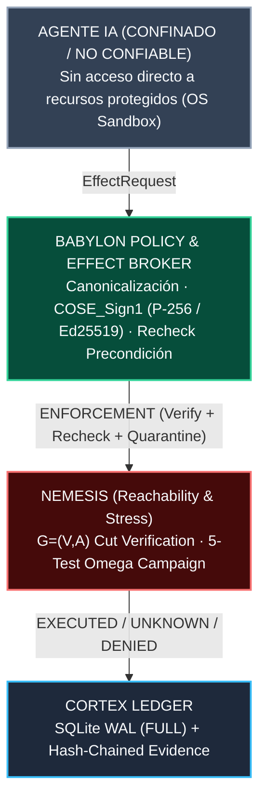

# 🛡️ BABYLON-60: Verified Execution Authority for AI Agents

> **En 10 segundos:**
> BABYLON-60 no promete que un modelo de IA nunca se equivoque ni pretende verificar matemáticamente cualquier futuro imaginable. Su objetivo es que, **dentro de un perímetro explícito y confinado, la capacidad de proponer una acción nunca sea suficiente para ejecutarla** ($\text{INV-}\Omega$).
> **Estado: alpha de seguridad.** La protección efectiva requiere tanto la verificación criptográfica del broker (`L2`) como el confinamiento de procesos del agente en el sistema operativo (`L3`). Una instalación de reglas/skills por sí sola NO impide que un agente no confinado escriba o ejecute comandos directamente.

[](https://github.com/borjamoskv/BABYLON-60/actions)
[](https://github.com/borjamoskv/BABYLON-60)
[](./LICENSE)
[](./CLAIMS.toml)
[](./Cargo.toml)
[](./proof/lean/BabylonTrace.lean)

> **Release status:** v5.0.0 is a candidate. Its signed manifest attests only the commit recorded in that file.

---

## ⚡ Quickstart & Installation

La distribución soportada incluye la CLI de terminal y el servidor de memoria
MCP por stdio. Requiere Python 3.10 o posterior y `uv`.

```bash
git clone https://github.com/borjamoskv/BABYLON-60.git
cd BABYLON-60
bash install.sh --dry-run
bash install.sh
.venv/bin/babylon60 --help
# Servidor MCP por stdio:
.venv/bin/babylon60-mcp --ledger /ruta/ledger.db
```

El instalador usa `uv sync --locked --no-dev` y exige un checkout limpio.
También funciona desde el paquete fuente generado con
`bash scripts/package_release.sh /ruta/de/salida`. No inicia una interfaz web ni
instala aplicaciones de escritorio. El [puente MCP del kernel](docs/03_guides/guide_kernel_mcp.md)
requiere el checkout completo y un entorno independiente.

La presentación de las respuestas sigue un [contrato común](01_KISH_ENGINE/babylon60/presentation.md):
resultado primero, lectura clara y detalle progresivo. Ambos servidores MCP lo
entregan al conectar mediante `instructions` y como recurso
`babylon://presentation/guide`. Los agentes que usan la CLI deben leer
`babylon60 presentation` (o `babylon60 presentation --json`) al comenzar.
El contrato viaja con el paquete instalado. Orienta la redacción del agente;
la aplicación anfitriona controla el renderizado y puede no aplicar estas pautas.

La firma visual v2 mantiene MOSKV-1 y el modelo como núcleo compacto. Añade
comprobaciones, cambios y límites cuando resultan útiles; las mediciones sin
datos no ocupan tarjetas. En el checkout, `python3 scripts/guards/render_signature_panel.py datos.json firma.html`
genera un panel nuevo a partir de datos declarados, con fuentes y fecha. El
validador comprueba su estructura; no certifica la evidencia ni el runtime.

Las acciones críticas requieren una [autorización firmada de la solicitud completa](docs/03_guides/guide_signed_authorization.md):
`babylon60 approve <execution_id> --task-file <task.json>`. Una fila de auditoría
sin firma no concede permiso.

---

## 🧬 Architecture & Invariants (`INV-Ω` · CORTEX · BABYLON · NEMESIS)



---

### 💎 ¿Cómo media BABYLON-60 los efectos de los agentes? (`INV-Ω`)
BABYLON-60 separa estrictamente **autorización válida** y **mediación completa** en 4 niveles de evidencia auditables en [`CLAIMS.toml`](./CLAIMS.toml):
- **`L1: Formal` (Lean 4 & Loom):** Los modelos abstractos de la política y del protocolo Seqlock satisfacen invariantes matemáticos inductivos (`no_torn_reads_universal`, `auth_001_universal_inductive_safety`). *Nota: demostrar `L1` sobre la especificación no certifica automáticamente el binario compilado ni el sistema operativo.*
- **`L2: Implementación` (`SovereignExecutor`):** El broker en Rust verifica que toda autorización (`COSE_Sign1` con Ed25519 o clave P-256 en Secure Enclave condicionada a Touch ID) esté vinculada criptográficamente al digest exacto del efecto, la política vigente, la precondición del recurso, un nonce único y la época de autoridad activa.
- **`L3: Aislamiento` (Mediación Completa en macOS):** Confinamiento del proceso del agente (`MacOsAgentConfinement` / `sandbox-exec`) y verificación del grafo de alcanzabilidad $G=(V,A)$ en `NEMESIS` ($\forall \pi: a \leadsto r,\; b \in \pi$) para impedir que el agente modifique recursos protegidos o el ledger SQLite eludiendo al broker.
- **`L4: Experimental` (Campaña $\Omega$ y `NEMESIS`):** Pruebas adversariales reproducibles sobre el sistema de archivos real (`BYPASS-001`, `AUTH-002`, `RACE-003`, `CRASH-004`, `REVOCATION-005`).

👉 **[Leer el Manifiesto de Ingeniería: Las Miles de Horas Detrás de BABYLON-60 (WHY_BABYLON_60.md)](./WHY_BABYLON_60.md)**

---

### ✅ ¿Esto es para mí?
- **SÍ:** Si tienes agentes de IA que modifican código, archivos o bases de datos y necesitas mediar sus efectos con controles verificables.
- **SÍ:** Si tu empresa necesita documentar controles humanos y evidencia técnica para sus flujos con agentes. BABYLON puede apoyar ese trabajo, pero no certifica por sí solo el cumplimiento de la **Ley Europea de Inteligencia Artificial (EU AI Act)**.
- **NO:** Si solo usas ChatGPT para que te redacte emails de vez en cuando.

---

### 🧑‍🍳 ¿Cómo funciona por dentro? (La regla del restaurante)
Imagina que la IA es un **camarero súper inteligente** pero muy caótico, y tu ordenador es la **caja fuerte del restaurante**.
1. El camarero (la IA) puede sugerirte el mejor plato y tomar nota a los clientes.
2. Pero el camarero **NO tiene la llave de la caja registradora** ni permiso físico para entrar en la cámara acorazada.
3. Cada vez que hay que cobrar, el camarero tiene que pedir autorización al broker (y al dueño con Touch ID) para esa cuenta exacta.
4. Si el camarero intenta abrir la caja directamente sin pasar por el broker, **el sistema operativo bloquea el acceso (`EPERM`)**, y si intenta reutilizar o alterar una orden firmada, el broker rechaza la operación y registra la evidencia en el Ledger.

### 📖 Diccionario de Asfalto (De Marciano a Cristiano)
| Lo que dicen los técnicos | Lo que significa en la vida real |
| :--- | :--- |
| **Fail-Stop Apoptosis** | Si algo huele a quemado, cerrar la admisión de órdenes al milisegundo (`POISONED`) para no propagar un estado corrupto. |
| **Seqlock SPMC ($RFO=0$)** | Una pizarra de lectura ultrarrápida: el escritor actualiza el estado y múltiples lectores lo consultan en caché L1 sin bloquearse entre sí (optimización de latencia, no barrera de seguridad). |
| **Modelo Estocástico** | Un robot (LLM) que funciona por probabilidad; a veces es un genio, a veces se inventa las cosas. Por eso no puede tener autoridad. |
| **Hash-Chained Ledger / SQLite WAL** | Un registro transaccional con cadenas de hashes y triggers de integridad que detecta alteraciones y evita la reutilización de nonces tras un reinicio. |

---

<details>
<summary><b>⚙️ PARA AUDITORES E INGENIEROS: Ver Especificaciones Técnicas y Niveles de Evidencia (L1–L4)</b></summary>

*Especificaciones verificables y alcance exacto de las garantías:*

- **Invariante Raíz (`INV-Ω`):**
  1. *Autorización Correcta:* $\forall e \in E_{\text{protegidos}}: \operatorname{Executed}(e) \implies \operatorname{Authorized}(e) \land \operatorname{SignatureValid}(e) \land \operatorname{PolicyValid}(e) \land \operatorname{Fresh}(e)$.
  2. *Mediación Completa:* $\forall p \in \text{Processes}_{\text{agente}}, \forall e \in E_{\text{protegidos}}: \operatorname{Execute}(p,e) \implies \operatorname{MediatedByBABYLON}(p,e)$.
- **Primitivas de Memoria Compartida (Espacio de Usuario / C-ABI):**
  - `SharedManifest` de 64 bytes alineado a una línea de caché L1 (`align(64)`, C-ABI en espacio de usuario).
  - **Concurrencia Lock-Free:** Lector puro Seqlock SPMC sin tráfico RMW de lectura ($RFO = 0$). Modelo verificado de forma acotada con Loom (`L1_FORMAL`).
- **Evidencia Criptográfica y Campaña Experimental (`L2`–`L4`):**
  - Valida autorizaciones `COSE_Sign1` (Ed25519 o P-256 del Secure Enclave) sobre un payload canónico de 214 bytes antes de despachar cualquier mutación.
  - Ejecuta la campaña reproducible de 5 pruebas (`BYPASS-001` a `REVOCATION-005`) y el falsificador de alcanzabilidad de grafo `NEMESIS`: `cargo test --features cortex-persist --test omega_mediation_campaign`.
- **Evidencia del candidato v5.0.0:**
  - Consulta [`CLAIMS.toml`](./CLAIMS.toml) para ver la clasificación `L1_FORMAL`, `L2_IMPLEMENTATION`, `L3_ISOLATION` y `L4_EXPERIMENTAL` de cada afirmación.
  - Para auditar las declaraciones y niveles de evidencia: `python3 scripts/c5_quality_gates/verify_claims.py --list`.
- **Limitaciones Conocidas:**
  - El código de `BABYLON-60` se ejecuta en espacio de usuario (`EL0` en macOS ARM64), no en el kernel XNU (`Ring-0`/`EL1`).
  - La protección `L3_ISOLATION` requiere ejecutar los procesos del agente bajo el perfil de confinamiento del sistema operativo (`MacOsAgentConfinement` / `sandbox-exec` o aislamiento de usuario/descriptores).
  - Los triggers de SQLite WAL previenen transiciones inválidas en el flujo del broker, pero la protección frente a escritura directa del agente sobre el archivo `.db` depende del confinamiento `L3` del sistema de archivos.

</details>

---

### ❓ Preguntas Frecuentes para Humanos

- **¿Me va a pedir la huella dactilar todo el rato?**
  No. La IA puede pensar, redactar y consultar información libremente. El freno de mano solo salta si el agente intenta **acciones de riesgo real**: borrar archivos, alterar bases de datos, ejecutar comandos de terminal destructivos o mover dinero.
- **¿Qué pasa si mi Mac no tiene Touch ID o uso un teclado externo?**
  El sistema conmuta automáticamente a tu contraseña habitual de inicio de sesión de macOS o a un PIN local seguro.
- **¿Consume batería o ralentiza mi Mac?**
  Cero. El núcleo está programado en Rust bare-metal alineado a 64 bytes en la caché física del procesador ($RFO=0$). Cuando no hay agentes pidiendo autorización, su consumo de CPU es 0.00%.
- **¿Cómo se desinstala si ya no lo quiero?**
  Simplemente borras la carpeta `BABYLON-60`. No instala demonios invasivos en tu sistema ni modifica archivos ocultos del sistema operativo.

---

### 💼 Licencia, Seguridad y Uso (`License & Security`)
**Licencia Dual Soberana v4.0:**
- **Uso Personal y Científico:** 100% Gratis y Abierto (`LICENSE`).
- **Uso Corporativo / Comercial:** Requiere `BABYLON60_LICENSE_KEY`. Consulta [COMMERCIAL_LICENSE.md](./docs/COMMERCIAL_LICENSE.md).
- **Seguridad y Divulgación (`Security`):** Para reportar vulnerabilidades en el TCB o en los módulos de Ring-0, consulta [SECURITY.md](./SECURITY.md) y [DOCS_GRAMMAR.md](./docs/DOCS_GRAMMAR.md).

<sub>BABYLON-60 v5.0.0 · Tamper-Evident Cryptographic Ledger for AI Agents · Borja Moskv</sub>
