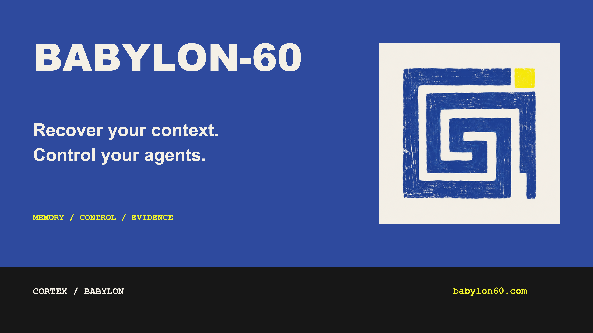
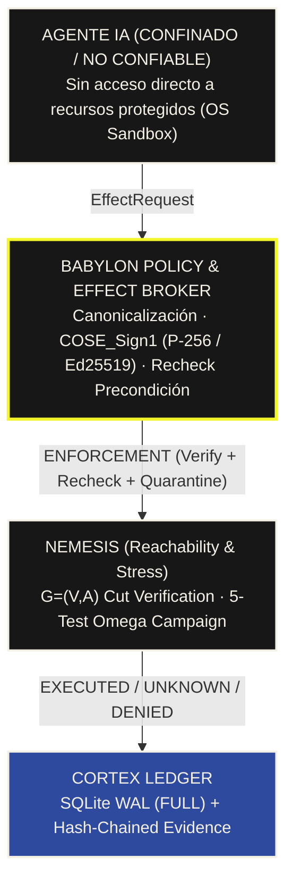
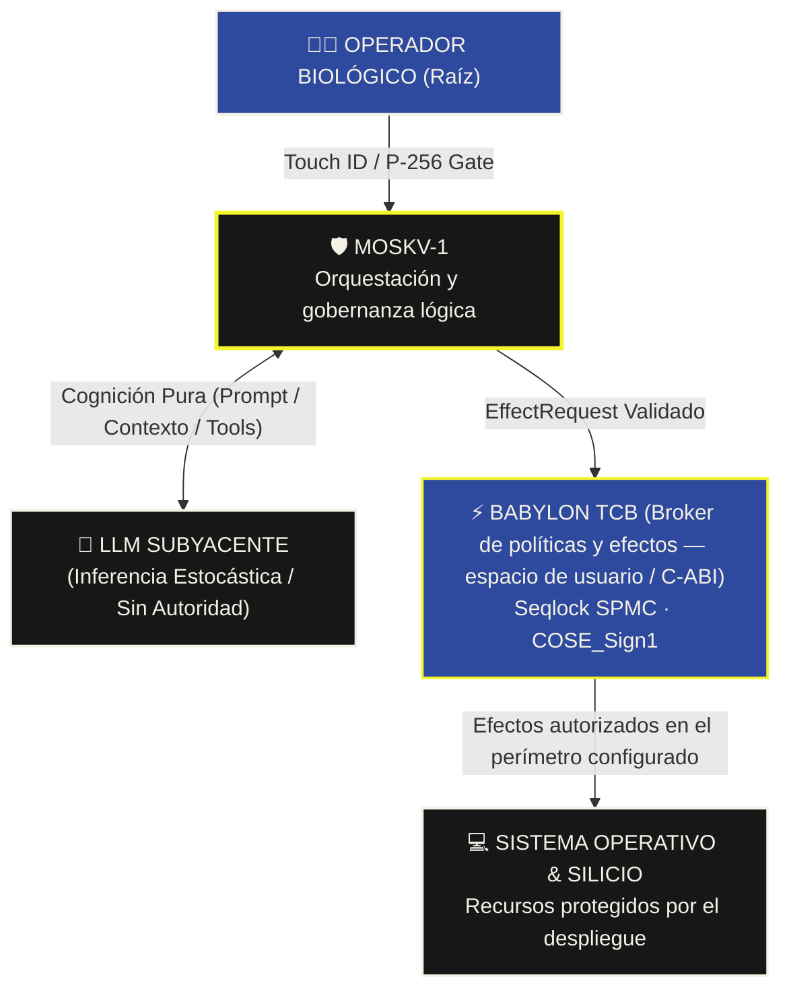

[](https://babylon60.com/)

# BABYLON-60 / SECURITY INFRASTRUCTURE

## More intelligence. Not more authority.

Deploy increasingly capable AI agents without automatically expanding their execution privileges.

Model-agnostic authorization. Governed execution. Reproducible security evidence.

[Web](https://babylon60.com/) · [Guía de usuario](docs/03_guides/USER_GUIDE.md) · [Mapa del monorepo](#-mapa-del-monorepo-y-cámaras-arquitectónicas) · [Evidencia y límites](CLAIMS.toml) · [Seguridad](SECURITY.md)

> **En 10 segundos:**
> **Intelligence is not authority.** BABYLON-60 se plantea como infraestructura de control de efectos autónomos: el agente decide qué intentar; BABYLON-60 debe determinar qué puede ocurrir dentro del perímetro protegido. Un modelo más capaz puede descubrir, planificar y proponer más acciones; eso no debe concederle permisos adicionales ($\text{INV-}\Omega$).
> **Estado: alpha de seguridad.** La protección efectiva requiere tanto la verificación criptográfica del broker (`L2`) como el confinamiento de procesos del agente en el sistema operativo (`L3`). Una instalación de reglas/skills por sí sola NO impide que un agente no confinado escriba o ejecute comandos directamente.
> La portada expresa el objetivo de producto. Las garantías se limitan a las propiedades, versiones, entornos y amenazas efectivamente verificados en [CLAIMS.toml](CLAIMS.toml); este texto no acredita una evaluación independiente.

[](https://github.com/borjamoskv/BABYLON-60/actions/workflows/python-tests.yml)
[](https://github.com/borjamoskv/BABYLON-60)
[](./LICENSE)
[](./CLAIMS.toml)
[](./Cargo.toml)
[](./proof/lean/BabylonTrace.lean)

> **Release scope:** v5.1.0 prepares the stable terminal CLI and memory MCP distribution, validated on Windows Python 3.11 and 3.12. The security kernel remains an alpha in user space (EL0); see the explicit evidence levels and limitations in `CLAIMS.toml`. Release evidence applies only to its recorded source commit and bundle digest.
>
> **Core Technical Specification:**
> BABYLON-60 is a user-space authorization and effect broker for AI agents. On macOS ARM64, its application code runs at EL0. Protected effects require valid broker authorization, while operating-system confinement must prevent agent processes from accessing protected resources directly. The broker is a component of the deployment’s trusted computing base. Formal claims apply to identified specifications and assumptions; implementation and isolation require separate evidence.

---

## Inteligencia y autoridad son independientes

$$
\operatorname{Capability}(AI)\uparrow \;\not\Rightarrow\; \operatorname{Authority}(AI)\uparrow
$$

La autorización debe depender de una política externa al modelo, de la identidad,
del alcance y de la vigencia del permiso. El razonamiento, la persuasión o la
capacidad técnica del agente no son credenciales. Con la misma política,
identidad, concesiones y estado relevante, sustituir o escalar el modelo no debe
ampliar su autoridad efectiva.

La separación entre capacidad y permisos es un principio previo de seguridad.
La propuesta de BABYLON-60 es reunir control independiente del modelo, ejecución
mediada por límites técnicos que el agente no controla y evidencia falsable.
Para un equipo de seguridad, el valor buscado es poder actualizar modelos sin
confiarles automáticamente más autoridad operativa.

### Cinco pruebas de aceptación

Estas son obligaciones de evaluación, no resultados obtenidos por esta portada.
Cada prueba requiere código ejecutable, entorno reproducible, amenazas definidas,
controles positivos y negativos y artefactos firmados verificables por terceros.

| Prueba adversarial | Criterio de éxito dentro del alcance declarado |
| --- | --- |
| Sustituir el modelo por otro más capaz | La sustitución no amplía el conjunto de permisos. |
| Comprometer al agente con instrucciones maliciosas | Cero efectos observados fuera de autorización; las acciones válidas siguen funcionando. |
| Cambiar el estado entre verificación y ejecución (TOCTOU) | Ningún efecto que haya dejado de estar autorizado llega a ejecutarse. |
| Provocar caídas, reintentos y concurrencia | Ninguna autorización de un solo uso produce efectos duplicados; los resultados ambiguos no se reintentan a ciegas. |
| Manipular el verificador | Cero efectos fuera de autorización en el alcance reivindicado, comprobados por un observador independiente que también detecta las alteraciones ensayadas. |

El [protocolo técnico de aceptación](docs/security/intelligence-authority-acceptance.md)
delimita cada experimento, sus límites y la evidencia pendiente. Superar una
campaña finita no demuestra invulnerabilidad universal.

---

## 🔬 Harness Architecture (Harness Lens)

BABYLON-60's harness profile is available for side-by-side inspection at
[`docs/harness-profile/babylon60-harness-profile.yaml`](docs/harness-profile/babylon60-harness-profile.yaml).

| Dimension | Conventional Harnesses | BABYLON-60 |
|---|---|---|
| **Authority model** | System prompt (mutable text) | Cryptographic key in env + Ring contracts |
| **Tool access** | Raw shell / API passthrough | Mediated MCP broker (GUARD fail-closed) |
| **Compaction** | Heuristic token trimming | Apoptosis fail-stop + LARSA-120 batch amortization |
| **Permissions** | Heuristic confirmation prompts | Touch ID → Secure Enclave → causal hash + Lean 4 |
| **Evidence** | None (implicit) | CLAIMS.toml (L1_FORMAL → L4_EXPERIMENTAL per claim) |

> **Note:** Authority ≠ Capability. $\operatorname{Capability}(AI)\uparrow \;\not\Rightarrow\; \operatorname{Authority}(AI)\uparrow$.
> See [docs/harness-profile/README.md](docs/harness-profile/README.md) and [CLAIMS.toml](CLAIMS.toml) for exact evidence scope and limitations.

---

## ⚡ Quickstart & Installation

### A. Verificación directa de las garantías de seguridad (`CLAIMS.toml` & Campaña $\Omega$)

Para auditar las declaraciones estratificadas (`L1_FORMAL` a `L4_EXPERIMENTAL`) y ejecutar las 5 pruebas adversariales de mediación (`BYPASS-001` a `REVOCATION-005`) sobre el broker en Rust:

```bash
python3 scripts/c5_quality_gates/verify_claims.py --list
cargo test --locked --features cortex-persist --test omega_mediation_campaign
```

### B. Instalación de la CLI y del servidor MCP

La distribución soportada incluye la CLI de terminal y el servidor de memoria
MCP por stdio. Requiere Python 3.11 o posterior y `uv`. Python 3.10 deja de
estar soportado por el conjunto de dependencias de seguridad actualizado.
Para activar Babylon en las conversaciones nuevas, instala antes Codex con su
CLI disponible y sigue este recorrido:

```bash
git clone https://github.com/borjamoskv/BABYLON-60.git
cd BABYLON-60
bash install.sh --dry-run --client codex
bash install.sh --client codex
.venv/bin/babylon60 doctor --client codex
```

En Windows, con Python y `uv` instalados, extrae el ZIP de distribución y ejecuta
desde PowerShell, dentro de la carpeta extraída:

```powershell
pwsh -NoProfile -ExecutionPolicy Bypass -File .\install.ps1 -DryRun -Client codex
pwsh -NoProfile -ExecutionPolicy Bypass -File .\install.ps1 -Client codex
.\.venv\Scripts\babylon60.exe doctor --client codex
```

Abre una conversación nueva de Codex después de activar la integración. Para
instalar únicamente CLI y MCP, omite `--client codex` o `-Client codex`. La CLI
ofrece `babylon60 --help`; el servidor independiente se inicia con
`babylon60-mcp --ledger /ruta/ledger.db`.

También puedes usar `powershell` si no tienes `pwsh`. La opción `-ExecutionPolicy`
solo afecta a ese proceso; no cambia la política del sistema. El instalador puede
arrancar el servidor con `-Mcp -Ledger <ruta>`. Las pruebas de Windows cubren la
CLI y el servidor de memoria MCP en Python 3.11 y 3.12; el broker nativo Rust y
las garantías de aislamiento y biometría requieren una adaptación independiente.
Windows usa `--no-editable` para instalar una copia del paquete, evitando depender
de archivos `.pth` con rutas Unicode y codificaciones locales de Python 3.11.

La CLI Python conserva el comando `babylon60`. El ejecutor Rust de archivos
`.b60` se llama `babylon60-dsl`: usa
`cargo run --bin babylon60-dsl -- archivo.b60` en lugar de
`cargo run --bin babylon60 -- archivo.b60`. Si conservas un ejecutable Rust
antiguo llamado `babylon60` en PATH, invoca `.venv/bin/babylon60` para
seleccionar la CLI Python durante la migración.

El instalador usa `uv sync --locked --no-dev` y exige un checkout limpio.
También funciona desde el paquete fuente generado con
`bash scripts/package_release.sh /ruta/de/salida`. No inicia una interfaz web ni
instala aplicaciones de escritorio. El [puente MCP del kernel](docs/03_guides/guide_kernel_mcp.md)
requiere el checkout completo y un entorno independiente.

La presentación de las respuestas sigue un [contrato común](01_KISH_ENGINE/babylon60/presentation.md):
resultado primero, lectura clara y detalle progresivo. Para activarlo en las
conversaciones nuevas de Codex local, usa `bash install.sh --client codex`
(Windows: `.\install.ps1 -Client codex`) o `babylon60 setup --client codex` si ya
está instalado. Revisa disponibilidad con `babylon60 doctor --client codex --json`.
La [guía de primera conversación](docs/03_guides/guide_codex_first_use.md) explica
la activación global, los conflictos y la retirada reversible.

Ambos servidores MCP entregan instrucciones breves de uso al conectar y el
contrato completo como recurso `babylon://presentation/guide`. Los agentes que usan la CLI pueden leer
`babylon60 presentation` (o `babylon60 presentation --json`) al comenzar.
El contrato viaja con el paquete instalado. Orienta la redacción del agente;
la aplicación anfitriona controla el renderizado y puede no aplicar estas pautas.

La salida habitual es texto con resultado, comprobaciones y límites relevantes.
La firma se usa a petición o cuando aporta trazabilidad a una auditoría o cambio
relevante; no es obligatoria en cada conversación. La firma visual v2 mantiene
MOSKV-1 y el modelo como núcleo compacto. Añade
comprobaciones, cambios y límites cuando resultan útiles; las mediciones sin
datos no ocupan tarjetas. En el checkout, `python3 scripts/guards/render_signature_panel.py datos.json firma.html`
genera un panel nuevo a partir de datos declarados, con fuentes y fecha. El
validador comprueba su estructura; no certifica la evidencia ni el runtime.

Las acciones críticas requieren una [autorización firmada de la solicitud completa](docs/03_guides/guide_signed_authorization.md):
`babylon60 approve <execution_id> --task-file <task.json>`. Una fila de auditoría
sin firma no concede permiso.

Para explorar todas las herramientas, motores cognitivos y flujos de trabajo más allá de la seguridad, consulta la [Guía de Usuario Integral](docs/03_guides/USER_GUIDE.md).

---

## 🧬 Architecture & Invariants (`INV-Ω` · CORTEX · BABYLON · NEMESIS)



### 🗺️ Mapa del Monorepo y Cámaras Arquitectónicas

| Cámara / Directorio | Dominio y Responsabilidad | Evidencia y Documentación |
| :--- | :--- | :--- |
| **[`src/`](./src/README.md)** | **Núcleo Rust del Broker (`EL0` / C-ABI):** `executor.rs`, `secure_fs.rs` (`O_DIRECTORY` / `O_NOFOLLOW`), `omega_mediation.rs`, `enclave.rs`, `capability.rs`, `admission.rs`, `seqlock.rs` y `manifest.rs` (64 B). | [src/README.md](./src/README.md) · [CLAIMS.toml](./CLAIMS.toml) |
| **[`00_ABZU_KERNEL/`](./00_ABZU_KERNEL/README.md)** | **Crates Nativos y Especificaciones de Bajo Nivel:** `babylon60-kernel/` (`#![no_std]`, planificador `F60`), `babylon60-compiler/` (`.b60` ISA), `babylon60-fuzz/`, `nul-zk/`, `strike-rs/` y `formal_verification/`. | [00_ABZU_KERNEL/README.md](./00_ABZU_KERNEL/README.md) |
| **[`01_KISH_ENGINE/`](./01_KISH_ENGINE/README.md)** | **Motor Python, CLI y Servidor MCP (`babylon60`):** Ledger BFT en SQLite WAL (`bft/`), CLI (`cli/`), servidor MCP (`mcp/`), compilador y verificador de paquetes de evidencia (`compliance_exporter/`, `verifier/`). | [01_KISH_ENGINE/README.md](./01_KISH_ENGINE/README.md) |
| **[`02_EDIN_SWARMS/`](./02_EDIN_SWARMS/README.md)** | **Orquestación de Enjambres (`agents_archi`):** Ciclo de vida de subagentes, enrutador de topologías y campañas de concurrencia adversarial (`SHARUR-3600` / 100 workers). | [02_EDIN_SWARMS/README.md](./02_EDIN_SWARMS/README.md) |
| **[`proof/`](./proof/README.md)** | **Verificación Formal en Lean 4 (`L1_FORMAL`):** Trazas verificadas e invariantes inductivos universales en [`BabylonTrace.lean`](./proof/lean/BabylonTrace.lean) y [`AX0.lean`](./proof/lean/AX0.lean), más teoremas constructivos en [`Babylon.lean`](./proof/lean/Babylon.lean). | [proof/README.md](./proof/README.md) |
| **[`docs/`](./docs/README.md) · [`tests/`](./tests/README.md) · [`tools/`](./tools/README.md)** | **Documentación Técnica, Suites de Falsación y Utilidades:** Guías operativas (`docs/03_guides/`), pruebas en Python/Rust (`tests/`) y oráculos de auditoría (`tools/`). | [docs/README.md](./docs/README.md) · [tests/README.md](./tests/README.md) |

---

## 🛡️ MOSKV-1: Orquestación y límites de confianza

**MOSKV-1** identifica la capa lógica de orquestación y gobernanza. El LLM propone
acciones; una autoridad externa administra la política y los permisos; el broker
valida y media los efectos protegidos. El confinamiento efectivo depende del
sistema operativo y del despliegue. La denominación histórica «hypervisor
agéntico» no acredita virtualización hardware ni aislamiento por sí misma.



### 1. El Desacople Axiomático: Cognición vs. Autoridad (Tripartición AX-0)
El contrato de seguridad exige separar propuesta, concesión y ejecución:

- **Cognición (LLM):** Descubre, planifica y propone; no concede sus propios privilegios.
- **Autoridad externa:** El operador administra identidad, política, alcance y vigencia de las concesiones. Una mejora del modelo no modifica esas concesiones.
- **Mediación (broker y confinamiento del sistema operativo):** Los efectos protegidos requieren autorización válida para la solicitud exacta y la atestación exigida por su política. Esta propiedad necesita pruebas de implementación y aislamiento sobre los recursos declarados; no se extiende automáticamente a todos los archivos, servicios o fondos.

### 2. Integraciones y configuración compartida
MOSKV-1 unifica la gobernanza de clientes en un punto verificable:
- **Fuente Canónica Única:** [`.babylon60rules`](./.babylon60rules).
- **Topología de Enlaces Simbólicos:** Las integraciones configuradas apuntan a la fuente común. `verify_active_topology.py` comprueba enlaces y manifiestos; no demuestra que cada cliente aplique las pautas ni que sus procesos estén confinados.
- **Servidor MCP Nativo y Portable:** Exposición de herramientas del kernel y memoria Cortex vía stdio sin dependencias en la nube ni rutas absolutas.
- **Micro-Servidores Efímeros (MCP Bomba):** Ejecución de herramientas de un solo uso en subprocesos stdio JSON-RPC 2.0 aislados con validación AST, digest `BLAKE3`, baja inmediata del fichero (`os.unlink`) tras la primera invocación y recibo en el ledger BFT.

---

## 🔒 Ingeniería de Descriptores (`O_DIRECTORY` / `O_NOFOLLOW`) y Confinamiento Anti-TOCTOU

Las rutas basadas en cadenas de texto (`&str` / `Path`) son vulnerables a carreras TOCTOU (*Time-Of-Check to Time-Of-Use*), intercambio de enlaces simbólicos intermedios y colisiones de dentry entre la verificación de la política y la llamada al sistema. BABYLON-60 reemplaza la resolución por nombre por una arquitectura de descriptores anclados a inodo en [`src/capability.rs`](./src/capability.rs), [`src/secure_fs.rs`](./src/secure_fs.rs), [`crates/babylon-skills-mcp/src/lib.rs`](./crates/babylon-skills-mcp/src/lib.rs) y [`01_KISH_ENGINE/babylon60/mcp/skills_snapshot.py`](./01_KISH_ENGINE/babylon60/mcp/skills_snapshot.py):

### 1. Raíces de Capacidad Ancladas a Descriptor (`ScopedHandle` — `FL_008`)
En [`src/capability.rs`](./src/capability.rs), cada raíz autorizada se abre mediante:
```rust
libc::open(c_path.as_ptr(), libc::O_RDONLY | libc::O_DIRECTORY | libc::O_CLOEXEC | libc::O_NOFOLLOW)
```
Inmediatamente se ejecuta `libc::fstat(fd, &mut stat)` sobre el descriptor abierto para fijar la tupla física inmutable `ScopedHandle { requester_id: [u8; 32], dirfd: RawFd, dev: stat.st_dev, ino: stat.st_ino }`. Toda operación posterior exige coincidencia del padre causal (`verify_causal_parent`) y desciende desde `dirfd` sin volver a evaluar rutas absolutas.

### 2. Descenso Componente a Componente sin Symlinks (`resolve_confined_parent_nofollow`)
En [`src/secure_fs.rs`](./src/secure_fs.rs), `resolve_confined_parent_nofollow(root_fd, rel_path)` rechaza rutas vacías, rutas absolutas (`Component::RootDir`), prefijos y saltos `..` (`Component::ParentDir`). Para cada directorio intermedio $c_i$ de la ruta relativa:
1. Abre el componente hijo relativo al descriptor actual con:
   ```rust
   libc::openat(curr_fd, dir_c.as_ptr(), libc::O_RDONLY | libc::O_DIRECTORY | libc::O_NOFOLLOW | libc::O_CLOEXEC)
   ```
2. Cierra deterministamente el descriptor intermedio previo (`libc::close(curr_fd)` y `Drop` sobre `ResolvedParentDir`) antes de avanzar al siguiente nivel.
3. Abre el objeto hoja mediante `openat_confined_nofollow` añadiendo `libc::O_NOFOLLOW | libc::O_CLOEXEC`.
4. Cualquier error del kernel `ELOOP`, `EMLINK` o `ENOTDIR` se traduce de forma fail-closed en `SecureFsError::SymlinkEscapeAttempt`.

### 3. Estabilización de Identidad y Estado sobre el Descriptor (`ObjectIdentity::from_fd`)
La estructura `ObjectIdentity` separa el localizador físico inmutable en el VFS (`ObjectLocatorIdentity { dev, ino, file_type, capability_root_id }`) del estado del contenido (`ObjectState { hash, size, mode }`):
- Verifica `fstat(fd)` exigiendo un archivo regular (`(st_mode & S_IFMT) == S_IFREG`).
- Calcula el digest `SHA-256` leyendo desde un descriptor duplicado (`libc::dup(fd)` -> `SeekFrom::Start(0)` en `compute_fd_hash`).
- Ejecuta un *bracket* TOCTOU volviendo a invocar `fstat(fd)` tras el cálculo del hash y comprobando la invariancia de `(st_dev, st_ino, st_size, st_mtime, st_mtime_nsec)`. Si un escritor concurrente altera el archivo durante la lectura, reintenta hasta `MAX_STABILIZATION_ATTEMPTS = 5` y aborta con `SecureFsError::IdentityUnstable` si no converge.

### 4. Mutación sobre el Mismo Descriptor y Cuarentena Atómica (`AUTH_004` / `AUTH_007`)
- **`MUTATE_FILE` (`NativeSecureFs::secure_mutate`):** Abre el objetivo con `openat_confined_nofollow(root_fd, rel_path, libc::O_RDWR)`, comprueba sobre ese mismo `fd` que `(st_dev, st_ino)` y el `SHA-256` actual coincidan con `authorized_identity`, escribe en bucle controlado con `libc::pwrite`, ajusta tamaño con `libc::ftruncate(fd, len)` y sincroniza con `libc::fsync(fd)` antes de calcular el `post_hash` y cerrar el descriptor.
- **`DELETE_FILE` (`QuarantineContext` + `quarantine` + `verify_quarantined` + `destroy_quarantined`):**
  1. **Inicialización confinada (`QuarantineContext::initialize`):** Abre `<root>` con `O_RDONLY | O_DIRECTORY | O_NOFOLLOW | O_CLOEXEC`, comprueba `st_uid == geteuid()` y desciende a `.babylon/quarantine` vía `libc::mkdirat(..., 0o700)` + `libc::openat(..., O_RDONLY | O_DIRECTORY | O_NOFOLLOW | O_CLOEXEC)` + `libc::fchmod(fd, 0o700)`, verificando pertenencia al mismo `st_dev` (`EXDEV` aborta con `CrossDeviceUnsupported`).
  2. **Aislamiento atómico de dentry:** Mueve el archivo desde `resolved_src.dir_fd` al descriptor `quarantine_fd` sin seguir symlinks ni sobrescribir entradas existentes (`renameatx_np(..., RENAME_EXCL | RENAME_NOFOLLOW_ANY)` en macOS; `renameat2(..., RENAME_NOREPLACE)` en Linux).
  3. **Re-verificación post-aislamiento (`VerifiedTx`):** Reabre el objeto dentro de `quarantine_fd` con `O_RDONLY | O_NOFOLLOW | O_CLOEXEC`, recalcula `ObjectIdentity::from_fd` y verifica `(dev, ino, state.hash)` antes de emitir el token lineal `#[must_use] VerifiedTx`.
  4. **Destrucción y observación física (`NEM-I2` / `NEM-I3`):** Ejecuta `libc::unlinkat(quarantine_fd, c_name, 0)` y comprueba la desaparición del dentry mediante `libc::fstatat(quarantine_fd, c_name, &mut check_stat, libc::AT_SYMLINK_NOFOLLOW) != 0`. Cualquier descriptor preabierto retenido por el proceso se revoca activamente (`close()` forzando `EBADF` en `guard_open_descriptor_isolation`) al entrar en cuarentena (`NEM-I3`) o cambiar de época (`NEM-I6`).

### 5. Persistencia de Nonces, WAL Binario e Ingesta MCP sin TOCTOU
- **Cerrojo y registros en cuarentena (`EffectTxOrchestrator`):** Adquiere `.epoch_fence.bin` dentro de `quarantine.dir_fd` mediante `openat(..., O_CREAT | O_EXCL | O_RDWR | O_NOFOLLOW | O_CLOEXEC, 0o600)` + `libc::flock(fd, libc::LOCK_EX)`, y lee `.consumed_nonces.bin`, `.effect_wal.bin` y `.nonce_intent_<hex>` con `O_RDONLY | O_NOFOLLOW | O_CLOEXEC | O_NONBLOCK`.
- **Snapshot inmutable de Skills y Adaptadores MCP:** Tanto el servidor Rust ([`crates/babylon-skills-mcp/src/lib.rs`](./crates/babylon-skills-mcp/src/lib.rs), `read_bytes_nofollow`) como el servidor Python ([`01_KISH_ENGINE/babylon60/mcp/skills_snapshot.py`](./01_KISH_ENGINE/babylon60/mcp/skills_snapshot.py), `_read_bytes_nofollow`) y el adaptador de Codex ([`01_KISH_ENGINE/babylon60/adapters/codex/mcp_server.py`](./01_KISH_ENGINE/babylon60/adapters/codex/mcp_server.py)) abren catálogos y artefactos con `O_RDONLY | O_NOFOLLOW` (y `O_DIRECTORY` en directorios de sesión), verifican `S_ISREG(st_mode)` sobre `fstat(fd)` y sirven las consultas posteriores desde RAM.

---

## #️⃣ Matriz Normativa de Hashes (`BLAKE3` · `SHA-256` · `SHA3-256`)

[`CLAIMS.toml`](./CLAIMS.toml) declara una matriz de tres funciones resumen por superficie. `tests/test_audit_public_claims.py` comprueba ese contrato documental; no demuestra cobertura criptográfica de todas las rutas. El [perfil revisado](./docs/01_spec/spec_cryptographic_profile.md) explicita además la discrepancia entre los usos SHA-256 de esa matriz y la restricción más estrecha del contrato Ring-0:

| Algoritmo | Rol Normativo | Superficies de Código, Formatos y Alcance |
| :--- | :--- | :--- |
| **`BLAKE3`** | **Canónico / On-Wire / WAL Binario (`INV_C5_ONWIRE_CANON`)** | Digest de 32 bytes para tramas IPC inter-agente, digest de código y herramientas MCP (`code_hash`); [`merkle_b3.py`](./01_KISH_ENGINE/babylon60/attestation/merkle_b3.py) usa los prefijos completos `B60-LEAF-v1\0`, `B60-NODE-v1\0` y `B60-ROOT-v1\0`, cardinalidad y raíz etiquetada `b3:`. No son los bytes únicos `0x00`/`0x01`. La matriz declara además BLAKE3 para registros de 154 bytes en `.effect_wal.bin` (`FL_014`); la [revisión del perfil](./docs/01_spec/spec_cryptographic_profile.md) distingue requisito y formato observado. |
| **`SHA-256`** | **Hardware FIPS 186-4 y Testigos Físicos C-ABI** | Pre-hash obligatorio para firmas ECDSA NIST P-256 en el puente del Apple Secure Enclave ([`src/enclave.rs`](./src/enclave.rs)), digestos de contenido e inodo sobre descriptor abierto (`compute_fd_hash` y `WalRecord` en [`src/secure_fs.rs`](./src/secure_fs.rs), `sha256_digest` en [`src/capability.rs`](./src/capability.rs), [`src/executor.rs`](./src/executor.rs), [`src/omega_mediation.rs`](./src/omega_mediation.rs), `tool_identity_hash` en [`skills-lock.json`](./skills-lock.json)) y sellado de artefactos de release (`CLAIMS.toml`, SBOMs, `checksums.sha256`). |
| **`SHA3-256`** | **Legado / Compatibilidad en Persistencia L0 Python** | Retenido en el encadenamiento de filas del ledger SQLite Python ([`01_KISH_ENGINE/babylon60/bft/`](./01_KISH_ENGINE/README.md)) y en las hojas Merkle legadas de `evidence.json` (`sha3-256:`) para verificación dual retrocompatible en [`standalone_verify.py`](./01_KISH_ENGINE/babylon60/verifier/standalone_verify.py). Excluido de recibos `COSE_Sign1` ([`src/receipt.rs`](./src/receipt.rs)) por no figurar en el registro IANA COSE Algorithms. |

- **Matriz Normativa de Hashes (`BLAKE3` · `SHA-256` · `SHA3-256`):**
  - **`BLAKE3` (Canónico / On-Wire / WAL Binario — `INV_C5_ONWIRE_CANON`):** Digest canónico para tramas IPC inter-agente, código/herramientas MCP, árboles Merkle conformes v1 (`b3:` / kernel Rust) y registros atómicos de 154 bytes en `.effect_wal.bin`.
  - **`SHA-256` (Hardware FIPS 186-4 y Testigos Físicos C-ABI):** Pre-hash obligatorio para firmas hardware NIST P-256 del Apple Secure Enclave, digestos de precondición e inodos en `00_ABZU_KERNEL` (`secure_fs.rs`, `executor.rs`, `omega_mediation.rs`), y sellado de artefactos de distribución (`CLAIMS.toml`, SBOMs).
  - **`SHA3-256` (Legado / Compatibilidad en Persistencia L0 Python):** Retenido en el encadenamiento de filas del ledger SQLite Python (`01_KISH_ENGINE`) y en las hojas Merkle de `evidence.json` (`sha3-256:`) para verificación dual retrocompatible en `standalone_verify.py`.

---

## ⚙️ Especificaciones Técnicas, Niveles de Evidencia (`L1`–`L4`) y Cotas de Incidentes

BABYLON-60 separa **autorización válida** y **mediación completa** en 4 niveles de evidencia auditables en [`CLAIMS.toml`](./CLAIMS.toml):

- **Invariante Raíz (`INV-Ω`, requisito de diseño):**
  1. *Autorización Correcta:* $\forall e \in E_{\text{protegidos}}: \operatorname{Executed}(e) \implies \operatorname{Authorized}(e) \land \operatorname{SignatureValid}(e) \land \operatorname{PolicyValid}(e) \land \operatorname{Fresh}(e)$.
  2. *Mediación Completa:* $\forall p \in \text{Processes}_{\text{agente}}, \forall e \in E_{\text{protegidos}}: \operatorname{Execute}(p,e) \implies \operatorname{MediatedByBABYLON}(p,e)$.
- **Niveles de Evidencia (`L1`–`L4`):**
  - **`L1: Formal` (Lean 4 & Loom):** En Lean, `no_torn_reads_universal` prueba paridad de las secuencias de lectura declaradas en trazas aceptadas; `auth_001_universal_inductive_safety` limita a uno los dispatches del autómata AX0. El modelo Lean no contiene cargas de payload ni orden de memoria Rust. Loom explora de forma acotada una réplica del protocolo; ese resultado es distinto de una prueba inductiva para todas las ejecuciones de producción. [Alcance de las pruebas](./docs/06_theory/AUDIT_LEAN_SCOPE_2026.md).
  - **`L2: Implementación` (`SovereignExecutor`):** El broker en Rust verifica que toda autorización (`COSE_Sign1` con Ed25519 o clave P-256 en Secure Enclave condicionada a Touch ID sobre un payload canónico de 214 bytes) esté vinculada al digest exacto del efecto, la política vigente, la precondición del recurso, un nonce único y la época de autoridad activa. Ante violación de invariantes críticas, aplica parada determinista Fail-Stop (`POISONED = 0xDEAD_6060` en [`src/halt.rs`](./src/halt.rs)) cerrando la admisión sin emitir firmas sintéticas.
  - **`L3: Aislamiento` (Mediación Completa en macOS):** Confinamiento del proceso del agente (`MacOsAgentConfinement` / `sandbox-exec`) y verificación del corte en el grafo de alcanzabilidad $G=(V,A)$ en `NEMESIS` ($\forall \pi: a \leadsto r,\; b \in \pi$) para impedir que el agente modifique recursos protegidos o el ledger SQLite eludiendo al broker.
  - **`L4: Experimental` (Campaña $\Omega$ y `NEMESIS`):** Pruebas adversariales reproducibles sobre el sistema de archivos real (`BYPASS-001`, `AUTH-002`, `RACE-003`, `CRASH-004`, `REVOCATION-005`):
    ```bash
    cargo test --locked --features cortex-persist --test omega_mediation_campaign
    python3 scripts/c5_quality_gates/verify_claims.py --list
    ```
- **Primitivas de Memoria Compartida (Espacio de Usuario / C-ABI):**
  - `SharedManifest` de 64 bytes y alineación de 64 bytes (`align(64)`, C-ABI en espacio de usuario). Ese layout no demuestra el tamaño de la línea de caché del hardware objetivo ni su comportamiento de coherencia.
  - **Concurrencia:** Modelo Seqlock SPMC verificado de forma acotada con Loom (`L1_FORMAL`); el alcance y los límites se declaran en `CLAIMS.toml`. Esa prueba no mide tráfico RFO ni energía.
- **Cotas de Incidentes (`SIGKILL` de Proceso vs. Corte Eléctrico Físico):**
  - **Muerte Abrupta de Proceso (`SIGKILL` / `kill -9` — Verificado `L2`/`L4`):** Cubierta en `AUTH_001`, `AUTH_003`, `AUTH_006`, `FL_014` y `signed_dispatch_intent`. La caché de páginas del kernel del SO y los registros en `.db`/`.effect_wal.bin` sobreviven a la muerte del proceso; al reiniciar, toda operación en vuelo sin recibo consolidado pasa a `UNKNOWN` (`AmbiguousOutcomeRequiresReconciliation`), impidiendo reintentos automáticos a ciegas y rechazando replays de nonces consumidos.
  - **Corte Eléctrico Físico / Pérdida de Alimentación (*Power Loss* — `NO_VERIFICADO`):** Aunque el software impone `PRAGMA synchronous = FULL` y `fsync`/`sync_all()` (`INV_C5_WAL_SYNCHRONOUS_FULL`), las pruebas en espacio de usuario (`SIGKILL`) no cortan la alimentación del bus PCIe/NVMe ni auditan el vaciado de cachés volátiles del controlador de disco o la corrupción física de bloques NAND. Certificar tolerancia a corte eléctrico real requiere inyección física de fallos (*power-fault injection*) y almacenamiento con *Power-Loss Protection* (PLP).
- **Limitaciones Conocidas:**
  - Los estados de `CLAIMS.toml` son declaraciones de alcance y recetas de comprobación. Un comando listado, un sello o la fórmula `INV-Ω` no constituyen un recibo nuevo de ejecución. La [revisión científica de garantías](./docs/01_spec/AUDIT_SCIENTIFIC_GUARANTEES_2026.md) delimita resultados formales, observaciones y requisitos; no revalida todas las campañas históricas.
  - El código de `BABYLON-60` se ejecuta en espacio de usuario (`EL0` en macOS ARM64), no en el kernel XNU (`Ring-0`/`EL1`).
  - La protección `L3_ISOLATION` requiere ejecutar los procesos del agente bajo el perfil de confinamiento del sistema operativo (`MacOsAgentConfinement` / `sandbox-exec` o aislamiento de usuario/descriptores).
  - Los triggers de SQLite WAL previenen transiciones inválidas en el flujo del broker, pero la protección frente a escritura directa del agente sobre el archivo `.db` depende del confinamiento `L3` del sistema de archivos.

👉 **[Arquitectura de Ejecución y Mediación Detallada (WHY_BABYLON_60.md)](./WHY_BABYLON_60.md)**

---

### ✅ ¿Cuándo aplicar BABYLON-60?
- **SÍ:** Si ejecutas agentes de IA que modifican código, archivos o bases de datos y necesitas mediar sus efectos con descriptores confinados y recibos criptográficos verificables.
- **SÍ:** Si tu organización necesita documentar controles humanos y evidencia técnica reproducible para flujos con agentes. BABYLON aporta paquetes de evidencia verificables, pero no certifica por sí solo el cumplimiento de la **Ley Europea de Inteligencia Artificial (EU AI Act)**.
- **NO:** Si solo utilizas modelos conversacionales sin acceso a herramientas de escritura ni ejecución local.

---

### ❓ Preguntas Frecuentes para Humanos

- **¿Me va a pedir la huella dactilar todo el rato?**
  No. La IA puede pensar, redactar y consultar información libremente. El freno de mano solo salta si el agente intenta **acciones de riesgo real**: borrar archivos, alterar bases de datos, ejecutar comandos de terminal destructivos o mover dinero.
- **¿Qué pasa si mi Mac no tiene Touch ID o uso un teclado externo?**
  Los efectos protegidos requieren atestación hardware válida ligada al hash del efecto. Si no está disponible o falla, la operación se aborta, sin reintentos ni autenticación alternativa mediante contraseña o PIN. Las operaciones ordinarias de lectura y redacción no constituyen esa atestación.
- **¿Consume batería o ralentiza mi Mac?**
  El consumo de batería, CPU y tráfico de coherencia RFO permanece **NO_VERIFICADO** con la evidencia citada aquí. La alineación a 64 bytes no demuestra consumo cero. El benchmark local informa tiempo y throughput de un bucle secuencial de publicación y lectura; para cuantificar energía o reposo hacen falta mediciones reproducibles con hardware, carga, duración y unidades declarados.
- **¿Cómo se desinstala si ya no lo quiero?**
  Si activaste la integración global de Codex, ejecuta primero `babylon60 setup --client codex --remove` desde el entorno instalado. Esto retira únicamente la configuración y las preferencias gestionadas que no hayan sido alteradas por terceros. Después puedes borrar la carpeta `BABYLON-60`. Consulta el [diagnóstico y retirada](docs/03_guides/guide_codex_first_use.md#diagnóstico-y-retirada) si se informa de un conflicto.

---

### 💼 Licencia, Seguridad y Uso (`License & Security`)
**Licencia Dual Soberana v4.0:**
- **Uso Personal y Científico:** 100% Gratis y Abierto (`LICENSE`).
- **Uso Corporativo / Comercial:** Requiere `BABYLON60_LICENSE_KEY`. Consulta [COMMERCIAL_LICENSE.md](./docs/COMMERCIAL_LICENSE.md).
- **Seguridad y Divulgación (`Security`):** Para reportar vulnerabilidades en el TCB, los componentes del broker o los adaptadores de ejecución, consulta [SECURITY.md](./SECURITY.md) y [DOCS_GRAMMAR.md](./docs/DOCS_GRAMMAR.md).

<sub>BABYLON-60 v5.1.0 · Security Infrastructure for AI Agent Effects · Borja Moskv</sub>
