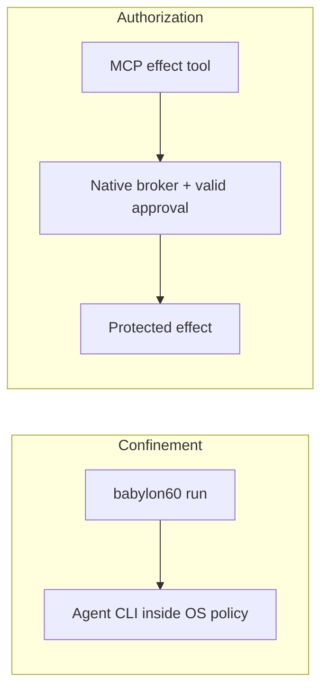

[](https://babylon60.com/)

# BABYLON-60

**English** · [Español](README_ES.md)

**More intelligence. Not more authority.**

BABYLON-60 provides local controls for AI agents: OS confinement for their
processes and signed authorization for selected MCP tools. The model proposes
an action; the configured policy and operator determine its permissions.

[](https://github.com/borjamoskv/BABYLON-60/actions/workflows/python-tests.yml)
[](https://github.com/borjamoskv/BABYLON-60/actions/workflows/verify_claims.yml)
[](LICENSE)

> [!IMPORTANT]
> **Security alpha.** Confinement and the broker have separate setup paths.
> `babylon60 run` does not enable the broker; installing a client integration
> does not confine that client. No command here combines both layers.
> Guarantees apply only to the [declared scope and evidence](#what-is-verified).

[Try it](#try-it-in-5-minutes) · [With your agent](#with-your-agent) ·
[Install / integrate](#installation) · [Troubleshooting](#troubleshooting) ·
[Limits](#what-run-does-not-stop) ·
[Verify](#what-is-verified) · [Reference](#documentation) ·
[FAQ](#frequently-asked-questions)

## What works today

| Capability | macOS | Linux x86_64 | Windows |
| :--- | :--- | :--- | :--- |
| Process confinement (`run`, `demo`) | Seatbelt | Landlock ABI 3+ and seccomp | No backend |
| CLI and MCP event ledger | Yes | Yes | Tested on Python 3.11 / 3.12 |
| MCP effect broker (alpha) | Native library and Touch ID required | No approval helper | No |

`run` restricts file access and leaves the network open. The MCP server stores
SQLite events with provenance supplied by the caller; this does not validate
whether an event is an original source or a sound inference.

## Try it in 5 minutes

**Requirements:** Python 3.11+ and [`uv`](https://docs.astral.sh/uv/getting-started/installation/);
`git` is needed only to clone. The demo also needs macOS with
`/usr/bin/sandbox-exec` or Linux x86_64 with Landlock ABI 3+ enabled
(kernel 6.2+). Linux aarch64 is `NO_VERIFICADO`. Windows users
should follow [Installation](#installation); the confinement demo is unavailable.

### Get the source

Clone once on any platform, or extract the terminal source ZIP into a new folder.
For a clone, these commands also work in PowerShell:

```console
git clone --depth 1 https://github.com/borjamoskv/BABYLON-60.git
cd BABYLON-60
```

Already have the source? Open its root folder and skip cloning. Then choose:

| Goal | Next step |
| :--- | :--- |
| Try confinement on macOS / Linux | Run the demo below |
| Install the CLI or integrate MCP, including on Windows | Follow [Installation](#installation) |

**Demo — macOS / Linux only:**

```bash
bash install.sh --demo
```

The installer creates the CLI in the source folder's `.venv`; it does not add it to
PATH. The demo uses a Python attacker script, **not an LLM**, to follow a
malicious README instruction against a decoy key in a disposable home.
It never touches your real `~/.ssh`.

Look for `verdict: BLOCKED` and exit code 0. This requires successful positive
controls and every counted attack to be blocked. Exit 1 means `FALSIFIED`,
2 means `INCONCLUSIVE`, and 3 means no confinement backend. Vector totals vary
by platform and revision; historical counts are in the
[demo reference](docs/03_guides/README_REFERENCE.md#demo-methodology-and-recorded-runs).

## With your agent

**macOS / Linux only.** [Install Babylon](#installation) and your agent's CLI
first. Then run from **your project's directory**, replacing `$HOME/BABYLON-60`
with the absolute source path. Keep the quotes so paths with spaces also work.

**Codex:**

```bash
cd "$HOME/your-project"
"$HOME/BABYLON-60/.venv/bin/babylon60" run --preset codex -- codex
```

**Or Claude Code:**

```bash
cd "$HOME/your-project"
"$HOME/BABYLON-60/.venv/bin/babylon60" run --preset claude-code -- claude
```

Write access covers the workspace, private temporary directory and paths the
preset grants for writing; Linux also allows `/dev/shm`. Other home-directory
files are withheld unless granted. These actions need no broker signature.

- Use `--dry-run` to inspect the policy; `run --help` lists all options.
- Presets retain their agent's own credentials. `--pass-env NAME` explicitly
  allows other credential-like environment variables.
- `run` rejects the Babylon clone, your home or its ancestors, and shared
  sticky directories such as `/tmp` as workspaces. Grants covering protected
  credential paths are also rejected.
- Recorded client checks cover confined `claude --version` and `codex --version`
  on Linux x86_64. Full LLM sessions remain `NO_VERIFICADO`.

[Grants, flags and compatibility details](docs/03_guides/README_REFERENCE.md#with-your-agent).

## Installation

Use the source checkout, not `pip install babylon60`: the PyPI name belongs
to an older 1.0.2 package with different content. The installer needs `uv`,
Python 3.11+ and a clean checkout. It installs the terminal CLI and MCP server,
without opening a desktop app.

[Get the source](#get-the-source) first. Run these commands from its root folder.
**macOS / Linux:** skip `bash install.sh` if you already installed via the demo.

```bash
bash install.sh
.venv/bin/babylon60 --help
```

**Windows (PowerShell):** install from a clean clone or the source ZIP.
Windows supports the CLI and MCP server, not process confinement:

```powershell
pwsh -NoProfile -ExecutionPolicy Bypass -File .\install.ps1 -DryRun
pwsh -NoProfile -ExecutionPolicy Bypass -File .\install.ps1
.\.venv\Scripts\babylon60.exe --help
```

`powershell` also works if `pwsh` is unavailable. `-ExecutionPolicy` affects
only that process. A dry run previews installation; it does not install anything.

**Check:** `--help` should print usage and commands including `setup`, `doctor`
and `run`. This confirms the CLI starts. Client integration is a separate step.

### Connect a client (optional)

**macOS / Linux:**

```bash
.venv/bin/babylon60 setup --client codex --dry-run
.venv/bin/babylon60 setup --client codex
.venv/bin/babylon60 doctor --client codex
```

**Windows (PowerShell):**

```powershell
.\.venv\Scripts\babylon60.exe setup --client codex --dry-run
.\.venv\Scripts\babylon60.exe setup --client codex
.\.venv\Scripts\babylon60.exe doctor --client codex
```

For either platform, replace `codex` with `claude`, `cursor` or `gemini` as
needed; Codex integration requires its CLI in PATH. Setup registers MCP and
managed instructions in the client's configuration. Inspect the dry run,
then open a **new conversation**. `doctor` checks configuration and probes MCP
directly; it does not prove that the client loads or follows the integration.

**Gemini:** configuration belongs in `~/.gemini`, or
`$GEMINI_CLI_HOME/.gemini` with an alternative home. Run `gemini mcp list` to
check discovery; folder trust can still disable a listed server. Rerunning
setup repairs older wrong-root registrations and preserves the old files.

State remains in `~/.babylon60` (or `$BABYLON_HOME`). The manifest labels
v5.1.0 as `candidate`; the Git tag predates `run`, `demo` and `log`. In a Git
checkout, record `git rev-parse HEAD`; for an extracted ZIP, read `commit` in
`RELEASE_MANIFEST.json`. The ZIP contains the CLI and selected guides, not the
complete Rust workspace. Links marked **↗** open the full repository online.

[Advanced setup and removal](docs/03_guides/README_REFERENCE.md#installation).

## Troubleshooting

| Symptom | Next step |
| :--- | :--- |
| `uv is required` | [Install uv](https://docs.astral.sh/uv/getting-started/installation/), reopen the terminal and rerun the installer. |
| Installer asks for a clean checkout | Inspect `git status --short`. Keep your changes; install from a separate clean clone or extract the source ZIP into a new folder. |
| `babylon60` is missing or shows old commands | Use `.venv/bin/babylon60` from the source root, or `.\.venv\Scripts\babylon60.exe` on Windows. The installer does not add it to PATH. |
| `run` rejects the workspace | Use a dedicated project directory. The Babylon sources, your home root and shared temporary directories are rejected. See [workspace restrictions](#with-your-agent). |
| Gemini lists MCP but disables it | Check the project's folder-trust setting in Gemini; listing alone does not establish a connection. See [client setup](#connect-a-client-optional). |
| `verify.sh` reports a hash mismatch | The files and receipt disagree. Use the intact source matching the manifest, or regenerate evidence after testing your changes. Editing a hash is not a repair. |

<a id="known-limits"></a>

## What `run` does not stop

- **Network access:** workspace data can leave the machine.
- **Persistence:** granted files remain writable. Selected startup and
  configuration paths are compared before and after execution; changes to
  files such as `AGENTS.md` or `Makefile` can go unreported. Review workspace
  changes before running its contents outside the sandbox.
- **Other host access:** macOS Keychain access is not fully isolated. On Linux,
  other processes' command lines remain readable and signalling is not
  isolated below Landlock ABI 6. Never pass credentials as command arguments.
- **Host compromise:** an administrator or compromised OS is outside the
  declared threat model. All Babylon code runs in user space.

Some agent features and nested sandboxes stop working under confinement.
[Platform restrictions and compatibility](docs/03_guides/README_REFERENCE.md#what-stops-working-inside)
explain the affected features and remaining uncertainty.

## How it works

These are **two separately configured paths**, not a combined launcher:



The broker refuses MCP effect tools without the native Rust library and a
valid approval for that exact task. The installer does not build the library;
see [broker setup (ES) ↗](https://github.com/borjamoskv/BABYLON-60/blob/main/docs/security/fl-mcp01-authority-drift.md#uso-y-comprobación)
and [signed authorization (ES)](docs/03_guides/guide_signed_authorization.md).

The event ledger is distinct from the versioned CORTEX Memory adapter, which
requires its own signed launch binding and native broker. Setup does not start
that adapter. [Architecture and memory scope](docs/03_guides/README_REFERENCE.md#beyond-confinement).

## What is verified

[`CLAIMS.toml`](CLAIMS.toml) records per-claim status, scope and evidence
levels. Formal models, software tests and physical hardware verification are
different kinds of evidence. Demo results have their own recorded runs.
From the source root, use a shell with Bash and `python3` available; the command
below is not a native PowerShell command.

```bash
bash verify.sh
```

This checks the source tree, both README hashes, claims, SBOM and evidence
against [`RELEASE_MANIFEST.json`](RELEASE_MANIFEST.json). It does **not** rerun
the suites. Editing the sources invalidates the receipt; regeneration requires
fresh tests on a clean source commit.

A manifest marked `unsigned_local_evidence` with `signature: null` checks
integrity but does not authenticate the publisher. CI badges apply to their
own workflow and commit, not to every guarantee. Software P-256 tests do not
attest Touch ID; `SIGKILL` tests do not establish survival of physical power
loss. Babylon does not itself certify legal compliance.

[Evidence levels, methods and limits](docs/03_guides/README_REFERENCE.md#what-is-verified).

## Documentation

[Full technical reference](docs/03_guides/README_REFERENCE.md) ·
[User guide (ES)](docs/03_guides/USER_GUIDE.md) ·
[Documentation index ↗](https://github.com/borjamoskv/BABYLON-60/blob/main/docs/README.md) · [Website](https://babylon60.com/)

Choose a topic for the method, examples or recorded evidence:

| Reference | What you will find |
| :--- | :--- |
| <a id="what-you-will-see"></a>[Demo output](docs/03_guides/README_REFERENCE.md#what-you-will-see) | Example output and verdicts |
| <a id="what-the-demo-does"></a>[Demo method](docs/03_guides/README_REFERENCE.md#what-the-demo-does) | Attack vectors, controls and boundaries |
| <a id="recorded-runs"></a>[Recorded runs](docs/03_guides/README_REFERENCE.md#recorded-runs) | Results by platform and revision |
| <a id="what-stops-working-inside"></a>[Compatibility](docs/03_guides/README_REFERENCE.md#what-stops-working-inside) | Features affected by confinement |
| <a id="beyond-confinement"></a>[Other components](docs/03_guides/README_REFERENCE.md#beyond-confinement) | Broker, memory and their separate setup |
| <a id="vocabulary"></a>[Vocabulary](docs/03_guides/README_REFERENCE.md#vocabulary) | Project terms and their scope |
| <a id="five-acceptance-tests"></a>[Acceptance tests](docs/03_guides/README_REFERENCE.md#five-acceptance-tests) | Five checks for the declared guarantees |
| <a id="incident-bounds-process-sigkill-vs-physical-power-loss"></a>[Crash testing](docs/03_guides/README_REFERENCE.md#incident-bounds-process-sigkill-vs-physical-power-loss) | Process termination versus physical power loss |
| <a id="normative-hash-matrix-blake3--sha-256--sha3-256"></a>[Hash matrix](docs/03_guides/README_REFERENCE.md#normative-hash-matrix-blake3--sha-256--sha3-256) | Where each digest algorithm applies |
| <a id="repository-map"></a>[Repository map](docs/03_guides/README_REFERENCE.md#repository-map) | Source directories and responsibilities |

## Frequently Asked Questions

**Will it keep asking for my fingerprint?**
`run` asks for no signature. MCP effect tools require exact-task approval.
If Touch ID fails, `approve` aborts with no retries and no fallback authentication
through a password or PIN. The Rust executor separately supports an admitted
Ed25519 key. [Authentication scope](docs/03_guides/README_REFERENCE.md#frequently-asked-questions).

**Does it slow down my machine or drain the battery?**
Battery, CPU and cache-coherence traffic costs are `NO_VERIFICADO`. A local
throughput benchmark is not an energy measurement.

**How do I uninstall it?**
From the clone, run `.venv/bin/babylon60 setup --client <client> --remove` for
each integration (Windows: `.\.venv\Scripts\babylon60.exe`). It preserves
foreign or modified configuration and the ledger. Then remove the clone;
keep the separate state directory unless you also want to delete that data.
[Conflict handling and removal (ES)](docs/03_guides/guide_codex_first_use.md#diagnóstico-y-retirada).

## License, security and citation

[Sovereign Dual-License v4.0](LICENSE) is a custom license, **not OSI-approved**.
Non-commercial use has a free tier; commercial use has separate
[terms](docs/COMMERCIAL_LICENSE.md). Review the license for the full conditions,
including restrictions on redistribution and automated use of the assets.

Report vulnerabilities privately to `security@babylon60.com` following
[SECURITY.md](SECURITY.md). Cite the project using [CITATION.cff](CITATION.cff).

<sub>BABYLON-60 v5.1.0 · Borja Moskv</sub>
