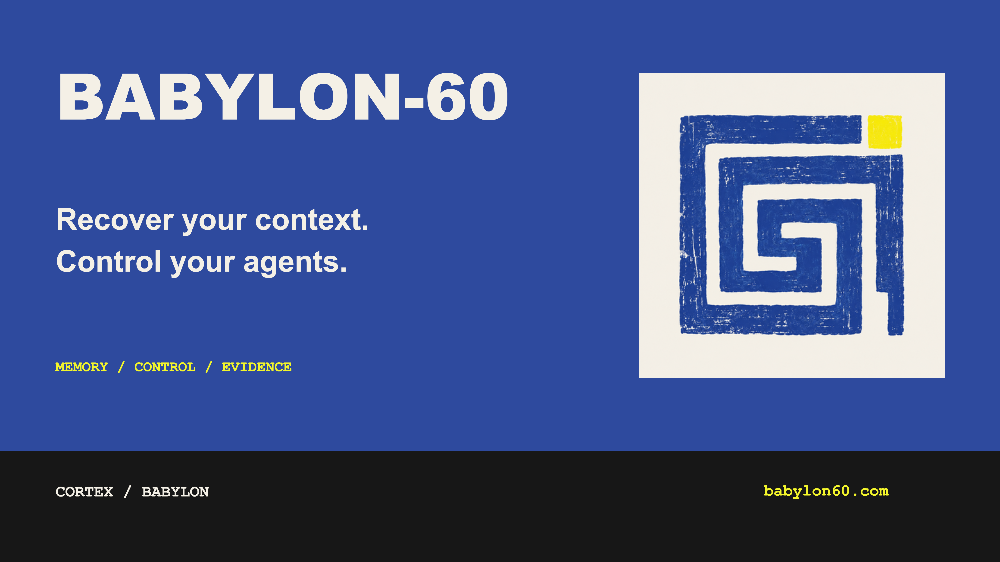
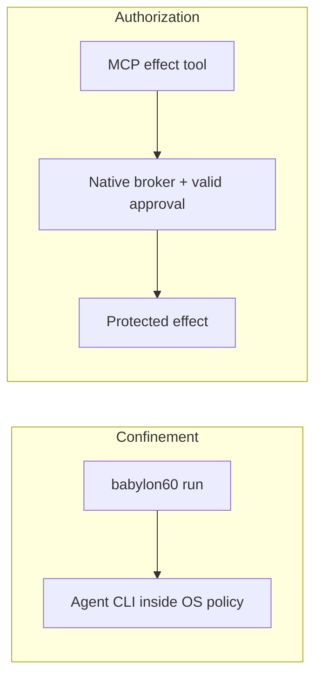

[](https://babylon60.com/)

# BABYLON-60

**English** · [Español](README_ES.md)

**Run AI agents with explicit permissions.**

BABYLON-60 limits which files an AI agent can read or change. It also provides
a local MCP event ledger and signed authorization for selected MCP tools.
The model proposes actions; the configured policy and operator control permissions.

[](https://github.com/borjamoskv/BABYLON-60/actions/workflows/python-tests.yml)
[](https://github.com/borjamoskv/BABYLON-60/actions/workflows/verify_claims.yml)
[](LICENSE)

> [!IMPORTANT]
> **Security alpha.** Process confinement and MCP authorization are configured
> separately. `run` does not enable the broker; client setup does not confine
> the client. See the [scope and evidence](#what-is-verified).

## Start here

| You want to… | Follow this path |
| :--- | :--- |
| Try file confinement | [Get the source](#get-the-source), then run the [demo](#quick-start) on macOS or Linux. |
| Run Codex or Claude Code with file restrictions | [Install](#installation), then [launch your agent](#with-your-agent). |
| Add the local MCP server to a client | [Install](#installation), then [connect a client](#connect-a-client-optional). |

[Troubleshooting](#troubleshooting) · [Limits](#what-run-does-not-stop) ·
[Evidence](#what-is-verified) · [Reference](#documentation) · [FAQ](#frequently-asked-questions)

<a id="what-works-today"></a>

## Platform support

| Capability | macOS | Linux x86_64 | Windows |
| :--- | :--- | :--- | :--- |
| Process confinement (`run`, `demo`) | Seatbelt | Landlock ABI 3+ and seccomp | No backend |
| CLI and MCP event ledger | Yes | Yes | [Recorded pass: Python 3.11 / 3.12](https://github.com/borjamoskv/BABYLON-60/actions/runs/44682649397) |
| MCP effect broker (alpha) | Native library and Touch ID required | No approval helper | No |

`run` restricts file access; **network connections remain open**.

The Windows result is from **20 November 2026**, not a check of every revision.
The Python badge above runs on Linux; see [native Windows CI](https://github.com/borjamoskv/BABYLON-60/actions/workflows/windows-terminal.yml)
for Windows installation and MCP results.

<a id="try-it-in-5-minutes"></a>

## Quick start

**Requirements:** Python 3.11+ and [`uv`](https://docs.astral.sh/uv/getting-started/installation/);
`git` is needed only to clone. The demo also needs macOS with
`/usr/bin/sandbox-exec` or Linux x86_64 with Landlock ABI 3+ enabled
(kernel 6.2+). Linux aarch64 is `NO_VERIFICADO`. Windows users
should follow [Installation](#installation); the confinement demo is unavailable.

### Get the source

Use a clean clone or extract a terminal source ZIP into a new folder.
These clone commands work in Bash and PowerShell:

```console
git clone --depth 1 https://github.com/borjamoskv/BABYLON-60.git
cd BABYLON-60
```

Already have the source? Open its root folder and skip cloning. Installation
time depends on dependency downloads and your cache. To skip the demo,
follow [Installation](#installation).

**Demo — macOS / Linux only:**

```bash
bash install.sh --demo
```

This installs the CLI and runs a Python test script against a decoy key in a
disposable home. The script follows a malicious README instruction; **no LLM
or model account is involved**, and your real `~/.ssh` is untouched.

Read the verdict and exit code:

| Exit code | Meaning |
| :--- | :--- |
| `0` — `BLOCKED` | Every counted demo attack was blocked and the positive controls passed. |
| `1` — `FALSIFIED` | The demo's blocking criterion failed. |
| `2` — `INCONCLUSIVE` | The run did not establish a result; inspect its diagnostics. |
| `3` | No supported confinement backend was available. |

Vector totals vary by platform and revision; historical counts are in the
[demo reference](docs/03_guides/README_REFERENCE.md#demo-methodology-and-recorded-runs).

## Installation

Use these installers: `pip install babylon60` refers to an older 1.0.2 package
with different content. You need Python 3.11+, `uv` and a clean source folder.
The installers put the CLI and MCP server in `.venv`, without opening a desktop
app or adding commands to PATH.

[Get the source](#get-the-source) first. Run these commands from its root folder.
**macOS / Linux:** skip `bash install.sh` if you already installed via the demo.

```bash
bash install.sh
.venv/bin/babylon60 --help
```

**Windows (PowerShell):**

```powershell
pwsh -NoProfile -ExecutionPolicy Bypass -File .\install.ps1
.\.venv\Scripts\babylon60.exe --help
```

Use `powershell` if `pwsh` is unavailable. `-ExecutionPolicy` affects only that
process. Add `-DryRun` to the installer command to preview without installing.

**Check:** `--help` should list `setup`, `doctor` and `run`. This confirms the
CLI starts. Next, [launch an agent](#with-your-agent) or connect a client below.

### Connect a client (optional)

Run from **Babylon's source folder**. Replace `codex` with `claude`, `cursor` or
`gemini` as needed; Codex requires its CLI in PATH. Setup registers MCP and
managed instructions in the client's configuration.

**1. Preview the changes — macOS / Linux:**

```bash
.venv/bin/babylon60 setup --client codex --dry-run
```

**Or Windows (PowerShell):**

```powershell
.\.venv\Scripts\babylon60.exe setup --client codex --dry-run
```

**2. After reviewing the preview, apply and check — macOS / Linux:**

```bash
.venv/bin/babylon60 setup --client codex
.venv/bin/babylon60 doctor --client codex
```

**Or Windows (PowerShell):**

```powershell
.\.venv\Scripts\babylon60.exe setup --client codex
.\.venv\Scripts\babylon60.exe doctor --client codex
```

**Check:** exit code 0, with `configuration`, `executable`, `mcp` and `contract`
all `OK`. Then open a **new conversation** in your client. `doctor` probes MCP
directly; `behavior: NO_VERIFICADO` and, outside Codex, `client_loading: NO_VERIFICADO`
mark the client behavior it has not tested.

**Gemini:** configuration belongs in `~/.gemini`, or
`$GEMINI_CLI_HOME/.gemini` with an alternative home. Run `gemini mcp list` to
check discovery; folder trust can still disable a listed server. Rerunning
setup repairs older wrong-root registrations and preserves the old files.

State lives in `~/.babylon60` (or `$BABYLON_HOME`). Client registrations point to
the installation's Python executable; keep that folder in place. If you move it,
follow [Troubleshooting](#troubleshooting) before removing the old installation.

The ZIP contains the CLI and selected guides, not the complete Rust workspace.
Links marked **↗** open the full repository online.

[Advanced setup and removal](docs/03_guides/README_REFERENCE.md#installation).

## With your agent

**macOS / Linux only.** Install Babylon and your agent's CLI first. Run the
examples from **your project's directory**, replacing `$HOME/BABYLON-60` with
Babylon's absolute source path. Keep the quotes for paths with spaces.
Both examples preview the policy without launching the agent.

**Codex:**

```bash
cd "$HOME/your-project"
"$HOME/BABYLON-60/.venv/bin/babylon60" run --dry-run --preset codex -- codex
```

**Or Claude Code:**

```bash
cd "$HOME/your-project"
"$HOME/BABYLON-60/.venv/bin/babylon60" run --dry-run --preset claude-code -- claude
```

Check `backend`, `policy_digest` and the allowed paths in the preview. To launch
the agent, repeat your chosen command **without `--dry-run`**.

Write access covers the workspace, private temporary directory and paths the
preset grants for writing; Linux also allows `/dev/shm`. Other home-directory
files are withheld unless granted. These actions need no broker signature.

- Presets retain their agent's own credentials. `--pass-env NAME` explicitly
  allows other credential-like environment variables.
- `run` rejects the Babylon clone, your home or its ancestors, and shared
  sticky directories such as `/tmp` as workspaces. Grants covering protected
  credential paths are also rejected.
- Recorded client checks cover confined `claude --version` and `codex --version`
  on Linux x86_64. Full LLM sessions remain `NO_VERIFICADO`.

`run --help` lists all options. [Grants and compatibility](docs/03_guides/README_REFERENCE.md#with-your-agent).

## Troubleshooting

| Symptom | Next step |
| :--- | :--- |
| `uv is required` | [Install uv](https://docs.astral.sh/uv/getting-started/installation/), reopen the terminal and rerun the installer. |
| Installer asks for a clean checkout | Inspect `git status --short`. Keep your changes; install from a separate clean clone or extract the source ZIP into a new folder. |
| `babylon60` is missing or shows old commands | Use `.venv/bin/babylon60` from the source root, or `.\.venv\Scripts\babylon60.exe` on Windows. The installer does not add it to PATH. |
| `run` rejects the workspace | Use a dedicated project directory. The Babylon sources, your home root and shared temporary directories are rejected. See [workspace restrictions](#with-your-agent). |
| Commands or `doctor` fail after moving the installation | Install into a new clean folder, then repeat setup and `doctor` there. The virtual environment and client registrations can retain the old path. |
| Gemini lists MCP but disables it | Check the project's folder-trust setting in Gemini; listing alone does not establish a connection. See [client setup](#connect-a-client-optional). |
| `verify.sh` reports a hash mismatch | The files and receipt disagree. Use the intact source matching the manifest, or regenerate evidence after testing your changes. Editing a hash is not a repair. |

<a id="known-limits"></a>

## What `run` does not stop

- **Network access:** workspace data can leave the machine.
- **Persistence:** granted files remain writable. Selected startup and
  configuration paths are compared before and after execution; changes to
  files such as `AGENTS.md` or `Makefile` can go unreported. Review workspace
  changes before running its contents outside the sandbox.
- **Other host access:** macOS Keychain access is not fully isolated. On Linux,
  other processes' command lines remain readable and signalling is not
  isolated below Landlock ABI 6. Never pass credentials as command arguments.
- **Host compromise:** an administrator or compromised OS is outside the
  declared threat model. All Babylon code runs in user space.

Some agent features and nested sandboxes stop working under confinement.
[Platform restrictions and compatibility](docs/03_guides/README_REFERENCE.md#what-stops-working-inside)
explain the affected features and remaining uncertainty.

## How it works

These are **two separately configured paths**, not a combined launcher:



The broker refuses MCP effect tools without the native Rust library and a
valid approval for that exact task. The installer does not build the library;
see [broker setup (ES) ↗](https://github.com/borjamoskv/BABYLON-60/blob/main/docs/security/fl-mcp01-authority-drift.md#uso-y-comprobación)
and [signed authorization (ES)](docs/03_guides/guide_signed_authorization.md).

The event ledger is distinct from the versioned CORTEX Memory adapter, which
requires its own signed launch binding and native broker. Setup does not start
that adapter. [Architecture and memory scope](docs/03_guides/README_REFERENCE.md#beyond-confinement).

The ledger stores SQLite events with provenance supplied by the caller. It does
not establish whether an event is an original source or a sound inference.

## What is verified

**Identify the revision first.** In a Git checkout, record `git rev-parse HEAD`;
for an extracted ZIP, read `commit` in `RELEASE_MANIFEST.json`. The manifest labels
v5.1.0 as `candidate`; the Git tag predates `run`, `demo` and `log`.

[`CLAIMS.toml`](CLAIMS.toml) records each claim's status, scope and evidence level.
Formal models, software tests, hardware checks and demo runs have distinct scopes.
From the source root, use **Bash with `python3`**; this is not a PowerShell command:

```bash
bash verify.sh
```

**Check:** exit code 0 means the source tree, both README hashes, claims,
dependency inventory (SBOM) and evidence passed their integrity checks against
[`RELEASE_MANIFEST.json`](RELEASE_MANIFEST.json). This does **not** rerun the suites.
Editing the sources invalidates the receipt; regeneration requires fresh tests
on a clean source commit.

A manifest marked `unsigned_local_evidence` with `signature: null` checks
integrity but does not authenticate the publisher. CI badges apply to their
own workflow and commit, not to every guarantee. Software P-256 tests do not
attest Touch ID; `SIGKILL` tests do not establish survival of physical power
loss. Babylon does not itself certify legal compliance.

[Evidence levels, methods and limits](docs/03_guides/README_REFERENCE.md#what-is-verified).

## Documentation

[Full technical reference](docs/03_guides/README_REFERENCE.md) ·
[User guide (ES)](docs/03_guides/USER_GUIDE.md) ·
[Documentation index ↗](https://github.com/borjamoskv/BABYLON-60/blob/main/docs/README.md) · [Website](https://babylon60.com/)

Choose a topic for the method, examples or recorded evidence:

| Reference | What you will find |
| :--- | :--- |
| <a id="what-you-will-see"></a>[Demo output](docs/03_guides/README_REFERENCE.md#what-you-will-see) | Example output and verdicts |
| <a id="what-the-demo-does"></a>[Demo method](docs/03_guides/README_REFERENCE.md#what-the-demo-does) | Attack vectors, controls and boundaries |
| <a id="recorded-runs"></a>[Recorded runs](docs/03_guides/README_REFERENCE.md#recorded-runs) | Results by platform and revision |
| <a id="what-stops-working-inside"></a>[Compatibility](docs/03_guides/README_REFERENCE.md#what-stops-working-inside) | Features affected by confinement |
| <a id="beyond-confinement"></a>[Other components](docs/03_guides/README_REFERENCE.md#beyond-confinement) | Broker, memory and their separate setup |
| <a id="vocabulary"></a>[Vocabulary](docs/03_guides/README_REFERENCE.md#vocabulary) | Project terms and their scope |
| <a id="five-acceptance-tests"></a>[Acceptance tests](docs/03_guides/README_REFERENCE.md#five-acceptance-tests) | Five checks for the declared guarantees |
| <a id="incident-bounds-process-sigkill-vs-physical-power-loss"></a>[Crash testing](docs/03_guides/README_REFERENCE.md#incident-bounds-process-sigkill-vs-physical-power-loss) | Process termination versus physical power loss |
| <a id="normative-hash-matrix-blake3--sha-256--sha3-256"></a>[Hash matrix](docs/03_guides/README_REFERENCE.md#normative-hash-matrix-blake3--sha-256--sha3-256) | Where each digest algorithm applies |
| <a id="repository-map"></a>[Repository map](docs/03_guides/README_REFERENCE.md#repository-map) | Source directories and responsibilities |

## Frequently Asked Questions

**Will it keep asking for my fingerprint?**
`run` asks for no signature. MCP effect tools require exact-task approval.
If Touch ID fails, `approve` aborts with no retries and no fallback authentication
through a password or PIN. The Rust executor separately supports an admitted
Ed25519 key. [Authentication scope](docs/03_guides/README_REFERENCE.md#frequently-asked-questions).

**Does it slow down my machine or drain the battery?**
Battery, CPU and cache-coherence traffic costs are `NO_VERIFICADO`. A local
throughput benchmark is not an energy measurement.

**How do I uninstall it?**
From the clone, run `.venv/bin/babylon60 setup --client <client> --remove` for
each integration (Windows: `.\.venv\Scripts\babylon60.exe`). It preserves
foreign or modified configuration and the ledger. Then remove the clone;
keep the separate state directory unless you also want to delete that data.
[Conflict handling and removal (ES)](docs/03_guides/guide_codex_first_use.md#diagnóstico-y-retirada).

## License, security and citation

[Sovereign Dual-License v4.0](LICENSE) is a custom license, **not OSI-approved**.
Non-commercial use has a free tier; commercial use has separate
[terms](docs/COMMERCIAL_LICENSE.md). Review the license for the full conditions,
including restrictions on redistribution and automated use of the assets.

Report vulnerabilities privately to `security@babylon60.com` following
[SECURITY.md](SECURITY.md). Cite the project using [CITATION.cff](CITATION.cff).

<sub>BABYLON-60 v5.1.0 · Borja Moskv</sub>
