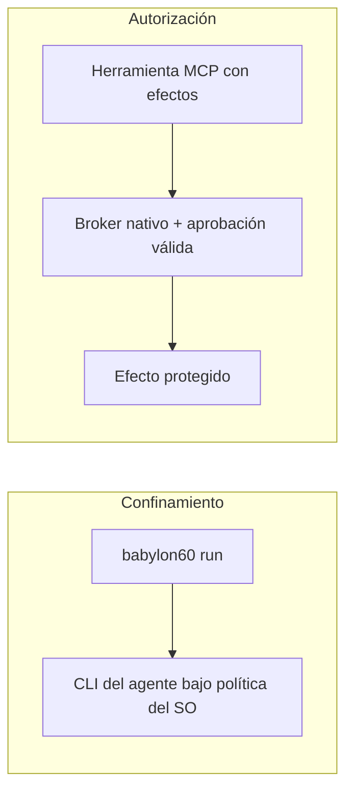

[](https://babylon60.com/)

# BABYLON-60

[English](README.md) · **Español**

**Ejecuta agentes de IA con permisos explícitos.**

BABYLON-60 limita qué archivos puede leer o modificar un agente de IA. También
ofrece un registro local de eventos MCP y autorización firmada para determinadas
herramientas MCP. El modelo propone acciones; la política configurada y el
operador controlan los permisos.

[](https://github.com/borjamoskv/BABYLON-60/actions/workflows/python-tests.yml)
[](https://github.com/borjamoskv/BABYLON-60/actions/workflows/verify_claims.yml)
[](LICENSE)

> [!IMPORTANT]
> **Alpha de seguridad.** El confinamiento de procesos y la autorización MCP se
> configuran por separado. `run` no activa el broker; configurar un cliente no
> lo confina. Consulta el [alcance y la evidencia](#qué-está-verificado).

## Empieza aquí

| Quieres… | Sigue esta ruta |
| :--- | :--- |
| Probar el confinamiento de archivos | [Obtén el código](#obtener-el-código) y ejecuta la [demo](#inicio-rápido) en macOS o Linux. |
| Usar Codex o Claude Code con restricciones de archivos | [Instala](#instalación) y después [lanza tu agente](#con-tu-agente). |
| Añadir el servidor MCP local a un cliente | [Instala](#instalación) y después [conecta un cliente](#conectar-un-cliente-opcional). |

[Solución de problemas](#solución-de-problemas) · [Límites](#lo-que-run-no-impide) ·
[Evidencia](#qué-está-verificado) · [Referencia](#documentación) · [Preguntas frecuentes](#preguntas-frecuentes-para-humanos)

<a id="qué-funciona-hoy"></a>

## Compatibilidad por plataforma

| Capacidad | macOS | Linux x86_64 | Windows |
| :--- | :--- | :--- | :--- |
| Confinamiento de procesos (`run`, `demo`) | Seatbelt | Landlock ABI 3+ y seccomp | Sin backend |
| CLI y registro de eventos MCP | Sí | Sí | [Prueba registrada: Python 3.11 / 3.12](https://github.com/borjamoskv/BABYLON-60/actions/runs/44682649397) |
| Broker de efectos MCP (alpha) | Requiere biblioteca nativa y Touch ID | Sin helper de aprobación | No |

`run` restringe el acceso a archivos; **las conexiones de red siguen abiertas**.

El resultado de Windows es del **20 de noviembre de 2026**; no verifica todas las
revisiones. El badge de Python de arriba se ejecuta en Linux; consulta el
[CI nativo de Windows](https://github.com/borjamoskv/BABYLON-60/actions/workflows/windows-terminal.yml)
para sus resultados de instalación y MCP.

<a id="probar-en-5-minutos"></a>

## Inicio rápido

**Requisitos:** Python 3.11+ y [`uv`](https://docs.astral.sh/uv/getting-started/installation/);
`git` solo hace falta para clonar. La demo también necesita macOS con
`/usr/bin/sandbox-exec` o Linux x86_64 con Landlock ABI 3+ activado
(kernel 6.2+). Linux aarch64 está `NO_VERIFICADO`. En Windows sigue
[Instalación](#instalación); la demo de confinamiento no está disponible.

### Obtener el código

Usa un clon limpio o extrae el ZIP fuente de terminal en una carpeta nueva.
Estos comandos de clonación funcionan en Bash y PowerShell:

```console
git clone --depth 1 https://github.com/borjamoskv/BABYLON-60.git
cd BABYLON-60
```

¿Ya tienes el código? Abre su carpeta raíz y omite la clonación. El tiempo de
instalación depende de las descargas y la caché. Para omitir la demo,
sigue [Instalación](#instalación).

**Demo — solo macOS / Linux:**

```bash
bash install.sh --demo
```

El comando instala la CLI y ejecuta un script de prueba en Python contra una
clave señuelo en una carpeta personal desechable. El script sigue una instrucción
maliciosa de un README; **no interviene ningún LLM ni cuenta de un proveedor de
modelos**, y tu `~/.ssh` real permanece intacto.

Consulta el veredicto y el código de salida:

| Código de salida | Significado |
| :--- | :--- |
| `0` — `BLOCKED` | Se bloquearon todos los ataques contabilizados y pasaron los controles positivos. |
| `1` — `FALSIFIED` | Falló el criterio de bloqueo de la demo. |
| `2` — `INCONCLUSIVE` | La ejecución no permitió establecer un resultado; revisa su diagnóstico. |
| `3` | No había un backend de confinamiento compatible. |

Los totales cambian según plataforma y revisión; las cifras
históricas están en la [referencia de la demo](docs/03_guides/README_REFERENCE_ES.md#demo-método-y-ejecuciones-registradas).

## Instalación

Usa estos instaladores: `pip install babylon60` corresponde a un paquete 1.0.2
antiguo con otro contenido. Necesitas Python 3.11+, `uv` y una carpeta fuente limpia.
Los instaladores colocan la CLI y el servidor MCP en `.venv`, sin abrir una
aplicación de escritorio ni añadir comandos al PATH.

Primero [obtén el código](#obtener-el-código). Ejecuta estos comandos desde su
carpeta raíz. **macOS / Linux:** omite `bash install.sh` si ya instalaste con la demo.

```bash
bash install.sh
.venv/bin/babylon60 --help
```

**Windows (PowerShell):**

```powershell
pwsh -NoProfile -ExecutionPolicy Bypass -File .\install.ps1
.\.venv\Scripts\babylon60.exe --help
```

Usa `powershell` si no tienes `pwsh`. `-ExecutionPolicy` afecta solo a ese proceso.
Añade `-DryRun` al comando del instalador para consultar el plan sin instalar.

**Comprobación:** `--help` debe enumerar `setup`, `doctor` y `run`. Confirma que
la CLI arranca. Después, [lanza un agente](#con-tu-agente) o conecta un cliente abajo.

### Conectar un cliente (opcional)

Ejecuta desde **la carpeta fuente de Babylon**. Sustituye `codex` por `claude`,
`cursor` o `gemini` según tu cliente; Codex requiere su CLI en PATH. Setup registra
MCP e instrucciones gestionadas en la configuración del cliente.

**1. Consulta los cambios previstos — macOS / Linux:**

```bash
.venv/bin/babylon60 setup --client codex --dry-run
```

**O bien Windows (PowerShell):**

```powershell
.\.venv\Scripts\babylon60.exe setup --client codex --dry-run
```

**2. Tras revisar el plan, aplica y comprueba — macOS / Linux:**

```bash
.venv/bin/babylon60 setup --client codex
.venv/bin/babylon60 doctor --client codex
```

**O bien Windows (PowerShell):**

```powershell
.\.venv\Scripts\babylon60.exe setup --client codex
.\.venv\Scripts\babylon60.exe doctor --client codex
```

**Comprobación:** código de salida 0 y `configuration`, `executable`, `mcp` y
`contract` en `OK`. Después abre una **conversación nueva** en tu cliente.
`doctor` prueba MCP directamente; `behavior: NO_VERIFICADO` y, salvo en Codex,
`client_loading: NO_VERIFICADO` indican el comportamiento del cliente que no ha probado.

**Gemini:** la configuración está en `~/.gemini`, o en
`$GEMINI_CLI_HOME/.gemini` con una carpeta personal alternativa. Ejecuta
`gemini mcp list` para comprobar su detección; la confianza de la carpeta puede
mantener desactivado un servidor listado. Repetir setup corrige los registros
antiguos en una raíz incorrecta y conserva los archivos anteriores.

El estado se guarda en `~/.babylon60` (o `$BABYLON_HOME`). Los registros del cliente
apuntan al Python de la instalación; conserva esa carpeta en su sitio. Si la mueves,
sigue [Solución de problemas](#solución-de-problemas) antes de retirar la instalación anterior.

El ZIP contiene la CLI y guías seleccionadas, no el workspace Rust completo.
Los enlaces con **↗** abren el repositorio en línea.

[Instalación avanzada y retirada](docs/03_guides/README_REFERENCE_ES.md#instalación).

## Con tu agente

**Solo macOS / Linux.** Instala primero Babylon y la CLI de tu agente. Ejecuta
los ejemplos desde **la carpeta de tu proyecto**, sustituyendo `$HOME/BABYLON-60`
por la ruta absoluta de las fuentes de Babylon. Conserva las comillas para las
rutas con espacios. Ambos ejemplos muestran la política sin iniciar el agente.

**Codex:**

```bash
cd "$HOME/tu-proyecto"
"$HOME/BABYLON-60/.venv/bin/babylon60" run --dry-run --preset codex -- codex
```

**O bien Claude Code:**

```bash
cd "$HOME/tu-proyecto"
"$HOME/BABYLON-60/.venv/bin/babylon60" run --dry-run --preset claude-code -- claude
```

Comprueba `backend`, `policy_digest` y las rutas permitidas en la vista previa.
Para lanzar el agente, repite el comando elegido **sin `--dry-run`**.

Se puede escribir en la carpeta de trabajo, la carpeta temporal privada y las rutas
que el preset habilite para escritura; Linux también permite `/dev/shm`.
Los demás archivos personales quedan fuera del acceso concedido.
Estas acciones no requieren firma del broker.

- Los presets conservan las credenciales de su agente. `--pass-env NOMBRE`
  permite pasar explícitamente otras variables con nombre de credencial.
- `run` rechaza como carpeta de trabajo el clon de Babylon, tu carpeta personal
  o sus superiores y directorios compartidos con sticky bit, como `/tmp`. También rechaza
  permisos que abarquen rutas de credenciales protegidas.
- Las comprobaciones de clientes registradas cubren `claude --version` y
  `codex --version` confinados en Linux x86_64. Las sesiones completas con
  un LLM siguen `NO_VERIFICADO`.

`run --help` enumera todas las opciones. [Permisos y compatibilidad](docs/03_guides/README_REFERENCE_ES.md#con-tu-agente).

## Solución de problemas

| Síntoma | Siguiente paso |
| :--- | :--- |
| `uv is required` | [Instala uv](https://docs.astral.sh/uv/getting-started/installation/), abre de nuevo la terminal y repite el instalador. |
| El instalador exige un checkout limpio | Revisa `git status --short`. Conserva tus cambios; instala desde otro clon limpio o extrae el ZIP fuente en una carpeta nueva. |
| No aparece `babylon60` o muestra comandos antiguos | Usa `.venv/bin/babylon60` desde la raíz de las fuentes, o `.\.venv\Scripts\babylon60.exe` en Windows. El instalador no lo añade al PATH. |
| `run` rechaza el workspace | Usa una carpeta propia del proyecto. Se rechazan las fuentes de Babylon, la raíz de tu HOME y los temporales compartidos. Consulta las [restricciones del workspace](#con-tu-agente). |
| Los comandos o `doctor` fallan después de mover la instalación | Instala en una carpeta nueva y limpia; repite setup y `doctor` allí. El entorno virtual y los registros del cliente pueden conservar la ruta anterior. |
| Gemini lista MCP pero lo desactiva | Revisa la confianza de la carpeta del proyecto en Gemini; aparecer en la lista no acredita conexión. Consulta la [configuración del cliente](#conectar-un-cliente-opcional). |
| `verify.sh` indica que un hash no coincide | Los archivos y el recibo difieren. Usa las fuentes intactas que corresponden al manifiesto o regenera la evidencia tras probar tus cambios. Editar un hash no lo repara. |

<a id="límites-conocidos"></a>

## Lo que `run` no impide

- **Acceso a la red:** los datos del workspace pueden salir de la máquina.
- **Persistencia:** los archivos concedidos siguen admitiendo escritura.
  Se comparan rutas seleccionadas de arranque y configuración antes y después;
  editar archivos como `AGENTS.md` o `Makefile` puede no generar aviso.
  Revisa los cambios antes de ejecutar el contenido fuera del sandbox.
- **Otros accesos al equipo:** el llavero de macOS no queda completamente
  aislado. En Linux siguen legibles las líneas de órdenes de otros procesos
  y las señales no se aíslan por debajo de Landlock ABI 6. Nunca pases
  credenciales como argumentos de comandos.
- **Equipo comprometido:** un administrador o sistema operativo comprometido
  queda fuera del modelo de amenazas declarado. Babylon se ejecuta en espacio de usuario.

Algunas funciones de los agentes y sus sandboxes anidados dejan de funcionar
bajo confinamiento. Las [restricciones por plataforma y compatibilidad](docs/03_guides/README_REFERENCE_ES.md#lo-que-deja-de-funcionar-dentro)
detallan las funciones afectadas y lo que sigue sin verificarse.

## Cómo funciona

Son **dos rutas que se configuran por separado**, no un lanzador combinado:



El broker rechaza las herramientas MCP con efectos si falta la biblioteca
nativa Rust o una aprobación válida para esa tarea exacta. El instalador no
compila la biblioteca; consulta la [configuración del broker ↗](https://github.com/borjamoskv/BABYLON-60/blob/main/docs/security/fl-mcp01-authority-drift.md#uso-y-comprobación)
y la [autorización firmada](docs/03_guides/guide_signed_authorization.md).

El registro de eventos es distinto del adaptador CORTEX Memory versionado,
que requiere su propio vínculo de lanzamiento firmado y un broker nativo.
Setup no arranca ese adaptador. [Arquitectura y alcance de la memoria](docs/03_guides/README_REFERENCE_ES.md#más-allá-del-confinamiento).

El registro guarda eventos SQLite con procedencia declarada por quien llama.
No acredita que un evento sea una fuente original o una inferencia correcta.

## Qué está verificado

**Identifica primero la revisión.** En un checkout Git, anota `git rev-parse HEAD`;
en un ZIP extraído, consulta `commit` en `RELEASE_MANIFEST.json`. El manifiesto marca
v5.1.0 como `candidate`; la etiqueta Git es anterior a `run`, `demo` y `log`.

[`CLAIMS.toml`](CLAIMS.toml) registra estado, alcance y nivel de evidencia de cada
declaración. Los modelos formales, tests software, pruebas hardware y demos tienen
alcances distintos. Desde la raíz de las fuentes, usa **Bash con `python3`**;
este comando no es nativo de PowerShell:

```bash
bash verify.sh
```

**Comprobación:** el código de salida 0 indica que el árbol de fuentes, los hashes
de ambos README, las declaraciones, el inventario de dependencias (SBOM) y la
evidencia pasaron los controles de integridad frente a
[`RELEASE_MANIFEST.json`](RELEASE_MANIFEST.json). **No** vuelve a ejecutar las suites.
Editar las fuentes invalida el recibo; regenerarlo requiere pruebas nuevas
sobre un commit fuente limpio.

Un manifiesto `unsigned_local_evidence` con `signature: null` comprueba
integridad, pero no autentica al publicador. Los badges de CI corresponden a
su workflow y commit, no a todas las garantías. Los tests P-256 software no
acreditan Touch ID; las pruebas con `SIGKILL` no acreditan resistencia a cortes
eléctricos físicos. Babylon no certifica por sí solo conformidad jurídica.

[Niveles de evidencia, métodos y límites](docs/03_guides/README_REFERENCE_ES.md#qué-está-verificado).

## Documentación

[Referencia técnica completa](docs/03_guides/README_REFERENCE_ES.md) ·
[Guía de usuario](docs/03_guides/USER_GUIDE.md) ·
[Índice documental ↗](https://github.com/borjamoskv/BABYLON-60/blob/main/docs/README.md) · [Web](https://babylon60.com/)

Elige un tema para consultar el método, los ejemplos o la evidencia registrada:

| Referencia | Qué encontrarás |
| :--- | :--- |
| <a id="qué-verás"></a>[Salida de la demo](docs/03_guides/README_REFERENCE_ES.md#qué-verás) | Ejemplo de salida y veredictos |
| <a id="qué-hace-la-demo"></a>[Método de la demo](docs/03_guides/README_REFERENCE_ES.md#qué-hace-la-demo) | Vectores de ataque, controles y límites |
| <a id="ejecuciones-registradas"></a>[Ejecuciones registradas](docs/03_guides/README_REFERENCE_ES.md#ejecuciones-registradas) | Resultados por plataforma y revisión |
| <a id="lo-que-deja-de-funcionar-dentro"></a>[Compatibilidad](docs/03_guides/README_REFERENCE_ES.md#lo-que-deja-de-funcionar-dentro) | Funciones afectadas por el confinamiento |
| <a id="más-allá-del-confinamiento"></a>[Otros componentes](docs/03_guides/README_REFERENCE_ES.md#más-allá-del-confinamiento) | Broker, memoria y su configuración separada |
| <a id="vocabulario"></a>[Vocabulario](docs/03_guides/README_REFERENCE_ES.md#vocabulario) | Términos del proyecto y su alcance |
| <a id="cinco-pruebas-de-aceptación"></a>[Pruebas de aceptación](docs/03_guides/README_REFERENCE_ES.md#cinco-pruebas-de-aceptación) | Cinco comprobaciones de las garantías declaradas |
| <a id="cotas-de-incidentes-sigkill-de-proceso-vs-corte-eléctrico-físico"></a>[Pruebas de caída](docs/03_guides/README_REFERENCE_ES.md#cotas-de-incidentes-sigkill-de-proceso-vs-corte-eléctrico-físico) | Terminación de proceso frente a corte eléctrico físico |
| <a id="matriz-normativa-de-hashes-blake3--sha-256--sha3-256"></a>[Matriz de hashes](docs/03_guides/README_REFERENCE_ES.md#matriz-normativa-de-hashes-blake3--sha-256--sha3-256) | Dónde se aplica cada algoritmo de hash |
| <a id="mapa-del-repositorio"></a>[Mapa del repositorio](docs/03_guides/README_REFERENCE_ES.md#mapa-del-repositorio) | Directorios de fuentes y responsabilidades |

## Preguntas Frecuentes para Humanos

**¿Me pedirá la huella continuamente?**
`run` no pide firmas. Las herramientas MCP con efectos requieren aprobar la
tarea exacta. Si Touch ID falla, `approve` aborta sin reintentos ni autenticación alternativa
por contraseña o PIN. El ejecutor Rust admite por separado una clave Ed25519
autorizada. [Alcance de la autenticación](docs/03_guides/README_REFERENCE_ES.md#preguntas-frecuentes-para-humanos).

**¿Ralentiza el equipo o gasta batería?**
El consumo de batería, CPU y tráfico de coherencia de caché está `NO_VERIFICADO`.
Un benchmark local de throughput no es una medida de energía.

**¿Cómo lo desinstalo?**
Desde el clon, ejecuta `.venv/bin/babylon60 setup --client <cliente> --remove`
para cada integración (Windows: `.\.venv\Scripts\babylon60.exe`). Conserva
configuración ajena o modificada y el ledger. Después elimina el clon;
conserva la carpeta de estado separada salvo que quieras borrar también esos datos.
[Conflictos y retirada](docs/03_guides/guide_codex_first_use.md#diagnóstico-y-retirada).

## Licencia, seguridad y cita

[Sovereign Dual-License v4.0](LICENSE) es una licencia propia, **no aprobada por OSI**.
El uso no comercial tiene un nivel gratuito; el uso comercial tiene
[condiciones específicas](docs/COMMERCIAL_LICENSE.md). Consulta la licencia para
conocer las condiciones completas, incluidas las restricciones de redistribución
y uso automatizado de los activos.

Comunica vulnerabilidades de forma privada a `security@babylon60.com` según
[SECURITY.md](SECURITY.md). Para citar el proyecto, usa [CITATION.cff](CITATION.cff).

<sub>BABYLON-60 v5.1.0 · Borja Moskv</sub>
