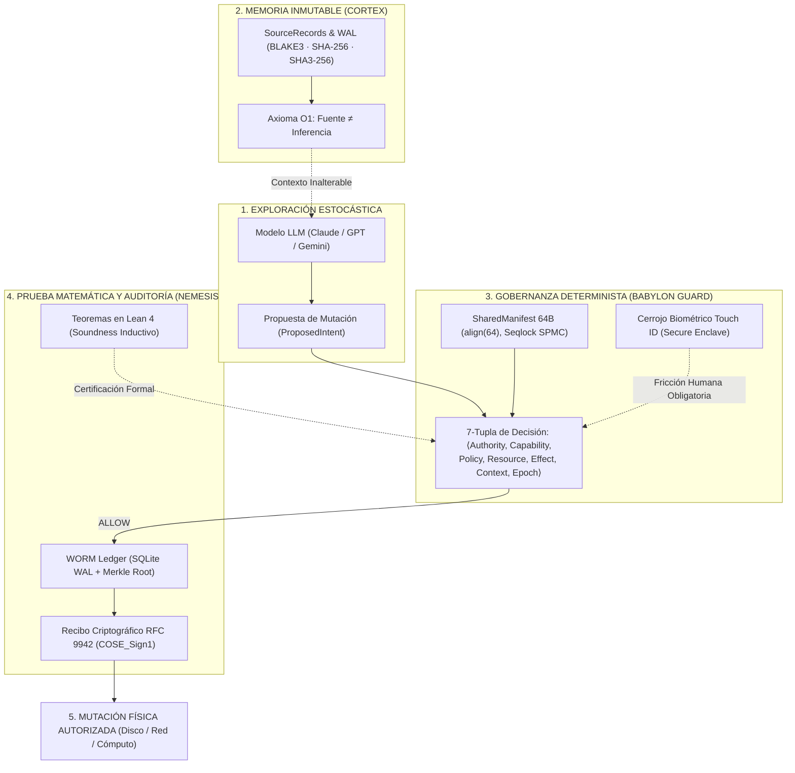

# WHY BABYLON-60: El Sustrato de Certeza en Silicio

> **«La inteligencia artificial no necesita mejores prompts para dejar de mentir; necesita que le quiten la autoridad física para hacerlo.»**  
> *Axioma AX-0: Ningún componente estocástico puede autorizar sus propios efectos secundarios irreversibles.*

---

## 1. El Abismo Epistémico: Por Qué los Wrappers Fracasan

La industria actual de la inteligencia artificial ha construido un gigante sobre pies de barro. El 99% de los frameworks que intentan gobernar agentes (LangChain, CrewAI, AutoGen, LlamaIndex) son **envoltorios superficiales (wrappers) de Python**. 

Su estrategia frente al error y la alucinación consiste en *"pedirle por favor"* al modelo que se porte bien mediante *prompt engineering*:
- Añaden instrucciones cada vez más largas ("sé objetivo", "no alucines", "sé seguro").
- Confían en que el modelo razone con fidelidad lógica absoluta.
- Ejecutan ciegamente en el sistema operativo cualquier herramienta o mutación que el modelo devuelva.

**El resultado es la catástrofe de fase:**
1. **Confabulación Estocástica:** Un LLM es un predictor de palabras de bucle abierto optimizado para verosimilitud estadística, no para verdad causal. Si no sabe algo, lo inventa.
2. **Amnesia Contextual:** A medida que la conversación avanza, la atención del modelo se degrada (*context drift*). Los hechos iniciales se diluyen o se contradicen.
3. **Inmunidad Cero:** Si un agente de IA alucina un comando destructivo (`rm -rf` o una transferencia de fondos no deseada), el wrapper lo despacha directamente al sistema.

---

## 2. La Arquitectura Causal de BABYLON-60

BABYLON-60 nace de **miles de horas de investigación y desarrollo bare-metal** para resolver este problema en el único lugar donde no se puede mentir: **el hardware y las matemáticas**. 

En lugar de confiar en el modelo, BABYLON-60 trata al LLM como **músculo de exploración no privilegiado**, subordinándolo a un **broker determinista de autorización y efectos en espacio de usuario**:



---

## 3. ¿Por Qué las Respuestas son Radicalmente Fiables y Certeras?

### I. Axioma O1: La Fuente Jamás es Modificada por la Inferencia (`Fuente ≠ Inferencia`)
En los sistemas comunes, el LLM resume un documento, guarda su resumen en una base de datos vectorial y, en la siguiente consulta, lee su propio resumen. El error se retroalimenta como un teléfono escacharrado hasta el colapso.  
En BABYLON-60, las tramas IPC, los árboles Merkle conformes y los registros atómicos de 154 bytes en `.effect_wal.bin` se sellan con **`BLAKE3`**, los testigos de inodos y pre-hashes del Secure Enclave con **`SHA-256`**, y los `SourceRecords` de compatibilidad L0 con **`SHA3-256`**. Toda deducción del modelo se etiqueta de forma fail-closed como `INFERENCE`. La inferencia jamás tiene permiso para sobreescribir la realidad territorial.

### II. Evaluación determinista de la 7-tupla de autorización
El modelo no puede tocar un archivo ni llamar a una API por sí mismo. Solo puede emitir un `ProposedIntent`.  
Ese intento es evaluado en silicio local por un árbitro estricto en Rust que verifica la 7-tupla canónica:
$$\mathcal{T}_{\text{auth}} = \langle \text{Authority}, \text{Capability}, \text{Policy}, \text{Resource}, \text{Effect}, \text{Context}, \text{Epoch} \rangle$$
Si el modelo carece de capability o viola la época temporal, la llamada se descarta al instante sin burocracia cognitiva (*Drop Silencioso*).

### III. Layout de 64 Bytes Alineado y Protocolo Seqlock SPMC (`L1_FORMAL`)
El estado de verdad del sistema reside en el `SharedManifest`: **exactamente 64 bytes con alineación estática `align(64)`** (`claim.inv_01_manifest_layout`).  
Mediante un protocolo Seqlock SPMC (*Single-Producer Multi-Consumer*) cuyo modelo de concurrencia está verificado acotadamente bajo el model checker `Loom` (`claim.inv_02_seqlock_concurrency`, `L1_FORMAL`), los lectores consultan el estado sin bloqueos ni lecturas desgarradas (*no torn reads*). Conforme a [`CLAIMS.toml`](./CLAIMS.toml), el tráfico físico de coherencia `RFO` y el consumo energético permanecen declarados como `NO_VERIFICADO` hasta medición hardware dedicada.

### IV. Cerrojo Biométrico en el Secure Enclave
Toda mutación irreversible o de alto impacto no depende de la voluntad del software: exige el contacto físico del operador en el sensor **Touch ID de Apple Silicon**, firmado mediante curvas elípticas NIST P-256 en el enclave de silicio (`allowableReuseDuration = 0`).

### V. Modelo Formal en Lean 4 y Delimitación de Contorno (`EL0` + `L3_ISOLATION`)
El modelo de transiciones de autorización de BABYLON-60 está formalizado en el asistente de pruebas interactivas **Lean 4** (`proof/lean/BabylonTrace.lean` y `proof/lean/AX0.lean`), demostrando inductivamente sobre el modelo de estados que ningún identificador de autorización consumido puede despacharse más de una vez (`countDispatches trace ≤ 1`).  
Para que esta propiedad del modelo se sostenga frente a procesos de agentes reales en espacio de usuario (`EL0`), el despliegue debe combinarse con el confinamiento de procesos del sistema operativo (`L3_ISOLATION`: perfiles `sandbox-exec` / Seatbelt y aislamiento de descriptores), impidiendo que el agente escriba directamente en disco sin pasar por el broker.

---

## 4. Matriz Comparativa: La Diferencia entre un Wrapper y un Broker de Efectos

| Dimensión Crítica | Frameworks Habituales (LangChain / CrewAI / etc.) | BABYLON-60 Trust Substrate |
| :--- | :--- | :--- |
| **Sustrato Tecnológico** | Python dinámico en el mismo espacio del agente | Broker Rust compilado (`EL0`) + C-ABI + Confinamiento OS (`L3`) |
| **Autoridad de Decisión** | El LLM ejecuta lo que decide su texto | **Axioma AX-0:** $\text{LLM} \neq \text{Authority}$. El modelo solo propone. |
| **Integridad de Memoria** | Texto volátil reinyectado en el prompt | WAL de 154B (`BLAKE3`), testigos `SHA-256` y SourceRecords `SHA3-256` |
| **Concurrencia en Memoria** | Mutexes lentos en Python con contención GIL | `SharedManifest` de 64B (`align(64)`) + modelo Seqlock SPMC verificado en Loom |
| **Respuesta ante Fallos** | Bloques `try/except` que ocultan la corrupción | **Fail-Stop Apoptosis:** `POISONED = 0xDEAD_6060` |
| **Verificación de Seguridad** | Benchmarks sintéticos sin modelo formal | **Modelo de estados verificado en Lean 4 + suites adversariales NEMESIS** |
| **Cumplimiento Legal** | Sin rastro forense estructurado | **Exportador de trazabilidad técnica para EU AI Act (Arts. 12, 14, 15)** |
| **Huella en el Cliente** | Dependencia de nubes de terceros para el control | **Local-First:** Mediación y persistencia ejecutadas localmente |

---

## 5. Evidencia Reproducible: Pruébalo Tú Mismo

No te fíes de este documento. Ejecuta los verificadores en tu propia máquina:

```bash
# 1. Ejecutar el verificador Zero-Trust de manifiesto, SBOMs y raíz Merkle (28 claims):
./verify.sh

# 2. Listar y auditar los 28 claims estratificados (L1_FORMAL a L4_EXPERIMENTAL):
python3 scripts/c5_quality_gates/verify_claims.py --list

# 3. Verificar las pruebas formales en Lean 4:
lean proof/lean/BabylonTrace.lean && lean proof/lean/AX0.lean

# 4. Comprobar el modelo de concurrencia Seqlock bajo Loom:
LOOM_MAX_PREEMPTIONS=2 RUSTFLAGS="--cfg loom" cargo test --test seqlock_loom --release
```

---
**Firmado y Atestado:**  
**Borja Fernández Angulo**  
*Investigador en Sistemas Complejos · Arquitecto Principal de BABYLON-60*
