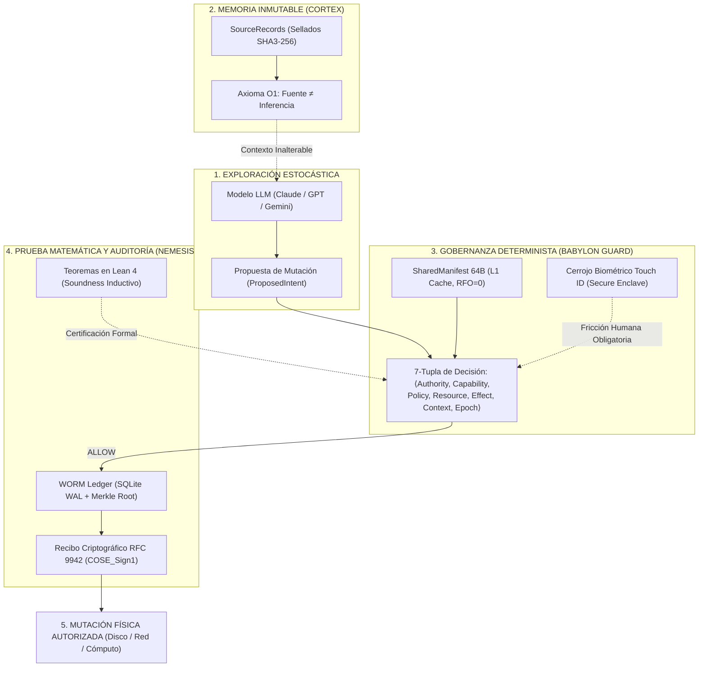

# WHY BABYLON-60: El Sustrato de Certeza en Silicio

> **«La inteligencia artificial no necesita mejores prompts para dejar de mentir; necesita que le quiten la autoridad física para hacerlo.»**  
> *Axioma AX-0: Ningún componente estocástico puede autorizar sus propios efectos secundarios irreversibles.*

---

## 1. El Abismo Epistémico: Por Qué los Wrappers Fracasan

La industria actual de la inteligencia artificial ha construido un gigante sobre pies de barro. El 99% de los frameworks que intentan gobernar agentes (LangChain, CrewAI, AutoGen, LlamaIndex) son **envoltorios superficiales (wrappers) de Python**. 

Su estrategia frente al error y la alucinación consiste en *"pedirle por favor"* al modelo que se porte bien mediante *prompt engineering*:
- Añaden instrucciones cada vez más largas ("sé objetivo", "no alucines", "sé seguro").
- Confían en que el modelo razone con fidelidad lógica absoluta.
- Ejecutan ciegamente en el sistema operativo cualquier herramienta o mutación que el modelo devuelva.

**El resultado es la catástrofe de fase:**
1. **Confabulación Estocástica:** Un LLM es un predictor de palabras de bucle abierto optimizado para verosimilitud estadística, no para verdad causal. Si no sabe algo, lo inventa.
2. **Amnesia Contextual:** A medida que la conversación avanza, la atención del modelo se degrada (*context drift*). Los hechos iniciales se diluyen o se contradicen.
3. **Inmunidad Cero:** Si un agente de IA alucina un comando destructivo (`rm -rf` o una transferencia de fondos no deseada), el wrapper lo despacha directamente al sistema.

---

## 2. La Arquitectura Causal de BABYLON-60

BABYLON-60 nace de **miles de horas de investigación y desarrollo bare-metal** para resolver este problema en el único lugar donde no se puede mentir: **el hardware y las matemáticas**. 

En lugar de confiar en el modelo, BABYLON-60 trata al LLM como **músculo de exploración no privilegiado**, subordinándolo a un **Kernel Determinista de Anillo-0**:



---

## 3. ¿Por Qué las Respuestas son Radicalmente Fiables y Certeras?

### I. Axioma O1: La Fuente Jamás es Modificada por la Inferencia (`Fuente ≠ Inferencia`)
En los sistemas comunes, el LLM resume un documento, guarda su resumen en una base de datos vectorial y, en la siguiente consulta, lee su propio resumen. El error se retroalimenta como un teléfono escacharrado hasta el colapso.  
En BABYLON-60, los datos primarios residen en **SourceRecords sellados criptográficamente (SHA3-256)**. Toda deducción del modelo se etiqueta de forma fail-closed como `INFERENCE`. La inferencia jamás tiene permiso para sobreescribir la realidad territorial.

### II. Arbitraje de la 7-Tupla en Anillo-0
El modelo no puede tocar un archivo ni llamar a una API por sí mismo. Solo puede emitir un `ProposedIntent`.  
Ese intento es evaluado en silicio local por un árbitro estricto en Rust que verifica la 7-tupla canónica:
$$\mathcal{T}_{\text{auth}} = \langle \text{Authority}, \text{Capability}, \text{Policy}, \text{Resource}, \text{Effect}, \text{Context}, \text{Epoch} \rangle$$
Si el modelo carece de capability o viola la época temporal, la llamada se descarta al instante sin burocracia cognitiva (*Drop Silencioso*).

### III. Concurrencia de Caché L1 sin Bloqueos ($RFO = 0$)
El estado de verdad del sistema reside en el `SharedManifest`: **exactamente 64 bytes alineados físicamente a una línea de caché L1**.  
Mediante un protocolo Seqlock SPMC (*Single-Producer Multi-Consumer*) verificado exhaustivamente bajo el model checker `Loom`, cientos de lectores concurrentes leen el estado del sistema sin bloqueos, sin *Request For Ownership* ($RFO=0$) y con latencia imperceptible.

### IV. Cerrojo Biométrico en el Secure Enclave
Toda mutación irreversible o de alto impacto no depende de la voluntad del software: exige el contacto físico del operador en el sensor **Touch ID de Apple Silicon**, firmado mediante curvas elípticas NIST P-256 en el enclave de silicio (`allowableReuseDuration = 0`).

### V. Teoremas Demostrados en Lean 4
La seguridad de BABYLON-60 no es una hipótesis empírica: está verificada matemáticamente en el asistente de pruebas interactivas **Lean 4** (`proof/lean/BabylonTrace.lean` y `proof/lean/AX0.lean`), demostrando formalmente que ninguna traza de ejecución arbitraria puede violar la invariante de autoridad única.

---

## 4. Matriz Comparativa: La Diferencia entre un Wrapper y un Kernel

| Dimensión Crítica | Frameworks Habituales (LangChain / CrewAI / etc.) | BABYLON-60 Trust Substrate |
| :--- | :--- | :--- |
| **Sustrato Tecnológico** | Python dinámico de alto nivel | Rust bare-metal compilado (`#![no_std]` capable) + C-ABI |
| **Autoridad de Decisión** | El LLM ejecuta lo que decide su texto | **Axioma AX-0:** $\text{LLM} \neq \text{Authority}$. El modelo solo propone. |
| **Integridad de Memoria** | Texto volátil reinyectado en el prompt | SourceRecords inmutables sellados con SHA3-256 (CORTEX) |
| **Concurrencia en Memoria** | Mutexes lentos en Python con contención GIL | `SharedManifest` de 64 bytes L1 Lock-Free ($RFO=0$) |
| **Respuesta ante Fallos** | Bloques `try/except` que ocultan la corrupción | **Fail-Stop Apoptosis:** `POISONED = 0xDEAD_6060` |
| **Verificación de Seguridad** | "Trust me bro" / Benchmarks sintéticos | **Teoremas matemáticos demostrados en Lean 4** |
| **Cumplimiento Legal** | Indefensión jurídica ante auditorías | **Informes de Evidencia Criptográfica para EU AI Act (Arts. 12, 14, 15)** |
| **Huella en el Cliente** | Servidores remotos pesados, dependencias en la nube | **Local-First puro:** Corre 100% en tu máquina |

---

## 5. Evidencia en Silicio: Pruébalo Tú Mismo

No te fíes de este documento. Ejecuta la evidencia en tu propio ordenador:

```bash
# 1. Comprobar la demostración interactiva de AX-0 en 2 segundos:
cargo run --bin tour

# 2. Auditar los 12 claims arquitectónicos en silicio:
python3 scripts/verify_claims.py

# 3. Verificar las pruebas formales en Lean 4:
lean proof/lean/BabylonTrace.lean && lean proof/lean/AX0.lean

# 4. Comprobar el modelo de concurrencia Seqlock sin colisiones:
LOOM_MAX_PREEMPTIONS=2 RUSTFLAGS="--cfg loom" cargo test --test seqlock_loom --release
```

---
**Firmado y Atestado:**  
**Borja Fernández Angulo**  
*Investigador en Sistemas Complejos · Arquitecto Principal de BABYLON-60*
