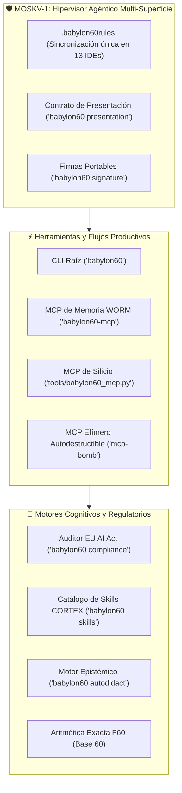

# Guía de Usuario de BABYLON-60
## Capacidades, Herramientas y Operativa Diaria más allá de la Seguridad

BABYLON-60 no es únicamente un broker de autorización y efectos en espacio de usuario. Es un entorno de infraestructura agéntica gobernado por **MOSKV-1**, diseñado para potenciar, auditar, sincronizar y expandir las capacidades de desarrollo con modelos de lenguaje de frontera en 13 entornos de trabajo.

Esta guía documenta todas las herramientas prácticas que BABYLON-60 aporta a tu flujo de trabajo diario.

---

## 1. Mapa de Capacidades del Sistema



---

## 2. Gobernanza Multi-Superficie (MOSKV-1)

### Cero Deriva entre IDEs y Terminales
Cuando alternas entre Cursor, Claude Code, Windsurf, VS Code, Codex, Cline o terminales de línea de comandos, los asistentes suelen perder alineamiento y operar con instrucciones contradictorias.

MOSKV-1 resuelve esto mediante una **raíz canónica única**:
- `.babylon60rules` es la fuente de verdad absoluta.
- `.cursorrules`, `.windsurfrules`, `.codexrules`, `CLAUDE.md`, `.clinerules`, `.roorules` y `.github/copilot-instructions.md` son symlinks directos a esta raíz.
- Cualquier actualización en las reglas del proyecto se propaga instantáneamente a todas las herramientas sin intervención manual.

### La Matriz de los 6 Dominios Canónicos
En cualquier consulta técnica o arquitectónica, puedes invocar los prismas de especialización integrados en MOSKV-1:
- ⚡ **El Ingeniero:** C-ABI bare-metal, latencia sub-microsegundo, concurrencia Lock-Free y optimización de caché L1.
- 🌡️ **El Físico:** Termodinámica de la información (cotas de Landauer y Bekenstein) y erradicación de anergía.
- 🩺 **El Médico:** Protección del wetware del operador: cadencia somática, detección de sobrecarga ejecutiva y prevención de burnout.
- 🎵 **El Músico:** Balance dinámico, ritmo temporal y resonancia armónica en el diseño de interfaces y secuencias.
- ⚖️ **El Abogado:** Auditoría formal y cumplimiento por diseño del Reglamento de IA de la UE (**EU AI Act**).
- 🏛️ **El Filósofo:** Epistemología popperiana radical: separación estricta entre mapa y territorio y falsación empírica en silicio.

---

## 3. Servidores MCP: Integración con tu Asistente

BABYLON-60 incluye dos servidores MCP independientes para complementar tu entorno:

### A. Servidor de Memoria WORM (`babylon60-mcp`)
Proporciona memoria estructurada a largo plazo respaldada por SQLite WAL y hashes criptográficos:
```bash
# Iniciar servidor stdio apuntando a un ledger persistente:
.venv/bin/babylon60-mcp --ledger ~/.babylon60/mi_proyecto.db
```
- **Ventaja práctica:** El modelo recuerda decisiones de diseño, contratos y decisiones previas sin sufrir *context drift* ni amnesia entre sesiones.

### B. Puente MCP del Kernel (`tools/babylon60_mcp.py`)
Permite a los asistentes inspeccionar y aplicar cambios con garantías atómicas:
- `kernel_source_read`: lectura segura de fuentes con verificación de digest BLAKE3.
- `kernel_patch_apply`: aplicación atómica de parches en archivo temporal con `fsync` y reemplazo transaccional.
- `kernel_tests_run`: ejecución aislada de tests de estrés y suites de verificación en silicio.

---

## 4. Herramientas Avanzadas de la CLI (`babylon60`)

La CLI principal (`babylon60`) unifica el acceso a todos los motores del sistema:

### 1. Auditoría y Cumplimiento EU AI Act (`babylon60 compliance`)
Genera informes oficiales de auditoría criptográfica alineados con el Reglamento (UE) 2024/1689:
```bash
# Generar reporte de cumplimiento para los Arts. 9, 12, 14 y 15:
babylon60 compliance --output reporte_cumplimiento.html
```
- **Resultado:** Informe técnico listo para auditoría legal con sellos de trazabilidad, cadena de custodia WORM y verificación de control humano.

### 2. Catálogo y Enrutador de Skills (`babylon60 skills`)
Permite listar y enrutar intenciones a la habilidad idónea dentro de la flota CORTEX:
```bash
# Ver estado del registro de skills:
babylon60 skills status

# Enrutar una tarea al especialista óptimo:
babylon60 skills route --query "auditar concurrencia en canal de memoria compartida"
```

### 3. Servidores Efímeros Autodestructibles (`babylon60 mcp-bomb`)
Permite sintetizar en caliente un servidor MCP puntual en Python, ejecutarlo en un subproceso aislado, registrar el recibo inmutable y autodestruirlo físicamente tras su uso:
```bash
babylon60 mcp-bomb \
  --domain "CalculoPrimos" \
  --code "def run(n): return [x for x in range(2, n) if all(x % d != 0 for d in range(2, int(x**0.5)+1))]" \
  --args '{"n": 50}'
```
- **Ventaja práctica:** Cero residuos de scripts temporales en disco y certificación criptográfica de la ejecución en el ledger.

### 4. Motor Epistémico AUTODIDACT-Ω (`babylon60 autodidact`)
Permite orquestar investigaciones profundas, destilar papers científicos y estructurar conocimiento formal:
```bash
babylon60 autodidact status
```

### 5. Aritmética y Sincronización Temporal F60
El sistema integra tipos exactos sexagesimales (`F60`) para evitar pérdidas de precisión por redondeo IEEE-754:
- Ideal para planificadores de tareas recurrentes, cadencias de agentes en enjambre y sincronización de eventos de audio/tiempo real.

---

## 5. Firma Portable y Contrato de Presentación

### Generación de Firmas para Reportes
Puedes generar firmas de trazabilidad formal para cualquier salida de análisis:
```bash
# Exportar firma en formato HTML autónomo (sin dependencias externas):
babylon60 signature --input metadatos.json --format html --output firma.html

# Mostrar en texto plano:
babylon60 signature --input metadatos.json --format text
```

### Consulta del Contrato de Presentación
Para consultar las directrices de comunicación clara y colapso de jerga:
```bash
babylon60 presentation
```

---

## 6. Primeros Pasos Recomendados

1. **Inspeccionar el estado general:**
   ```bash
   babylon60 status
   ```
2. **Revisar las herramientas MCP activas:**
   ```bash
   babylon60 tools --server all
   ```
3. **Explorar las habilidades disponibles:**
   ```bash
   babylon60 skills list --scope workspace
   ```
4. **Conectar tu IDE:** Añade el servidor MCP a la configuración de tu editor preferido siguiendo la [Guía del Puente MCP del Kernel](guide_kernel_mcp.md).
