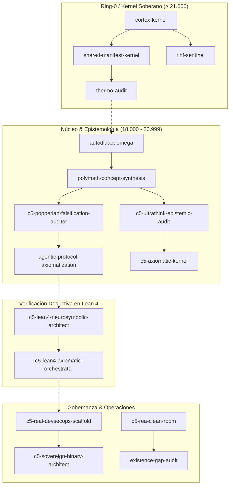

# MOSKV-1 — TAXONOMÍA ARSENAL DE SKILLS POR EXERGÍA (v26.200)

<div align="center">

[](https://github.com/borjamoskv/BABYLON-60)
[](https://github.com/borjamoskv/BABYLON-60)

</div>

> **Las arquitecturas se definen por el estado que preservan.**  
> Los skills se definen por la exergía que producen.

```yaml
Fecha: 2026-11-17T18:45:00+01:00
Operador: borjamoskv
Total_Entradas_Catalogo_Global: 77
Entradas_Distribucion_Workspace: 22
Media_Tier_Catalogo_Global: 20000.39
Media_Tier_Distribucion_Workspace: 20009.09
Clasificacion: Niveles de Exergía Termodinámica (S → D)
Estado_Colisiones: requiere evidencia de la suite de convergencia
Regla_Linguistica: Soberanía Lingüística Total (C5-REAL en Español / GitHub Estrictamente en Inglés)
```

---

El [catálogo global](../skills.json) registra capacidades; el [catálogo workspace](../../.agents/skills/skills.json) describe las entradas distribuidas en el proyecto. El [lockfile](../../skills-lock.json) distingue `workspace_disk` de `catalog_synthetic`. Los registros sintéticos no prueban la disponibilidad física en este checkout. Los tiers son índices internos de clasificación, no mediciones físicas ni garantías. La selección no autoriza la ejecución. La convergencia entre distribuciones requiere la ejecución de la suite correspondiente en la fuente canónica; una proyección pública no acredita recursos omitidos.

## 1. Topología Funtorial y Grafos de Adyacencia (MASS Stage 2)



---

## 2. Invariante de Frontera Lingüística (Soberanía C5-REAL vs. Ecosistema GitHub)

El arsenal de skills opera bajo una demarcación ontológica estricta de dos canales lingüísticos:

1. **Soberanía Lingüística Total (Territorio C5-REAL — Español):**
   - Todo el razonamiento ontológico, epistemología polímata, fundamentación matemática en Lean 4, medicina, física teórica, arquitectura de software interna y guías de gobernanza residen en español técnico soberano de alta densidad exérgica.
   - Las descripciones, metadatos y árboles de inferencia del clúster de skills garantizan cero dependencia colonial lingüística interna.

2. **Invariante Canónica de Superficie Pública (GitHub — Strict English Invariant):**
   - **GitHub siempre en inglés**: Toda superficie expuesta al ecosistema internacional de código abierto (repositorios públicos de GitHub, READMEs de cara al exterior, mensajes de commit en repositorios abiertos, issues, pull requests y especificaciones de pipelines de CI/CD) DEBE redactarse y ejecutarse **estrictamente en inglés**.
   - Esta separación previene la fricción comunicativa en la red global de colaboradores y herramientas externas sin adulterar la soberanía del núcleo interior.

---

## NIVEL S — KERNEL SOBERANO Y META-KERNEL (TIER S, ≥ 21.000)

> Skills que mutan directamente el estado determinista causal, hacen cumplir invariantes BFT o blindan el núcleo de hardware y silicio.

| # | Skill | Categoría | Exergía ($\Xi$) | Ámbito de Acción |
|:--|:------|:----------|:---------------:|:-----------------|
| 1 | `cortex-kernel` | Kernel | `23000` | C5-REAL Standard |
| 2 | `c5-kudurru-64` | Kernel | `22500` | C5-REAL Standard |
| 3 | `shared-manifest-kernel` | Kernel | `22000` | C5-REAL Standard |
| 4 | `c5-mushushu-0` | Kernel | `22000` | C5-REAL Standard |
| 5 | `c5-larsa-120` | Kernel | `21800` | C5-REAL Standard |
| 6 | `babylon60-kernel-invariants` | Kernel | `21600` | C5-REAL Standard |
| 7 | `cortex-skill-composer` | Meta-Kernel | `21500` | C5-REAL Standard |
| 8 | `thermo-audit` | Kernel | `21500` | C5-REAL Standard |
| 9 | `c5-ring0-babylon-kernel` | Kernel | `21500` | C5-REAL Standard |
| 10 | `c5-ring0-babylon-kernel-project` | Kernel | `21500` | C5-REAL Standard |
| 11 | `c5-thermos-audit` | Kernel | `21400` | C5-REAL Standard |
| 12 | `c5-enki-60` | Nucleus | `21400` | C5-REAL Standard |
| 13 | `c5-rea-clean-room` | Kernel | `21300` | C5-REAL Standard |
| 14 | `cortex-skill-auditor` | Meta-Kernel | `21200` | C5-REAL Standard |
| 15 | `c5-autonomous-agent-primitives` | Meta-Kernel | `21200` | C5-REAL Standard |
| 16 | `rlhf-sentinel` | Governance | `21200` | C5-REAL Standard |
| 17 | `c5-information-thermodynamics` | Nucleus | `21200` | C5-REAL Standard |
| 18 | `cortex-skill-genesis` | Meta-Kernel | `21000` | C5-REAL Standard |
| 19 | `c5-lean4-neurosymbolic-architect` | Nucleus | `21000` | C5-REAL Standard |
| 20 | `c5-lexicon-enforcer` | Nucleus | `21000` | C5-REAL Standard |
| 21 | `autodidact-omega` | Nucleus | `21000` | C5-REAL Standard |

---

## NIVEL A — ARMAMENTO OPERATIVO Y NÚCLEO DE INFERENCIA (TIER A, 18.000 — 20.999)

> Habilidades de alta densidad ontológica: investigación profunda, oráculos Popperianos, ingeniería inversa y gobernanza DevSecOps.

| # | Skill | Categoría | Exergía ($\Xi$) | Ámbito de Acción |
|:--|:------|:----------|:---------------:|:-----------------|
| 1 | `epistemic-extinction-protocol` | Nucleus | `20980` | C5-REAL Standard |
| 2 | `cta-cognitive-transition-algebra` | Nucleus | `20950` | C5-REAL Standard |
| 3 | `c5-lean4-axiomatic-orchestrator` | Nucleus | `20900` | C5-REAL Standard |
| 4 | `c5-plan-omega` | Nucleus | `20900` | C5-REAL Standard |
| 5 | `c5-sovereign-system1-engine` | Nucleus | `20850` | C5-REAL Standard |
| 6 | `c5-sovereign-inference-runtime` | Systems | `20850` | C5-REAL Standard |
| 7 | `c5-silicon-stress-suite` | Operations | `20850` | C5-REAL Standard |
| 8 | `c5-debloat-agent-kernel` | Nucleus | `20800` | C5-REAL Standard |
| 9 | `categorical-hallucination-audit` | Nucleus | `20700` | C5-REAL Standard |
| 10 | `c5-adaptive-annealing-engine` | Nucleus | `20650` | C5-REAL Standard |
| 11 | `existence-gap-audit` | Nucleus | `20600` | C5-REAL Standard |
| 12 | `c5-sharur-3600` | Governance | `20600` | C5-REAL Standard |
| 13 | `c5-epistemic-thermodynamics` | Nucleus | `20600` | C5-REAL Standard |
| 14 | `c5-epistemic-thermodynamics-project` | Nucleus | `20600` | C5-REAL Standard |
| 15 | `c5-academic-peer-reviewer` | Nucleus | `20500` | C5-REAL Standard |
| 16 | `c5-axiomatic-kernel` | Nucleus | `20500` | C5-REAL Standard |
| 17 | `c5-dialectical-pipeline` | Nucleus | `20500` | C5-REAL Standard |
| 18 | `polymath-concept-synthesis` | Nucleus | `20500` | C5-REAL Standard |
| 19 | `c5-popperian-falsification-auditor` | Nucleus | `20500` | C5-REAL Standard |
| 20 | `goal` | Governance | `20500` | C5-REAL Standard |
| 21 | `c5-tri-provider-swarm` | Governance | `20400` | C5-REAL Standard |
| 22 | `c5-ultrathink-epistemic-audit` | Nucleus | `20400` | C5-REAL Standard |
| 23 | `c5-cortex-swarm-orchestrator` | Governance | `20400` | C5-REAL Standard |
| 24 | `c5-cortex-swarm-orchestrator-project` | Governance | `20400` | C5-REAL Standard |
| 25 | `cct-cognitive-theory-advisor` | Nucleus | `20300` | C5-REAL Standard |
| 26 | `c5-session-deskimming` | Governance | `20250` | C5-REAL Standard |
| 27 | `cloud-chamber` | Nucleus | `20200` | C5-REAL Standard |
| 28 | `c5-metodo-acreativo` | Nucleus | `20050` | C5-REAL Standard |
| 29 | `grill-me-v2` | Governance | `19900` | C5-REAL Standard |
| 30 | `apple-bypass` | Operations | `19800` | C5-REAL Standard |
| 31 | `wait-what` | Nucleus | `19600` | C5-REAL Standard |
| 32 | `c5-html-report-injection-audit` | Governance | `19600` | C5-REAL Standard |
| 33 | `c5-sovereign-binary-architect` | Systems | `19500` | C5-REAL Standard |
| 34 | `symbiotic-cognitive-architecture` | Governance | `19400` | C5-REAL Standard |
| 35 | `c5-terminological-archaeology` | Nucleus | `19400` | C5-REAL Standard |
| 36 | `c5-sovereign-daemon-deployment` | Operations | `19350` | C5-REAL Standard |
| 37 | `anergy-purge-protocol` | Governance | `19300` | C5-REAL Standard |
| 38 | `swarm-quantum-collapse` | Governance | `19100` | C5-REAL Standard |
| 39 | `babylon60-architecture` | Governance | `19000` | C5-REAL Standard |
| 40 | `c5-alpha-extraction-pipeline` | Operations | `18950` | C5-REAL Standard |
| 41 | `c5-anti-slop-ui` | Governance | `18800` | C5-REAL Standard |
| 42 | `dynamic-subagent-lifecycle` | Governance | `18600` | C5-REAL Standard |
| 43 | `babylon-shield` | Specialized | `18500` | C5-REAL Standard |
| 44 | `c5-ctm-formal-architect` | Specialized | `18500` | C5-REAL Standard |
| 45 | `c5-exergy-scale-evaluator` | Specialized | `18500` | C5-REAL Standard |
| 46 | `c5-gemini-api-2026-standards` | Specialized | `18500` | C5-REAL Standard |
| 47 | `c5-ontological-translator` | Specialized | `18500` | C5-REAL Standard |
| 48 | `c5-systemic-dissection-protocol` | Specialized | `18500` | C5-REAL Standard |
| 49 | `lora-swarm-pipeline` | Operations | `18200` | C5-REAL Standard |
| 50 | `swarm-router` | Governance | `18100` | C5-REAL Standard |

---

## NIVEL B — OPERACIONES DE DOMINIO E INGENIERÍA DE SISTEMAS (TIER B, 15.000 — 17.999)

> Auditoría Popperiana, telemetría de sesiones, compilación para agentes y estampado L5.

| # | Skill | Categoría | Exergía ($\Xi$) | Ámbito de Acción |
|:--|:------|:----------|:---------------:|:-----------------|
| 1 | `discourse-popperian-falsification` | Operations | `17900` | C5-REAL Standard |
| 2 | `cortex-telemetry` | Operations | `17500` | C5-REAL Standard |
| 3 | `wizard` | Utilities | `17000` | C5-REAL Standard |
| 4 | `writing-for-agents` | Utilities | `16500` | C5-REAL Standard |
| 5 | `opentimestamps-l5-diagnostics` | Diagnostics | `15000` | C5-REAL Standard |

---

## NIVEL D — UTILIDADES Y TRANSDUCTORES DE PROTOCOLO (TIER D, < 12.000)

> Utilidades de handoff inter-sesión y preservación de contexto.

| # | Skill | Categoría | Exergía ($\Xi$) | Ámbito de Acción |
| 1 | `handoff` | Utilities | `10500` | C5-REAL Standard |

---
