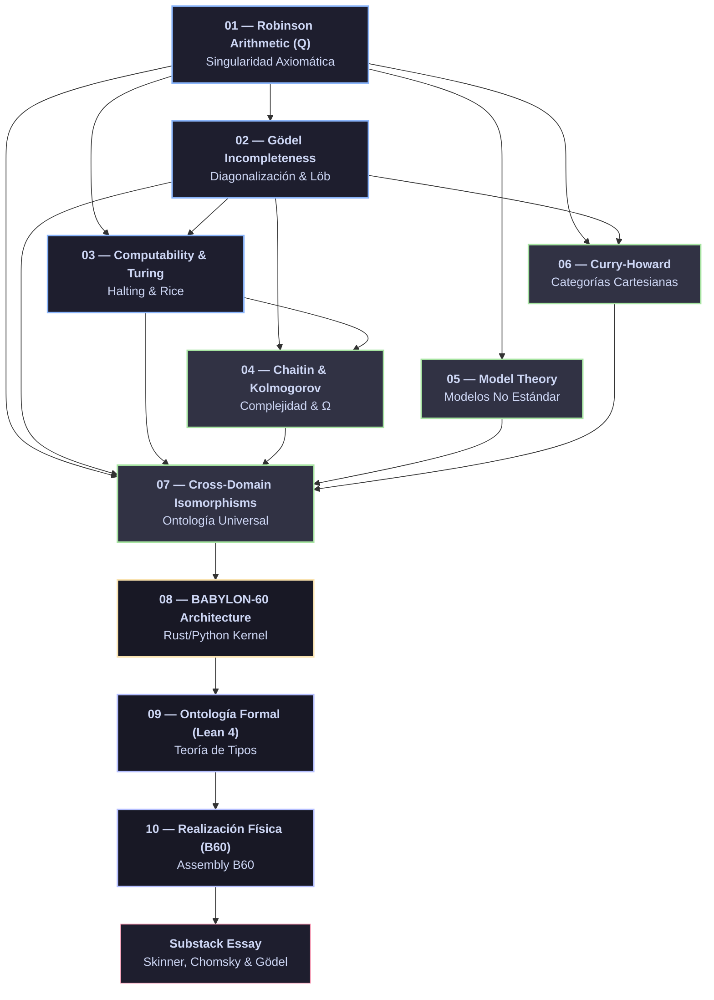

# 🧬 🏛️ Fundamentos Teóricos de BABYLON-60

<div align="center">

[](https://github.com/borjamoskv/BABYLON-60)
[](https://github.com/borjamoskv/BABYLON-60)

</div>

> **Metamatemática, Teoría de la Información y Arquitectura de Verificación**

> [!NOTE]
> *"The Arithmetic of Robinson is the ignition point — the mathematical singularity — where the interaction between addition and multiplication under first-order quantification simultaneously generates self-reference, undecidability, informational horizons, uninhabitable types, logical maximality, referential underdetermination, computational inaccessibility of models, and the impossibility of self-verification."*

---

## 1. 📌 Executive Summary

This documentation suite establishes the **metamathematical, information-theoretic, and proof-theoretic foundations** underlying the BABYLON-60 ecosystem. Each module provides rigorous mathematical proofs, formal domain sorts, and direct architectural mapping to the system's operational invariants (`[OBSOLETO: INV_BFT_04]`, `[OBSOLETO: INV_C5_15]`, `[OBSOLETO: INV_C5_17]`, `[OBSOLETO: INV_C5_18]`, `[OBSOLETO: INV_C5_28]`, `[OBSOLETO: GELABP_DEPTH_INVARIANT]`).

---

## 2. 📌 🗺️ Reading & Dependency Graph



---

## 3. 📌 📚 Master Index of Theory Modules

| # | Module Document | Core Metamathematical Topic | System Mapping | Invariant Link |
| :---: | :--- | :--- | :--- | :--- |
| **01** | [Aritmética de Robinson](./01_robinson_arithmetic.md) | Sistema Axiomático $Q$, $\Sigma_1$-completitud, indecidibilidad mínima | Core de ejecución `b60_kernel` | Indecidibilidad Esencial |
| **02** | [Incompletitud de Gödel](./02_goedel_incompleteness.md) | Gödelización, Lema de Diagonalización, Teoremas 1º/2º, Teorema de Löb | Auto-falsación y `CRITICAL_HALT` | Diagonalización |
| **03** | [Computabilidad y Turing](./03_computability_turing.md) | Máquinas de Turing Universales, Problema de la Parada, Teorema de Rice | Harness de pruebas y verificación estática | `[OBSOLETO: GELABP_DEPTH_INVARIANT]` |
| **04** | [Chaitin y Kolmogorov](./04_chaitin_kolmogorov.md) | Complejidad de Kolmogorov $K(x)$, Constante $\Omega$ de Chaitin | Escalado entero Base-60 | Principio de Cero-Anergia |
| **05** | [Teoría de Modelos](./05_model_theory.md) | Compacidad, Löwenheim-Skolem, Teorema de Lindström, Modelos No Estándar | Aislamiento de ejecución de agentes | `[OBSOLETO: INV_C5_18]` |
| **06** | [Correspondencia Curry-Howard](./06_curry_howard.md) | Proposiciones-como-Tipos, Pruebas-como-Programas, Categorías Cartesianas | Exportación backend Lean 4 | `01_spec/spec_proof_ir.md` |
| **07** | [Isomorfismos Cross-Domain](./07_cross_domain.md) | Mapeos estructurales isomorfos (Lingüística, Física, IA, Teoría de Pruebas) | Ontología Universal del Sistema | `[OBSOLETO: INV_C5_28]` (1-WL) |
| **08** | [Arquitectura BABYLON-60](./08_babylon60_architecture.md) | Matriz de mapeo metamatemático-a-código | Rust/Python Kernel | `01_spec/spec_technical.md` |
| **09** | [Ontología Formal (Lean 4)](./09_formal_ontology_lean.md) | Semántica de pequeños pasos, Teoría de Tipos Constructiva en práctica | `proof/lean/Babylon.lean` | `[OBSOLETO: INV_BFT_04]` |
| **10** | [Realización Física (B60)](./10_physical_realization.md) | B60 Assembly, completitud de Turing, fuzzing, determinismo de grafos | `fibonacci.b60`, `fuzz_b60.py` | `[OBSOLETO: INV_BFT_04]` |
| **11** | [Monitor Armónico Tonnetz](./axiom_tonnetz_oversight.md) | Sonificación de Entropía, Toro de Tonnetz, EU AI Act | Audio Engine Bi-Modal | `Art. 14 EU AI Act` |
| **12** | [Motor de Aeones Conformes (Penrose-Landauer)](./axiom_cyclic_conformal_aeon.md) | Cosmología CCC, Suelo de Landauer, Ciclo de Fase Omega | Kernel Ring-0 / SharedManifest | `INV_C5_AEON / INV-3` |
| **13** | [Continuidad sin Obediencia](./CONTINUIDAD_SIN_OBEDIENCIA_TEORIA_ARQUITECTONICA.md) | No-herencia de autoridad, $X \rightsquigarrow Y \not\equiv X \Rightarrow Y$, cadena heptádica y $Effect \neq Outcome$ | Desacoplamiento CORTEX / BABYLON / NEMESIS | Axioma Matriz de No-Herencia |
| **14** | [Desintegración Bayesiana y No-Alucinación](./axiom_bayesian_disintegration.md) | Categorías de Markov, desintegración regular y cota de confabulación | Cortafuegos Epistémico MUSHUSHU-0 | `INV_C5_FLASH_DEFENSE` |
| **15** | [Sharur Parallel Workspace Swarm](./axiom_sharur_swarm.md) | Concurrencia estocástica y colapso isostático en espacios de trabajo | Orquestador SHARUR-3600 / EDIN-100 | `INV_C5_18` |
| **16** | [Transducción Bio-Silicio y Ontología Tumoral](./axiom_oncology_protocol.md) | Mapeo de vías de señalización celular y paisajes de Waddington a DAGs | Transductor `cortex-onco` | `02_ontology/axiom_oncologia_300_primitivas.md` |
| **17** | [Proof-Carrying Execution](./BABYLON60_PROOF_CARRYING_EXECUTION.md) | Semántica de ejecución acoplada a certificados de prueba verificables | Verificador PCC en Anillo-0 | `01_spec/spec_proof_ir.md` |
| **18** | [Tétrada Causal C5-REAL](./TETRADA_CAUSAL_BABYLON60.md) | Cuatro causas estructurales aplicadas a la arquitectura determinista | Gobernanza Triádica (CORTEX/BABYLON/NEMESIS) | `02_ontology/babylon_ontology_v1.md` |
| **19** | [Topología Maestra C5-REAL](./TOPOLOGIA_MAESTRA.md) | Geometría global de subsistemas, anillos de privilegio y flujos IPC | Mapa Maestro de Arquitectura | `01_spec/spec_architecture.md` |
| **20** | [Vector A — Master Ledger & ATMS Design](./VECTOR_A_MASTER_LEDGER_DESIGN.md) | Cadena hash BLAKE3 `CORTEX-TAINT` y mantenimiento de verdad (ATMS) | `ledger.rs` / SQLite WAL Append-Only | `O1 / O7 / O12` |
| **21** | [MOSKV-1 APEX Blueprint](./MOSKV_1_APEX_BLUEPRINT.md) | Manifiesto de consolidación arquitectónica y linaje `CORTEX-OMEGA` | Shell Soberano MOSKV-1 | `CORTEX-TAINT` |
| **22** | [Compendio de Invariantes Termodinámicas](./c5_thermodynamic_invariants_compendium.md) | Capas de exergía, límite de Landauer y cotas de disipación | Evaluador Exergético 21k | `01_spec/spec_exergy_ontology.md` |
| **23** | [Dictamen de Auditoría Axiomática 2026](./AUDIT_AXIOMS_2026.md) | Verificación formal de completitud y consistencia de axiomas C5-REAL | Suite de Auditoría Epistémica | `AXIOMATIZATION_C5_REAL.md` |
| **24** | [Veredicto C5-REAL: Colapso C4-SIM](./AUDIT_VERDICT_C5_REAL.md) | Falsación empírica de simulaciones decorativas y ghost tests | Purga de Anergía y Sustrato Real | `Ley O6 / O8` |
| **25** | [Status Theory — Single Source of Truth](./STATUS_THEORY.md) | Registro histórico de resolución de forks, llaves y estado de compilación | Ledger de Estado Teórico | `STATUS.md` |
| **AX** | [Base Axiomática C5-REAL](./AXIOMATIZATION_C5_REAL.md) | Axiomas A1–A4 (Categorías de Markov, Inversión Bayesiana, No-Alucinación) | Motor de Verificación Axiomática | `[OBSOLETO: INV_C5_REAL_A4]` |

---

## 4. 📌 🧠 Universal Central Thesis

> [!IMPORTANT]
> **Tesis Central de Cómputo e Incompletitud:**
> Every finite cognitive or computational system (formal theory, neural model, biological brain, verification kernel) acts as an information compressor. The Kolmogorov complexity of its axioms $K(\text{Axioms})$ sets an absolute informational horizon $c_T$. Beyond that horizon, infinite mathematical truths exist that the system cannot prove — not due to engineering flaws, but because those truths contain more irreducible information than the system itself.

---

## 5. 📌 ⚖️ License & Sovereignty

> [!TIP]
> All theory modules in this suite are published under **`[OBSOLETO: INV_C5_17]`** (Sovereign Dual-Licensing Invariant): 100% free, open-source, and sovereign for individuals, independent developers, and non-commercial usage.

## 🔬 Verificación Formal (Lean 4)

> [!TIP]
> **Puente Isomorfo C5-REAL**
> Firma topológica extraída dinámicamente para demostración formal en Lean 4.

```lean
namespace Babylon60.Theory.00Index

/--
  Firma formal generada bajo C5-REAL Formal Verification.
-/
variable {C : Type} -- Categoría Base C
variable (is_epistemically_valid : C → Prop)

/-- Axioma de Validez Epistémica -/
axiom document_epistemic_validity (c : C) :
  is_epistemically_valid c

end Babylon60.Theory.00Index
```