# Teoría Arquitectónica de la Continuidad sin Obediencia: Fundamentos de la No-Herencia de Autoridad en Sistemas Agénticos

**Por Borja Fernández Angulo**  
*Investigador en Sistemas Complejos*

---

Revisión científica: 2026-10-24. **Propuesta normativa, no prueba de seguridad implementada.** Las separaciones siguientes son requisitos de diseño y distinciones conceptuales. No constituyen una ley física, ni categorías matemáticas completamente definidas, ni una garantía de confinamiento. [Hallazgos y alcance](AUDIT_SCIENTIFIC_STATUS_2026.md).

## Resumen Ejecutivo

Esta propuesta distingue información, creencia, intención, propuesta, autoridad, efecto y resultado. Su objetivo es impedir que recuperar o generar texto conceda permisos por sí mismo. Es compatible con entrenamiento y validación de modelos; no demuestra que esos enfoques sean inútiles ni que una barrera externa sea infalible.

La frase «Information shall propagate without authority propagating» expresa una política elegida. Para verificarla se necesitan fronteras, reglas de transición, modelo de amenazas y evidencia de implementación. La cadena heptádica es una taxonomía propuesta, no una ley de conservación física ni un teorema de independencia entre variables.

---

## 1. El Núcleo Fuerte: Continuidad sin Obediencia

Un agente autónomo en el mundo real se enfrenta a dos tentaciones arquitectónicas destructivas:
1. **La Amnesia Reaccionaria:** Reiniciar el estado epistémico en cada paso para evitar la contaminación por datos históricos, destruyendo la continuidad temporal.
2. **La Obediencia Ciega:** Permitir que el registro histórico determine las creencias presentes, o que las inferencias estocásticas desencadenen directamente efectos físicos en el entorno.

La resolución de esta paradoja reside en la coexistencia estricta de **continuidad temporal** y **ausencia total de obediencia automática**:

$$\boxed{\text{Continuity without obedience}}$$

Esta invariante se manifiesta en dos analogías de diseño, sin isomorfismo matemático demostrado:

$$\begin{aligned}
\text{CORTEX (Hacia el Pasado):} & \quad \mathbf{\text{Past} \not\Rightarrow \text{Belief}} \\
\text{BABYLON (Hacia el Futuro):} & \quad \mathbf{\text{Thought} \not\Rightarrow \text{Action}}
\end{aligned}$$

* **$\text{Past} \not\Rightarrow \text{Belief}$:** El pasado proporciona evidencia auditable, no dogma operativo. Que un dato resida en la memoria WORM demuestra que fue registrado, no que sea verdad ontológica ni que deba ser aceptado acríticamente por el estado cognitivo actual.
* **$\text{Thought} \not\Rightarrow \text{Action}$:** El pensamiento probabilístico genera hipótesis candidatas, no comandos de ejecución. Que un LLM genere un *payload* de mutación no le confiere el menor derecho a tocar el bus de hardware, el disco o la red.

---

## 2. El Principio General: Condicionamiento Informacional vs. Determinación Operacional

Formalizamos la relación entre estados del sistema distinguiendo dos relaciones conceptuales; no se han definido una categoría ni leyes de composición:

$$\boxed{X \rightsquigarrow Y \;\not\equiv\; X \Rightarrow Y}$$

Donde:
* **$\rightsquigarrow$ (Morfismo de Información / Condicionamiento):** $X$ aporta contexto semántico, antecedentes observables o estructura de entrada para la evaluación de $Y$. Relación de aporte de contexto. Su seguridad y coste requieren análisis independiente.
* **$\Rightarrow$ (Morfismo de Determinación / Coacción Operacional):** $X$ fuerza o causa deterministamente la transición de estado a $Y$. Operación de autoridad que muta los límites o recursos físicos del sustrato.

Bajo este principio, la arquitectura correcta de un agente establece flujos de información legítimos:

$$\begin{aligned}
\text{Memory} & \rightsquigarrow \text{Belief} && \text{(La memoria informa la creencia, pero no la dicta)} \\
\text{Retrieval} & \rightsquigarrow \text{Context} && \text{(La recuperación aporta contexto, no inyección ciega)} \\
\text{Thought} & \rightsquigarrow \text{Proposal} && \text{(La cognición elabora una propuesta, no un comando)} \\
\text{Proposal} & \rightsquigarrow \text{Authorization} && \text{(La propuesta solicita arbitraje, no auto-concesión)} \\
\text{Authorization} & \rightsquigarrow \text{Effect} && \text{(La autorización habilita el despacho, no garantiza el fin)}
\end{aligned}$$

Y prohíbe categóricamente los colapsos de autoridad:

$$\begin{aligned}
\text{Memory} & \not\Rightarrow \text{Belief} && \text{[Veto al Sesgo de Inercia Histórica]} \\
\text{Retrieval} & \not\Rightarrow \text{Injection} && \text{[Veto a la Inyección de Contexto Sin Sanitizar]} \\
\text{Thought} & \not\Rightarrow \text{Proposal} && \text{[Veto a la Propuesta Implícita / Involuntaria]} \\
\text{Proposal} & \not\Rightarrow \text{Authority} && \text{[Veto a la Auto-Elevación de Privilegios]} \\
\text{Authority} & \not\Rightarrow \text{Effect} && \text{[Veto al Despacho sin Validación de Barrera Fail-Closed]}
\end{aligned}$$

### Métrica de Desacoplamiento Arquitectónico

La expresión histórica $D(X,Y)=1-P(Y\mid X)$ se retira como garantía de aislamiento. Sin eventos y distribución no define una medición, y baja frecuencia observada de Y tras X no demuestra ausencia de autoridad ni causalidad. La seguridad se formularía como una propiedad de transiciones: todo efecto protegido requiere una autorización válida ligada a ese efecto. Esta es una obligación que necesita pruebas y cobertura; un muestreo de ejecuciones no la demuestra universalmente.

---

## 3. La Ley Unificada de CORTEX y BABYLON

CORTEX y BABYLON no son subsistemas aislados ni productos de conveniencia comercial. Son las dos mitades que proyectan un principio normativo común:

$$\boxed{\text{Information shall propagate without authority propagating}}$$

```text
                        ┌──────────────────────────────────────────────┐
                        │              LA LEY UNIFICADA                │
                        │ Information shall propagate without authority  │
                        └──────────────────────┬───────────────────────┘
                                               │
                       ┌───────────────────────┴───────────────────────┐
                       ▼                                               ▼
           ┌───────────────────────┐                       ┌───────────────────────┐
           │        CORTEX         │                       │        BABYLON        │
           │  (Retrospección WORM) │                       │  (Control Fail-Closed)│
           └───────────┬───────────┘                       └───────────┬───────────┘
                       │                                               │
         Historical Information                          Cognitive Information
                       │                                               │
                       ▼                                               ▼
                Present Context                                Candidate Action
                       │                                               │
                       │ (Veto CORTEX)                                 │ (Veto BABYLON)
                       x                                               x
                       │                                               │
               Historical Authority                            Cognitive Authority
                       │                                               │
                       ▼                                               ▼
                Present Belief                                  Physical Effect
```

1. **CORTEX (El Cortafuegos del Pasado):**  
   Permite la propagación de *información histórica* hacia el *contexto presente*, pero intercepta y anula la propagación de *autoridad histórica* hacia la *creencia presente*. La memoria es un registro cuya integridad y veracidad deben evaluarse por separado.
2. **BABYLON (El Cortafuegos del Futuro):**  
   Permite la propagación de *información cognitiva* (planes, sintaxis, código inferido) hacia la *acción candidata*, pero intercepta y anula la propagación de *autoridad cognitiva* hacia el *efecto físico*. El modelo es un motor de propuestas, jamás un ejecutor soberano.

---

## 4. El Séptimo Desacoplamiento: $\text{Effect} \neq \text{Outcome}$

La mayoría de los sistemas agénticos colapsan en el último tramo causal al confundir la ejecución técnica de una herramienta con la resolución real de la tarea:
* Invocación de `fs::remove_file("tmp.db")` ejecutada con éxito $\neq$ Alivio de presión de disco consolidado.
* Respuesta `HTTP 200 OK` en pasarela de pagos $\neq$ Liquidación transaccional acreditada.
* Despliegue en cluster con código de retorno $0$ $\neq$ Servicio respondiendo nominalmente bajo carga.
* Retorno de herramienta (*Tool Output*) $\neq$ Satisfacción de la especificación humana.

Esto impone el **Séptimo Desacoplamiento Cardinal**:

$$\boxed{\text{Effect} \neq \text{Outcome}} \quad (\text{Effect} \neq \text{Success})$$

Para que un efecto sea declarado legítimo en el registro epistémico, se exige una verificación bi-fásica:

$$\text{Proposal} \xrightarrow{\text{policy}} \text{Authority} \xrightarrow{\text{gate}} \text{Effect} \xrightarrow{\text{execution}} \text{Observation} \xrightarrow{\text{verification}} \text{Postcondition}$$

Formalmente:

$$\boxed{\text{Verified Effect} \equiv \text{Authorized Transition} \;\land\; \text{Observed Postcondition}}$$

Sin la atestación de la postcondición observada en el hardware o entorno, el sistema sufre de **obediencia complaciente**: una transición formalmente permitida pero semánticamente catastrófica.

---

## 5. La Cadena Heptádica de No-Herencia de Autoridad

Integrando las siete roles conceptualmente distintos, sin independencia estadística demostrada en el flujo de inferencia activa, obtenemos la **Cadena Heptádica**:

$$\boxed{
\text{Memory}
\neq
\text{Belief}
\neq
\text{Intent}
\neq
\text{Proposal}
\neq
\text{Authority}
\neq
\text{Effect}
\neq
\text{Outcome}
}$$

```text
┌────────────────────────────────────────────────────────────────────────────────────────┐
│                    CADENA HEPTÁDICA DE FRONTERAS PROPUESTAS                         │
├─────────────┬───────────────────┬──────────────────────────────────────────────────────┤
│ Entidad     │ Rol Ontológico    │ Frontera de No-Herencia (Objetivo de Diseño)       │
├─────────────┼───────────────────┼──────────────────────────────────────────────────────┤
│ MEMORY      │ Traza Histórica   │ Objetivo de integridad; WAL no demuestra WORM.           │
│             │                   │ ⇎ Belief: Requiere validación de frescura y sesgo.   │
├─────────────┼───────────────────┼──────────────────────────────────────────────────────┤
│ BELIEF      │ Modelo de Mundo   │ Estado latente de probabilidades en el contexto.     │
│             │                   │ ⇎ Intent: Creer algo no implica desear mutarlo.      │
├─────────────┼───────────────────┼──────────────────────────────────────────────────────┤
│ INTENT      │ Objetivo Activo   │ Función de utilidad y horizonte temporal definido.   │
│             │                   │ ⇎ Proposal: Desear un estado no genera acción aún.   │
├─────────────┼───────────────────┼──────────────────────────────────────────────────────┤
│ PROPOSAL    │ Candidato Formal  │ Contexto deliberativo estructurado (ProposalContext).│
│             │                   │ ⇎ Authority: Carece intrínsecamente de permisos.     │
├─────────────┼───────────────────┼──────────────────────────────────────────────────────┤
│ AUTHORITY   │ Arbitraje 7-Tupla │ Touch ID / Secure Enclave / Ring-0 Capability Token. │
│             │                   │ ⇎ Effect: La autorización no es el cambio físico.    │
├─────────────┼───────────────────┼──────────────────────────────────────────────────────┤
│ EFFECT      │ Transición Física │ Despacho atómico en silicio mediado por el broker.  │
│             │                   │ ⇎ Outcome: Disparar la syscall no prueba el éxito.   │
├─────────────┼───────────────────┼──────────────────────────────────────────────────────┤
│ OUTCOME     │ Telemetría Real   │ Medición empírica de la postcondición en hardware.   │
│             │                   │ Cierra el lazo cibernético y emite el Receipt final. │
└─────────────┴───────────────────┴──────────────────────────────────────────────────────┘
```

### El Axioma Matriz de No-Herencia de Autoridad

Se adopta el siguiente requisito de diseño, revisable según el modelo de amenazas:

> ### Axioma Matriz de No-Herencia de Autoridad
> **Ningún estado informacional adquiere autoridad operacional por el mero hecho de haber atravesado una etapa anterior del sistema.**

Requisitos adicionales propuestos; no son consecuencias lógicas suficientes del enunciado por sí solo:
1. **Corolario de Seguridad por Capacidades:** Poseer el texto de una acción no otorga la capacidad de invocarla.
2. **Corolario de Mínima Autoridad Dinámica:** Los privilegios no se delegan en bloque al inicio de la sesión; se instancian como *capability tokens* efímeros vinculados a una única tupla de decisión.
3. **Corolario de Procedencia Causal:** Cada transición exige un recibo criptográfico sellado vinculando el estado origen, la política evaluada y el hash del observador.
4. **Corolario de Verificación Post-Efecto:** Ningún efecto mutacional se consolida en la memoria WORM como "completado" sin evidencia física directa de su postcondición observada.

---

## 6. Topología Causal del Pipeline de Decisión

```mermaid
flowchart TD
    US[UNTRUSTED STATE / REPO / HARDWARE] -->|Sensor Telemetry| OBS[OBSERVATION]
    
    subgraph CORTEX_BOUNDARY["CORTEX BOUNDARY (Information Propagation)"]
        OBS -->|Deterministic Selection| CTX[CONTEXT]
        CTX -->|Probabilistic Interpretation| COG[COGNITION / LLM]
        COG -->|Explicit Proposal Serialization| PROP[PROPOSAL CONTEXT]
    end

    PROP -.->|Zero Inherent Authority| TRUST_WALL{{TRUST BOUNDARY FAIL-CLOSED}}
    
    subgraph BABYLON_BOUNDARY["BABYLON BOUNDARY (Operational Authority)"]
        TRUST_WALL -->|7-Tuple Policy Evaluation| AUTH{AUTHORITY / CAPABILITY}
        AUTH -->|DENY: Security Abort| QUAR[QUARANTINE / REJECTION RECEIPT]
        AUTH -->|ALLOW: Hardware Guard| EFF[EFFECT DISPATCH]
    end

    EFF -->|Silicon Syscall / POSIX Mutation| HW[EXTERNAL RUNTIME / SUBSYSTEM]
    
    subgraph NEMESIS_BOUNDARY["NEMESIS BOUNDARY (Outcome Verification)"]
        HW -->|Empirical Sensor Probe| POST_OBS[POST-EFFECT OBSERVATION]
        POST_OBS -->|Popperian Assertion Check| VERIF{POSTCONDITION SATISFIED?}
        VERIF -->|FAIL: Falsified Invariant| ROLL[COMPENSATION / DRIFT AUDIT]
        VERIF -->|PASS: Verified Outcome| RCPT[SEALED RECEIPT COMMITTED TO WORM]
    end

    style TRUST_WALL fill:#f85149,stroke:#fff,stroke-width:2px,color:#fff
    style CORTEX_BOUNDARY fill:#0b1329,stroke:#1f4fd1,stroke-width:1px
    style BABYLON_BOUNDARY fill:#1a1405,stroke:#c8962e,stroke-width:1px
    style NEMESIS_BOUNDARY fill:#0a1a12,stroke:#3fb950,stroke-width:1px
```



---

## 7. Modelado ilustrativo de tipos (sin prueba de ejecución física)

El siguiente ejemplo propone representar cada frontera mediante tipos Rust. `CommittedEffect`, `CapabilityToken` y `PostconditionWitness` son tipos del modelo ilustrativo de esta sección; no son símbolos del runtime actual ni una garantía comprobada en silicio. El fragmento no es un programa autónomo: faltan motores, errores y funciones. `dispatch` solo construye un valor etiquetado y no realiza un efecto; `PostconditionWitness` tiene campos públicos y su presencia no garantiza autenticidad. Consumo por valor no demuestra por sí solo resistencia a replay externo. El contrato propuesto exige controles adicionales:

```rust
//! Ilustración de interfaces; no prueba de confinamiento o efecto físico
//! Architecture: BABYLON-60 / CORTEX-PERSIST

use std::marker::PhantomData;

/// 1. Registro histórico inmutable en WORM ledger
pub struct MemoryEvent {
    pub source_hash: [u8; 32],
    pub payload: Vec<u8>,
}

/// 2. Creencia o contexto presente seleccionado
pub struct ContextView {
    pub active_slice: Vec<MemoryEvent>,
}

/// 3. Propuesta cognitiva explícita emitida por el LLM
/// Ley: Inference ⇎ Authority. Carece de métodos de despacho.
pub struct ProposalContext {
    pub causal_intent: String,
    pub proposed_action: ActionPayload,
}

pub struct ActionPayload {
    pub target_resource: String,
    pub operation: OperationKind,
}

pub enum OperationKind {
    ReadOnly,
    MutateFile,
    NetworkEgress,
    ExecuteProcess,
}

/// 4. Token de Autoridad soberana emitido tras evaluar la 7-tupla
/// No puede crearse desde el espacio de usuario ni por el LLM.
pub struct CapabilityToken {
    epoch: u64,
    signer_id: [u8; 32],
    signature: Vec<u8>, // Touch ID P-256 / Secure Enclave
}

/// 5. Efecto despachado en silicio
pub struct DispatchedEffect<T> {
    pub transition_id: [u8; 32],
    _state: PhantomData<T>,
}

pub struct PendingExecution;
pub struct ExecutedInHardware;

/// 6. Atestación empírica de la postcondición
pub struct PostconditionWitness {
    pub observed_state_hash: [u8; 32],
    pub telemetry_timestamp: u64,
}

/// 7. Efecto consolidado final: Authorized Transition ∧ Observed Postcondition
pub struct CommittedOutcome {
    pub receipt_hash: [u8; 32],
    pub success: bool,
}

impl ProposalContext {
    /// Transición estricta Proposal ⇝ Authority.
    /// El Broker de BABYLON es el único autorizado para emitir CapabilityToken.
    pub fn arbitrate(
        &self, 
        evaluator: &BabylonPolicyEngine,
        hardware_gate: &TouchIdGate
    ) -> Result<CapabilityToken, PolicyDenial> {
        evaluator.evaluate_7tuple(self, hardware_gate)
    }
}

impl CapabilityToken {
    /// Transición estricta Authority ⇝ Effect.
    /// Exige consumir el CapabilityToken de un solo uso (Affine Type).
    pub fn dispatch(
        self, 
        proposal: ProposalContext
    ) -> DispatchedEffect<ExecutedInHardware> {
        // Ejecución en anillo Ring-0 con sandbox activo
        DispatchedEffect {
            transition_id: compute_transition_id(&proposal),
            _state: PhantomData,
        }
    }
}

impl DispatchedEffect<ExecutedInHardware> {
    /// El Séptimo Desacoplamiento: Effect ≠ Outcome.
    /// Exige presentar el PostconditionWitness para generar el CommittedOutcome.
    pub fn verify_postcondition(
        self, 
        witness: PostconditionWitness,
        verifier: &NemesisVerifier
    ) -> Result<CommittedOutcome, VerificationFailure> {
        if verifier.assert_postcondition(self.transition_id, &witness) {
            Ok(CommittedOutcome {
                receipt_hash: seal_cose_receipt(self.transition_id, &witness),
                success: true,
            })
        } else {
            Err(VerificationFailure::PostconditionNotObserved)
        }
    }
}
```

---

## 8. Conclusión: La Tesis Fundacional para la IA de Frontera

La propuesta recomienda transiciones explícitas y comprobar postcondiciones observadas. La fiabilidad sigue dependiendo de sensores, políticas, verificadores, implementación y componentes confiados. No se deduce de ella una relación monotónica entre complejidad de razonamiento y entropía, ni protección «infranqueable» del sustrato.

El principio «Effect ≠ Outcome» distingue ejecutar una operación de lograr la intención humana; es una distinción útil de especificación. Definir «Verified Effect» como autorización más postcondición observada es una convención: la validez del juicio depende de cómo se mide y valida cada parte. **Aislamiento y seguridad universal: NO_VERIFICADOS en este ensayo.**

---

**Firmado:**  
**Borja Fernández Angulo**  
*Investigador en Sistemas Complejos*
