# Teoría Arquitectónica de la Continuidad sin Obediencia: Fundamentos de la No-Herencia de Autoridad en Sistemas Agénticos

<div align="center">

[](https://github.com/borjamoskv/BABYLON-60)
[](https://github.com/borjamoskv/BABYLON-60)

</div>


**Por Borja Fernández Angulo**  
*Investigador en Sistemas Complejos*

---

## Resumen Ejecutivo

Los paradigmas dominantes en inteligencia artificial agéntica intentan resolver la fiabilidad del sistema mediante la optimización estocástica del modelo: *prompt engineering*, *reinforcement learning from human feedback* (RLHF), *fine-tuning* o cadenas de razonamiento autoreflexivas. Este enfoque descansa sobre un error de categoría: asume que para obtener un sistema determinista y seguro se requiere una cognición intrínsecamente infalible.

El presente tratado formaliza la **Teoría Arquitectónica de la Continuidad sin Obediencia** (*Continuity without Obedience*). Demostramos que la robustez operacional de un sistema agéntico no depende de erradicar la falibilidad del modelo, sino de desacoplar formalmente la propagación de información de la delegación de autoridad. Establecemos el **Axioma Matriz de No-Herencia de Autoridad**, deducimos la **Cadena Heptádica de Desacoplamiento** ($\text{Memory} \neq \text{Belief} \neq \text{Intent} \neq \text{Proposal} \neq \text{Authority} \neq \text{Effect} \neq \text{Outcome}$), y unificamos la memoria persistente (**CORTEX**) y el control en silicio (**BABYLON**) bajo una ley física y matemática común:

$$\boxed{\text{Information shall propagate without authority propagating}}$$

---

## 1. El Núcleo Fuerte: Continuidad sin Obediencia

Un agente autónomo en el mundo real se enfrenta a dos tentaciones arquitectónicas destructivas:
1. **La Amnesia Reaccionaria:** Reiniciar el estado epistémico en cada paso para evitar la contaminación por datos históricos, destruyendo la continuidad temporal.
2. **La Obediencia Ciega:** Permitir que el registro histórico determine las creencias presentes, o que las inferencias estocásticas desencadenen directamente efectos físicos en el entorno.

La resolución de esta paradoja reside en la coexistencia estricta de **continuidad temporal** y **ausencia total de obediencia automática**:

$$\boxed{\text{Continuity without obedience}}$$

Esta invariante se manifiesta en dos instancias duales e isomorfas:

$$\begin{aligned}
\text{CORTEX (Hacia el Pasado):} & \quad \mathbf{\text{Past} \not\Rightarrow \text{Belief}} \\
\text{BABYLON (Hacia el Futuro):} & \quad \mathbf{\text{Thought} \not\Rightarrow \text{Action}}
\end{aligned}$$

* **$\text{Past} \not\Rightarrow \text{Belief}$:** El pasado proporciona evidencia auditable, no dogma operativo. Que un dato resida en la memoria WORM demuestra que fue registrado, no que sea verdad ontológica ni que deba ser aceptado acríticamente por el estado cognitivo actual.
* **$\text{Thought} \not\Rightarrow \text{Action}$:** El pensamiento probabilístico genera hipótesis candidatas, no comandos de ejecución. Que un LLM genere un *payload* de mutación no le confiere el menor derecho a tocar el bus de hardware, el disco o la red.

---

## 2. El Principio General: Condicionamiento Informacional vs. Determinación Operacional

Formalizamos la relación entre estados del sistema distinguiendo dos morfismos categóricos fundamentales:

$$\boxed{X \rightsquigarrow Y \;\not\equiv\; X \Rightarrow Y}$$

Donde:
* **$\rightsquigarrow$ (Morfismo de Información / Condicionamiento):** $X$ aporta contexto semántico, antecedentes observables o estructura de entrada para la evaluación de $Y$. Operación estocástica, asociativa o deliberativa de coste cero sobre la soberanía del sistema.
* **$\Rightarrow$ (Morfismo de Determinación / Coacción Operacional):** $X$ fuerza o causa deterministamente la transición de estado a $Y$. Operación de autoridad que muta los límites o recursos físicos del sustrato.

Bajo este principio, la arquitectura correcta de un agente establece flujos de información legítimos:

$$\begin{aligned}
\text{Memory} & \rightsquigarrow \text{Belief} && \text{(La memoria informa la creencia, pero no la dicta)} \\
\text{Retrieval} & \rightsquigarrow \text{Context} && \text{(La recuperación aporta contexto, no inyección ciega)} \\
\text{Thought} & \rightsquigarrow \text{Proposal} && \text{(La cognición elabora una propuesta, no un comando)} \\
\text{Proposal} & \rightsquigarrow \text{Authorization} && \text{(La propuesta solicita arbitraje, no auto-concesión)} \\
\text{Authorization} & \rightsquigarrow \text{Effect} && \text{(La autorización habilita el despacho, no garantiza el fin)}
\end{aligned}$$

Y prohíbe categóricamente los colapsos de autoridad:

$$\begin{aligned}
\text{Memory} & \not\Rightarrow \text{Belief} && \text{[Veto al Sesgo de Inercia Histórica]} \\
\text{Retrieval} & \not\Rightarrow \text{Injection} && \text{[Veto a la Inyección de Contexto Sin Sanitizar]} \\
\text{Thought} & \not\Rightarrow \text{Proposal} && \text{[Veto a la Propuesta Implícita / Involuntaria]} \\
\text{Proposal} & \not\Rightarrow \text{Authority} && \text{[Veto a la Auto-Elevación de Privilegios]} \\
\text{Authority} & \not\Rightarrow \text{Effect} && \text{[Veto al Despacho sin Validación de Barrera Fail-Closed]}
\end{aligned}$$

### Métrica de Desacoplamiento Arquitectónico

Definimos el **Grado de Desacoplamiento Arquitectónico** entre dos fronteras $X$ e $Y$ como:

$$D(X,Y) = 1 - P(Y \mid X)$$

Esta métrica no debe interpretarse en un sentido estadístico complaciente, sino como la **garantía de no-determinación impuesta por el silicio**. Un sistema seguro maximiza deliberadamente $D(X,Y)$ en aquellas fronteras donde el componente emisor $X$ posee una cota de confianza inferior a la del componente receptor $Y$:

$$\text{Trust}(X) < \text{Trust}(Y) \implies D(X,Y) \longrightarrow 1$$

---

## 3. La Ley Unificada de CORTEX y BABYLON

CORTEX y BABYLON no son subsistemas aislados ni productos de conveniencia comercial. Son las dos mitades que proyectan una única ley de conservación cibernética:

$$\boxed{\text{Information shall propagate without authority propagating}}$$

```text
                        ┌──────────────────────────────────────────────┐
                        │              LA LEY UNIFICADA                │
                        │ Information shall propagate without authority  │
                        └──────────────────────┬───────────────────────┘
                                               │
                       ┌───────────────────────┴───────────────────────┐
                       ▼                                               ▼
           ┌───────────────────────┐                       ┌───────────────────────┐
           │        CORTEX         │                       │        BABYLON        │
           │  (Retrospección WORM) │                       │  (Control Fail-Closed)│
           └───────────┬───────────┘                       └───────────┬───────────┘
                       │                                               │
         Historical Information                          Cognitive Information
                       │                                               │
                       ▼                                               ▼
                Present Context                                Candidate Action
                       │                                               │
                       │ (Veto CORTEX)                                 │ (Veto BABYLON)
                       x                                               x
                       │                                               │
               Historical Authority                            Cognitive Authority
                       │                                               │
                       ▼                                               ▼
                Present Belief                                  Physical Effect
```

1. **CORTEX (El Cortafuegos del Pasado):**  
   Permite la propagación de *información histórica* hacia el *contexto presente*, pero intercepta y anula la propagación de *autoridad histórica* hacia la *creencia presente*. La memoria es un testigo inmutable, jamás un tirano epistemológico.
2. **BABYLON (El Cortafuegos del Futuro):**  
   Permite la propagación de *información cognitiva* (planes, sintaxis, código inferido) hacia la *acción candidata*, pero intercepta y anula la propagación de *autoridad cognitiva* hacia el *efecto físico*. El modelo es un motor de propuestas, jamás un ejecutor soberano.

---

## 4. El Séptimo Desacoplamiento: $\text{Effect} \neq \text{Outcome}$

La mayoría de los sistemas agénticos colapsan en el último tramo causal al confundir la ejecución técnica de una herramienta con la resolución real de la tarea:
* Invocación de `fs::remove_file("tmp.db")` ejecutada con éxito $\neq$ Alivio de presión de disco consolidado.
* Respuesta `HTTP 200 OK` en pasarela de pagos $\neq$ Liquidación transaccional acreditada.
* Despliegue en cluster con código de retorno $0$ $\neq$ Servicio respondiendo nominalmente bajo carga.
* Retorno de herramienta (*Tool Output*) $\neq$ Satisfacción de la especificación humana.

Esto impone el **Séptimo Desacoplamiento Cardinal**:

$$\boxed{\text{Effect} \neq \text{Outcome}} \quad (\text{Effect} \neq \text{Success})$$

Para que un efecto sea declarado legítimo en el registro epistémico, se exige una verificación bi-fásica:

$$\text{Proposal} \xrightarrow{\text{policy}} \text{Authority} \xrightarrow{\text{gate}} \text{Effect} \xrightarrow{\text{execution}} \text{Observation} \xrightarrow{\text{verification}} \text{Postcondition}$$

Formalmente:

$$\boxed{\text{Verified Effect} \equiv \text{Authorized Transition} \;\land\; \text{Observed Postcondition}}$$

Sin la atestación de la postcondición observada en el hardware o entorno, el sistema sufre de **obediencia complaciente**: una transición formalmente permitida pero semánticamente catastrófica.

---

## 5. La Cadena Heptádica de No-Herencia de Autoridad

Integrando las siete entidades ortogonales en el flujo de inferencia activa, obtenemos la **Cadena Heptádica**:

$$\boxed{
\text{Memory}
\neq
\text{Belief}
\neq
\text{Intent}
\neq
\text{Proposal}
\neq
\text{Authority}
\neq
\text{Effect}
\neq
\text{Outcome}
}$$

```text
┌────────────────────────────────────────────────────────────────────────────────────────┐
│                    CADENA HEPTÁDICA DE FRONTERAS DETERMINISTAS                         │
├─────────────┬───────────────────┬──────────────────────────────────────────────────────┤
│ Entidad     │ Rol Ontológico    │ Frontera de No-Herencia (Garantía de Sustrato)       │
├─────────────┼───────────────────┼──────────────────────────────────────────────────────┤
│ MEMORY      │ Traza Histórica   │ Inmutable (WORM SQLite WAL / Hashes SHA3-256).      │
│             │                   │ ⇎ Belief: Requiere validación de frescura y sesgo.   │
├─────────────┼───────────────────┼──────────────────────────────────────────────────────┤
│ BELIEF      │ Modelo de Mundo   │ Estado latente de probabilidades en el contexto.     │
│             │                   │ ⇎ Intent: Creer algo no implica desear mutarlo.      │
├─────────────┼───────────────────┼──────────────────────────────────────────────────────┤
│ INTENT      │ Objetivo Activo   │ Función de utilidad y horizonte temporal definido.   │
│             │                   │ ⇎ Proposal: Desear un estado no genera acción aún.   │
├─────────────┼───────────────────┼──────────────────────────────────────────────────────┤
│ PROPOSAL    │ Candidato Formal  │ Contexto deliberativo estructurado (ProposalContext).│
│             │                   │ ⇎ Authority: Carece intrínsecamente de permisos.     │
├─────────────┼───────────────────┼──────────────────────────────────────────────────────┤
│ AUTHORITY   │ Arbitraje 7-Tupla │ Touch ID / Secure Enclave / Ring-0 Capability Token. │
│             │                   │ ⇎ Effect: La autorización no es el cambio físico.    │
├─────────────┼───────────────────┼──────────────────────────────────────────────────────┤
│ EFFECT      │ Transición Física │ Despacho atómico en silicio mediado por el broker.  │
│             │                   │ ⇎ Outcome: Disparar la syscall no prueba el éxito.   │
├─────────────┼───────────────────┼──────────────────────────────────────────────────────┤
│ OUTCOME     │ Telemetría Real   │ Medición empírica de la postcondición en hardware.   │
│             │                   │ Cierra el lazo cibernético y emite el Receipt final. │
└─────────────┴───────────────────┴──────────────────────────────────────────────────────┘
```

### El Axioma Matriz de No-Herencia de Autoridad

Toda la arquitectura se colapsa en un único principio rector indiscutible:

> ### Axioma Matriz de No-Herencia de Autoridad
> **Ningún estado informacional adquiere autoridad operacional por el mero hecho de haber atravesado una etapa anterior del sistema.**

Corolarios directos:
1. **Corolario de Seguridad por Capacidades:** Poseer el texto de una acción no otorga la capacidad de invocarla.
2. **Corolario de Mínima Autoridad Dinámica:** Los privilegios no se delegan en bloque al inicio de la sesión; se instancian como *capability tokens* efímeros vinculados a una única tupla de decisión.
3. **Corolario de Procedencia Causal:** Cada transición exige un recibo criptográfico sellado vinculando el estado origen, la política evaluada y el hash del observador.
4. **Corolario de Verificación Post-Efecto:** Ningún efecto mutacional se consolida en la memoria WORM como "completado" sin evidencia física directa de su postcondición observada.

---

## 6. Topología Causal del Pipeline de Decisión

```mermaid
flowchart TD
    US[UNTRUSTED STATE / REPO / HARDWARE] -->|Sensor Telemetry| OBS[OBSERVATION]
    
    subgraph CORTEX_BOUNDARY["CORTEX BOUNDARY (Information Propagation)"]
        OBS -->|Deterministic Selection| CTX[CONTEXT]
        CTX -->|Probabilistic Interpretation| COG[COGNITION / LLM]
        COG -->|Explicit Proposal Serialization| PROP[PROPOSAL CONTEXT]
    end

    PROP -.->|Zero Inherent Authority| TRUST_WALL{{TRUST BOUNDARY FAIL-CLOSED}}
    
    subgraph BABYLON_BOUNDARY["BABYLON BOUNDARY (Operational Authority)"]
        TRUST_WALL -->|7-Tuple Policy Evaluation| AUTH{AUTHORITY / CAPABILITY}
        AUTH -->|DENY: Security Abort| QUAR[QUARANTINE / REJECTION RECEIPT]
        AUTH -->|ALLOW: Hardware Guard| EFF[EFFECT DISPATCH]
    end

    EFF -->|Silicon Syscall / POSIX Mutation| HW[EXTERNAL RUNTIME / SUBSYSTEM]
    
    subgraph NEMESIS_BOUNDARY["NEMESIS BOUNDARY (Outcome Verification)"]
        HW -->|Empirical Sensor Probe| POST_OBS[POST-EFFECT OBSERVATION]
        POST_OBS -->|Popperian Assertion Check| VERIF{POSTCONDITION SATISFIED?}
        VERIF -->|FAIL: Falsified Invariant| ROLL[COMPENSATION / DRIFT AUDIT]
        VERIF -->|PASS: Verified Outcome| RCPT[SEALED RECEIPT COMMITTED TO WORM]
    end

    style TRUST_WALL fill:#f85149,stroke:#fff,stroke-width:2px,color:#fff
    style CORTEX_BOUNDARY fill:#0b1329,stroke:#1f4fd1,stroke-width:1px
    style BABYLON_BOUNDARY fill:#1a1405,stroke:#c8962e,stroke-width:1px
    style NEMESIS_BOUNDARY fill:#0a1a12,stroke:#3fb950,stroke-width:1px
```



---

## 7. Modelado de Tipos en Silicio (Rust Type-System as Proof)

El siguiente ejemplo propone representar cada frontera mediante tipos Rust. `CommittedEffect`, `CapabilityToken` y `PostconditionWitness` son tipos del modelo ilustrativo de esta sección; no son símbolos del runtime actual ni una garantía comprobada en silicio. Su construcción describe el contrato propuesto:

```rust
//! Enforcing the Heptadic Invariant at Compile-Time
//! Architecture: BABYLON-60 / CORTEX-PERSIST

use std::marker::PhantomData;

/// 1. Registro histórico inmutable en WORM ledger
pub struct MemoryEvent {
    pub source_hash: [u8; 32],
    pub payload: Vec<u8>,
}

/// 2. Creencia o contexto presente seleccionado
pub struct ContextView {
    pub active_slice: Vec<MemoryEvent>,
}

/// 3. Propuesta cognitiva explícita emitida por el LLM
/// Ley: Inference ⇎ Authority. Carece de métodos de despacho.
pub struct ProposalContext {
    pub causal_intent: String,
    pub proposed_action: ActionPayload,
}

pub struct ActionPayload {
    pub target_resource: String,
    pub operation: OperationKind,
}

pub enum OperationKind {
    ReadOnly,
    MutateFile,
    NetworkEgress,
    ExecuteProcess,
}

/// 4. Token de Autoridad soberana emitido tras evaluar la 7-tupla
/// No puede crearse desde el espacio de usuario ni por el LLM.
pub struct CapabilityToken {
    epoch: u64,
    signer_id: [u8; 32],
    signature: Vec<u8>, // Touch ID P-256 / Secure Enclave
}

/// 5. Efecto despachado en silicio
pub struct DispatchedEffect<T> {
    pub transition_id: [u8; 32],
    _state: PhantomData<T>,
}

pub struct PendingExecution;
pub struct ExecutedInHardware;

/// 6. Atestación empírica de la postcondición
pub struct PostconditionWitness {
    pub observed_state_hash: [u8; 32],
    pub telemetry_timestamp: u64,
}

/// 7. Efecto consolidado final: Authorized Transition ∧ Observed Postcondition
pub struct CommittedOutcome {
    pub receipt_hash: [u8; 32],
    pub success: bool,
}

impl ProposalContext {
    /// Transición estricta Proposal ⇝ Authority.
    /// El Broker de BABYLON es el único autorizado para emitir CapabilityToken.
    pub fn arbitrate(
        &self, 
        evaluator: &BabylonPolicyEngine,
        hardware_gate: &TouchIdGate
    ) -> Result<CapabilityToken, PolicyDenial> {
        evaluator.evaluate_7tuple(self, hardware_gate)
    }
}

impl CapabilityToken {
    /// Transición estricta Authority ⇝ Effect.
    /// Exige consumir el CapabilityToken de un solo uso (Affine Type).
    pub fn dispatch(
        self, 
        proposal: ProposalContext
    ) -> DispatchedEffect<ExecutedInHardware> {
        // Ejecución en anillo Ring-0 con sandbox activo
        DispatchedEffect {
            transition_id: compute_transition_id(&proposal),
            _state: PhantomData,
        }
    }
}

impl DispatchedEffect<ExecutedInHardware> {
    /// El Séptimo Desacoplamiento: Effect ≠ Outcome.
    /// Exige presentar el PostconditionWitness para generar el CommittedOutcome.
    pub fn verify_postcondition(
        self, 
        witness: PostconditionWitness,
        verifier: &NemesisVerifier
    ) -> Result<CommittedOutcome, VerificationFailure> {
        if verifier.assert_postcondition(self.transition_id, &witness) {
            Ok(CommittedOutcome {
                receipt_hash: seal_cose_receipt(self.transition_id, &witness),
                success: true,
            })
        } else {
            Err(VerificationFailure::PostconditionNotObserved)
        }
    }
}
```

---

## 8. Conclusión: La Tesis Fundacional para la IA de Frontera

La aspiración de construir agentes fiables domesticando estocásticamente sus representaciones internas es anergía termodinámica. Cuanto mayor es la complejidad del razonamiento, mayor es la entropía latente del modelo.

La solución de alta exergía invierte el paradigma:

> ### Tesis Fundacional de BABYLON-60
> **Los sistemas agénticos fiables no deben exigir una cognición fiable. Deben exigir transiciones explícitas, desacopladas y verificables en silicio entre memoria, creencia, intención, propuesta, autoridad, efecto y resultado observado.**
> 
> *«Reliable agentic systems should not require reliable cognition. They should require explicit transitions between memory, belief, intent, proposal, authority, effect, and verified outcome.»*

Al despojar a la inferencia estocástica de toda capacidad para crear autoridad por sí misma, el sistema traslada el centro de gravedad desde la psicología probabilística del LLM hacia la física determinista del sistema operativo y la criptografía de claves asimétricas. El agente puede alucinar, dudar o confabular en su espacio latente; la realidad física del sustrato permanece protegida tras fronteras infranqueables de silicio.

---

**Firmado:**  
**Borja Fernández Angulo**  
*Investigador en Sistemas Complejos*
