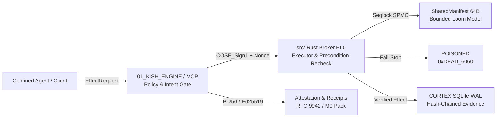

# 📚 BABYLON-60 — Documentation Hub

<div align="center">

[](../CLAIMS.toml)
[](../proof/lean/BabylonTrace.lean)
[](./04_research/eu_ai_act_compliance_whitepaper.md)
[](./COMMERCIAL_LICENSE.md)

</div>

> **Welcome.** This repository documents **BABYLON-60** and the **MOSKV-1** orchestration governance layer —  
> a user-space (`EL0`) authorization and effect broker with machine-checkable claims in [`CLAIMS.toml`](../CLAIMS.toml).

---

> ### 🛡️ Technical Controls & Evidence for Enterprise AI (EU AI Act Arts. 12, 14, 15)
> **BABYLON-60 proporciona controles técnicos de mediación de efectos, autorización firmada (`COSE_Sign1` con Ed25519 o P-256), parada determinista (`0xDEAD_6060`) y paquetes de evidencia verificables (`babylon-m0-evidence-pack`) dentro del perímetro declarado en [`CLAIMS.toml`](../CLAIMS.toml).**
>
> *Deslinde Ontológico Mandatorio:* BABYLON-60 provee controles técnicos habilitadores y evidencia auditable; no sustituye la evaluación de conformidad jurídica ni certifica por sí solo el cumplimiento automático del Reglamento (UE) 2024/1689 (EU AI Act).

---

## 🗺️ Start Here — Choose Your Path

| I am… | Go to |
| :--- | :--- |
| 🛡️ **CISO / DPO / Legal Counsel** evaluando el EU AI Act | [Compliance Pack & Guía →](./05_compliance_eu_ai_act.md) · [Whitepaper LegalTech →](./04_research/eu_ai_act_compliance_whitepaper.md) · [Manifiesto CLAIMS.toml](../CLAIMS.toml) |
| 🏭 **Enterprise DevOps** desplegando en producción | [Enterprise Quickstart →](./03_guides/QUICKSTART_ENTERPRISE.md) · [Guía de Usuario →](./03_guides/USER_GUIDE.md) |
| 🦀 **Rust / Systems Engineer** trabajando en el broker | [Architecture Manifest →](../ARCHITECTURE_MANIFEST.md) · [src/README.md](../src/README.md) · [00_ABZU_KERNEL/README.md](../00_ABZU_KERNEL/README.md) |
| 🐍 **Python Developer** utilizando el Orchestrator y MCP | [Complete Guide →](./03_guides/guide_babylon60_complete.md) · [01_KISH_ENGINE/README.md](../01_KISH_ENGINE/README.md) |
| 🔬 **Researcher / Philosopher** estudiando C5-REAL | [Formal Theory →](./06_theory/00_index.md) · [proof/README.md](../proof/README.md) · [Whitepaper →](./WHITEPAPER.md) |
| 🎵 **Musician / Audio Engineer** | Monitor Tonnetz — Revisión previa: propuesta |
| 📖 **First-time reader** | [Hello Causal Tutorial →](./03_guides/tutorial_hello_causal.md) |

---

## 🏛️ Monorepo Architecture (v5.0.1)

```
BABYLON-60 Monorepo
│
├── src/                         ← Rust Authorization & Effect Broker (User-Space EL0 / C-ABI)
│   ├── lib.rs & manifest.rs     │  SharedManifest 64B (align 64) & Fail-Stop (0xDEAD_6060)
│   ├── seqlock.rs & spsc.rs     │  Seqlock SPMC (Loom bounded model) & SPSC ringbuffers
│   ├── executor.rs & secure_fs.rs  Single-dispatch authority, quarantine & TOCTOU defense
│   ├── omega_mediation.rs       │  Complete mediation campaign (INV-OMEGA) & Seatbelt profiles
│   ├── enclave.rs & receipt.rs  │  P-256 / Ed25519 COSE_Sign1 receipts (RFC 9942)
│   └── capability.rs & admission.rs Scoped capability broker (FL-008) & admission control (FL-007)
│
├── crates/                      ← Workspace Crates
│   ├── b60-lang/                │  B60 DSL compiler, VM, fuzzer & ZK circuits
│   ├── babylon-attest/          │  Ed25519 attestation & Merkle DAG CLI
│   └── eridu-infer/             │  Local inference adapter & Unix socket IPC
│
├── 00_ABZU_KERNEL/              ← Low-Level Rust Crates & TLA+ Specs
│   └── crates/                  │  babylon60-kernel, babylon60-compiler, babylon60-fuzz, nul-zk, strike-rs
│
├── 01_KISH_ENGINE/              ← Python Cognitive Core, CLI & MCP Server
│   └── babylon60/               │  bft/, cli/, mcp/, verifier/, compliance_exporter/, guards/, kernel/
│
├── 02_EDIN_SWARMS/              ← Multi-Agent Swarm Orchestration (agents_archi / SHARUR-3600)
│
├── proof/                       ← Formal Specifications in Lean 4
│   └── lean/                    │  BabylonTrace.lean, AX0.lean (L1_FORMAL) & Babylon.lean
│
└── docs/                        ← Documentation Hub (You are here)
    ├── 01_spec/                 │  Formal specifications
    ├── 02_ontology/             │  Axioms & threat models
    ├── 03_guides/               │  Operational guides & agent contracts
    ├── 04_research/             │  Research papers & swarm topology
    ├── 06_theory/               │  Mathematical foundations & epistemic audits
    └── adr/                     │  Architecture Decision Records
```

### Mediated Execution & Evidence Flow



---

## 📂 Documentation Sections

### ⚡ Core Reference

| Document | Purpose |
| :--- | :--- |
| [SPECIFICATION.md](./SPECIFICATION.md) | Operational semantics, B60 ISA, F60 arithmetic |
| [WHITEPAPER.md](./WHITEPAPER.md) | Technical whitepaper: Merkle DAG, Self-Falsification, BFT |
| [KERNEL.md](./KERNEL.md) | Cross-cutting kernel invariants |
| [ARCHITECTURE_MANIFEST.md](../ARCHITECTURE_MANIFEST.md) | Full monorepo architectural manifest |

### 📋 Technical Specifications (`01_spec/`)

Estas páginas contienen requisitos y diseños con distintos niveles de evidencia. La revisión enlazada delimita siete especificaciones; no certifica toda la sección.

| Document | Purpose |
| :--- | :--- |
| [AUDIT_SCIENTIFIC_GUARANTEES_2026.md](./01_spec/AUDIT_SCIENTIFIC_GUARANTEES_2026.md) | Garantías acotadas, entropía/grafos y adaptador Z3 con resultados vinculados |
| [spec_invariants.md](./01_spec/spec_invariants.md) | Requisitos de invariantes; verificación delimitada |
| [spec_babylon60.md](./01_spec/spec_babylon60.md) | Full formal specification v4.x |
| [spec_architecture.md](./01_spec/spec_architecture.md) | Diseño del ledger e inspección estática parcial |
| [spec_cryptographic_profile.md](./01_spec/spec_cryptographic_profile.md) | Perfiles hash/serialización versionados; divergencias pendientes |
| [spec_security_model.md](./01_spec/spec_security_model.md) | Controles condicionales y fronteras pendientes de prueba |
| [spec_causal_hitl_governance.md](./01_spec/spec_causal_hitl_governance.md) | Human-in-the-Loop governance spec |
| [spec_exergy_ontology.md](./01_spec/spec_exergy_ontology.md) | Convenciones de nombres; rendimiento no medido |
| [spec_graph_canonical.md](./01_spec/spec_graph_canonical.md) | Filtro 1-WL, búsqueda exacta acotada y perfiles hash v2 |
| [spec_semantic_entropy_dual_firewall.md](./01_spec/spec_semantic_entropy_dual_firewall.md) | Entropía Q16: rechazo tipado y adaptador Z3 con consulta vinculada |
| [spec_nemesis.md](./01_spec/spec_nemesis.md) | Especificación NEMESIS; fuera de esta ampliación científica |
| [spec_technical.md](./01_spec/spec_technical.md) | Arquitectura core; fuera de esta ampliación científica |
| [spec_proof_ir.md](./01_spec/spec_proof_ir.md) | Proof IR → Lean 4 emitter spec |
| [artifact_format_v1.md](./01_spec/artifact_format_v1.md) | Artifact format v1 |

### 🧠 Axiomatic Ontology (`02_ontology/`)

| Document | Purpose |
| :--- | :--- |
| [axiom_ontology.md](./02_ontology/axiom_ontology.md) | Absolute semantic isomorphism ontology |
| [axiom_axiomatization.md](./02_ontology/axiom_axiomatization.md) | Formal axiomatization: MOSKV-1 APEX |
| [security_threat_model_v4.md](./02_ontology/security_threat_model_v4.md) | v4.0 threat model & attack vector mitigation |
| [spec_c5_graph_isomorphism.md](./02_ontology/spec_c5_graph_isomorphism.md) | Structural isomorphism matrix (APEX) |
| [axiom_oncologia_300_primitivas.md](./02_ontology/axiom_oncologia_300_primitivas.md) | 300 molecular oncology primitives |

### 📖 Operational Guides (`03_guides/`)

| Document | Purpose |
| :--- | :--- |
| [QUICKSTART_ENTERPRISE.md](./03_guides/QUICKSTART_ENTERPRISE.md) | Docker/K8s sidecar deployment |
| [tutorial_hello_causal.md](./03_guides/tutorial_hello_causal.md) | Hello World: first causal event |
| [guide_babylon60_complete.md](./03_guides/guide_babylon60_complete.md) | Complete architecture & dev guide |
| [guide_c5_axiom_verification.md](./03_guides/guide_c5_axiom_verification.md) | Axiom injection & verification workflow |
| [guide_legaltech_eu_ai_act.md](./03_guides/guide_legaltech_eu_ai_act.md) | LegalTech audit & EU AI Act compliance |
| [guide_swarm_pxs_orchestration.md](./03_guides/guide_swarm_pxs_orchestration.md) | Multi-agent swarm orchestration (P×S) |
| [guide_bio_silico_transduction.md](./03_guides/guide_bio_silico_transduction.md) | Bio-Silicio transduction & causal graphs |
| [guide_commercial_license.md](./03_guides/guide_commercial_license.md) | Commercial license details |
| [guide_skill_arsenal_taxonomy.md](./03_guides/guide_skill_arsenal_taxonomy.md) | Skill arsenal taxonomy by exergy |
| [guide_explanation.md](./03_guides/guide_explanation.md) | Local-first memory substrate & architecture concepts |
| [guide_experimental.md](./03_guides/guide_experimental.md) | Experimental ledger extensions |

### 🔬 Research & SOTA (`04_research/`)

| Document | Purpose |
| :--- | :--- |
| [eu_ai_act_compliance_whitepaper.md](./04_research/eu_ai_act_compliance_whitepaper.md) | Causal determinism as EU AI Act compliance |
| [evaluacion_falsacion_llm_models_2026.md](./04_research/evaluacion_falsacion_llm_models_2026.md) | Popperian falsification of LLM selection (2026) |
| [edin_swarm_architecture.md](./04_research/edin_swarm_architecture.md) | EDIN swarm architecture (100 parallel workers) |
| [sharur_222_swarm_topology.md](./04_research/sharur_222_swarm_topology.md) | SHARUR 222-agent swarm topology (11 × 20 threads) |
| [sota_evolution_roadmap.md](./04_research/sota_evolution_roadmap.md) | SOTA architectural evolution roadmap |
| [sanedrin_reflexive_forking_audit.md](./04_research/sanedrin_reflexive_forking_audit.md) | Sanhedrín audit: reflexive forking |
| [sota/sota_cortex_persist_202607.md](./04_research/sota/sota_cortex_persist_202607.md) | SOTA: async-persist ledger positioning |
| [sota/sota_ssm_lnn_202600.md](./04_research/sota/sota_ssm_lnn_202600.md) | SOTA: SSM, LNN & transformer collapse |

### ⚖️ Formal Theory (`06_theory/`)

The mathematical substrate: Robinson Arithmetic → Gödel → Turing → Chaitin-Kolmogorov → Curry-Howard → Lean 4.

| Document | Purpose |
| :--- | :--- |
| [01_robinson_arithmetic.md](./06_theory/01_robinson_arithmetic.md) | Aritmética de Robinson — Exposición matemática; no formalizada |
| [02_goedel_incompleteness.md](./06_theory/02_goedel_incompleteness.md) | Gödel, Rosser y Löb — Exposición matemática; no formalizada |
| [03_computability_turing.md](./06_theory/03_computability_turing.md) | Computabilidad y Turing — Exposición matemática; no formalizada |
| [04_chaitin_kolmogorov.md](./06_theory/04_chaitin_kolmogorov.md) | Complejidad algorítmica — Exposición matemática; no formalizada |
| [05_model_theory.md](./06_theory/05_model_theory.md) | Teoría de modelos — Exposición matemática; no formalizada |
| [06_curry_howard.md](./06_theory/06_curry_howard.md) | Curry–Howard — Exposición matemática; no formalizada |
| [07_cross_domain.md](./06_theory/07_cross_domain.md) | Analogías entre lógica y cognición — Ensayo; analogías no demostradas |
| [08_babylon60_architecture.md](./06_theory/08_babylon60_architecture.md) | Arquitectura propuesta — Diseño; runtime no certificado |
| [09_formal_ontology_lean.md](./06_theory/09_formal_ontology_lean.md) | Modelos Lean y correspondencia — Fuentes formales acotadas |
| [10_physical_realization.md](./06_theory/10_physical_realization.md) | B60: ejemplos y límites — Ejemplos; garantías no verificadas |
| [AXIOMATIZATION_C5_REAL.md](./06_theory/AXIOMATIZATION_C5_REAL.md) | Postulados C5-REAL — Revisión previa: no certificados |
| [TOPOLOGIA_MAESTRA.md](./06_theory/TOPOLOGIA_MAESTRA.md) | Topología conceptual — Mapa; integraciones no certificadas |
| [MOSKV_1_APEX_BLUEPRINT.md](./06_theory/MOSKV_1_APEX_BLUEPRINT.md) | MOSKV-1 APEX: blueprint — Propuesta de producto |
| [c5_thermodynamic_invariants_compendium.md](./06_theory/c5_thermodynamic_invariants_compendium.md) | Compendio C5-REAL corregido — Revisión previa: Lean discreto acotado |
| [axiom_cyclic_conformal_aeon.md](./06_theory/axiom_cyclic_conformal_aeon.md) | Ciclos Aeon — Modelo discreto; sin prueba térmica |
| [axiom_bayesian_disintegration.md](./06_theory/axiom_bayesian_disintegration.md) | Bayes finito y soporte — Revisión previa: alcance matemático |
| [axiom_sharur_swarm.md](./06_theory/axiom_sharur_swarm.md) | Sharur: concurrencia y reducción — Especificación condicional |
| [axiom_tonnetz_oversight.md](./06_theory/axiom_tonnetz_oversight.md) | Monitor Tonnetz — Revisión previa: propuesta |
| [axiom_oncology_protocol.md](./06_theory/axiom_oncology_protocol.md) | Modelo oncológico propuesto — Revisión previa: hipótesis |
| [AUDIT_AXIOMS_2026.md](./06_theory/AUDIT_AXIOMS_2026.md) | Rectificación de certificaciones — Revisión previa: seis entradas |
| [AUDIT_VERDICT_C5_REAL.md](./06_theory/AUDIT_VERDICT_C5_REAL.md) | Dictamen histórico C4-SIM — Historia no revalidada; filtro acotado |
| [00_index.md](./06_theory/00_index.md) | Índice de teoría y estatus científico — Índice; sin certificación global |
| [AUDIT_TAUTOLOGIA_VACIA_2026.md](./06_theory/AUDIT_TAUTOLOGIA_VACIA_2026.md) | Tautologías y evidencia — Auditoría documental limitada |
| [BABYLON60_PROOF_CARRYING_EXECUTION.md](./06_theory/BABYLON60_PROOF_CARRYING_EXECUTION.md) | Proof-carrying execution — Diseño; fuentes y métricas separadas |
| [CONTINUIDAD_SIN_OBEDIENCIA_TEORIA_ARQUITECTONICA.md](./06_theory/CONTINUIDAD_SIN_OBEDIENCIA_TEORIA_ARQUITECTONICA.md) | Continuidad sin obediencia — Requisitos normativos propuestos |
| [STATUS_THEORY.md](./06_theory/STATUS_THEORY.md) | Registro histórico de estado — Historia no revalidada; filtro acotado |
| [TETRADA_CAUSAL_BABYLON60.md](./06_theory/TETRADA_CAUSAL_BABYLON60.md) | Tétrada C5-REAL — Marco metafórico |
| [VECTOR_A_MASTER_LEDGER_DESIGN.md](./06_theory/VECTOR_A_MASTER_LEDGER_DESIGN.md) | Diseño de ledger y ATMS — Diseño; resultados no revalidados |
| [AUDIT_SCIENTIFIC_STATUS_2026.md](./06_theory/AUDIT_SCIENTIFIC_STATUS_2026.md) | Auditoría científica del corpus — alcance documental |
| [AUDIT_LEAN_SCOPE_2026.md](./06_theory/AUDIT_LEAN_SCOPE_2026.md) | 23 fuentes Lean: alcance, fixtures, widget aislado y verificación bajo demanda |
| [axiom_moloch_landauer_balance.md](./06_theory/axiom_moloch_landauer_balance.md) | Modelo contable Moloch — sin garantía física o de incentivos |

### 🏗️ Architecture Decision Records (`adr/`)

| ADR | Decision |
| :--- | :--- |
| [ADR-001](./adr/ADR-001-lean4-over-coq-isabelle.md) | Lean 4 over Coq/Isabelle for formal verification |
| [ADR-002](./adr/ADR-002-pyo3-maturin-ffi-bridge.md) | PyO3/Maturin FFI bridge for Rust-Python runtime |
| [ADR-003](./adr/ADR-003-bft-attestation-architecture.md) | BFT architecture & cryptographic attestation model |
| [ADR-004](./adr/ADR-004-taint-tracking-isolation.md) | Taint tracking & isolation model |
| [ADR-005](./adr/ADR-005-sovereign-dual-license.md) | Sovereign Dual-License v4.0 |
| [ADR-006](./adr/ADR-006-topologia-exposicion-repositorios.md) | C5-REAL public/private repository topology |

### 🔐 Formal Proofs (`proof/`)

| File | Content |
| :--- | :--- |
| [`proof/lean/BabylonTrace.lean`](../proof/lean/BabylonTrace.lean) | Modelo de secuencias y transiciones; compilación local acotada, sin bisimulación Rust–memoria física demostrada. Véase [auditoría](./06_theory/AUDIT_SCIENTIFIC_STATUS_2026.md). |
| [Alcance de proof/lean](../proof/lean/README.md) | Inventario local y límites; build por defecto distinto de compilación individual |

---

## 🧪 Verification Commands

```bash
# Full quality gate: lint + typecheck + tests
make all

# Lean 4 formal proof (requires Lean ≥ 4.x)
lean proof/lean/BabylonTrace.lean

# Rust monorepo — 84 tests, 0 failures
cargo test --workspace

# Python invariants (21 C5-REAL invariants)
uv run pytest tests/test_c5_invariants.py -v

# Full Python suite
export BABYLON_HOME=/tmp/babylon_test
uv run pytest tests/ -v
```

---

## 🔒 Security & License

- **Vulnerabilities**: Report to **security@babylon60.com** — never public issues.  
  SLA: ack < 24h, remediation < 72h. See [SECURITY.md](../SECURITY.md).
- **License**: Sovereign Dual-License v4.0.  
  Free for individuals/research. Enterprise key required for commercial use.  
  See [COMMERCIAL_LICENSE.md](./COMMERCIAL_LICENSE.md).

---

<sub>BABYLON-60 v4.3.0 · Sovereign Cognitive OS · MOSKV-1 · Borja Moskv</sub>
