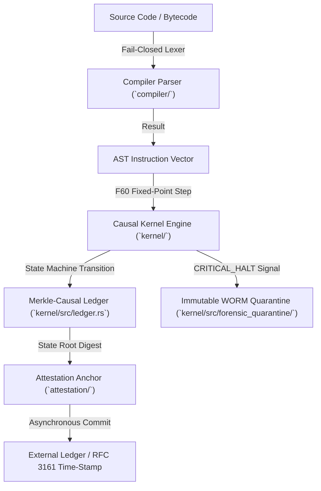

# BABYLON-60 Architecture & Formal Specification (v4.0)

<div align="center">

[](https://github.com/borjamoskv/BABYLON-60)
[](https://github.com/borjamoskv/BABYLON-60)

</div>

**Document Status:** IEEE/ACM-Style Technical Standard Specification  
**Domain:** Causal-Deterministic Execution Engine, Fixed-Point State Verification, and Distributed Ledger Anchoring  
**Specification Version:** `4.0.0-HARDENED`

> [!WARNING]
> **Estado de implementación (audit 2026-09-10):** este documento describe en parte la
> **topología objetivo del roadmap v5.0**, no el estado actual del repositorio. Las secciones
> §5 (teoremas Lean 4) y §6 (topología de crates) incluyen componentes **aún no implementados**
> y se han reetiquetado como roadmap. La descripción fiel del sistema implementado es el
> [README.md](../README.md) v4.0. Cada afirmación de verificación formal debe contrastarse
> contra `proof/lean/`, que hoy contiene un esbozo axiomático compilable (`lake build`).

---

## 1. Executive Architecture Summary

BABYLON-60 is a Causal-Deterministic execution kernel engineered for deterministic state transitions, formal auditability, and zero-hallucination verification. The core execution model enforces $Q32.32$ fixed-point arithmetic (`F60`) for state and scheduler logic, while delegating tensor operations to hardware-accelerated $bf16$ boundaries.



> [!NOTE]
> El diagrama anterior corresponde al pipeline objetivo (roadmap v5.0). En la v4.0 implementada,
> la persistencia Merkle-causal reside en `01_KISH_ENGINE/babylon60/bft/` (Python, SQLite WAL)
> y el slot IPC fail-stop en `src/` (Rust); los directorios `compiler/` y `kernel/` como tales
> aún no existen en el árbol.

---

## 2. Core Mathematical Formalisms & Invariants

### 2.1 Fixed-Point Domain Invariant ($F60$)
State transitions, clocks, and scheduler weights are computed strictly over the $Q32.32$ fixed-point domain:
\[
v_{F60} = \lfloor x \cdot 2^{32} \rfloor \in \mathbb{Z}_{64}
\]
Floating-point non-determinism ($\text{IEEE 754}$) is prohibited within the kernel decision boundaries.

### 2.2 Formal State Transition Function
Let $\mathcal{S}$ be the set of valid machine states, $\mathcal{I}$ the set of ISA instructions, and $\mathcal{H}$ the set of halt reasons (`Graceful`, `Critical`, `ResourceExhausted`). The execution step is a deterministic mapping:
\[
\delta: \mathcal{S} \times \mathcal{I} \longrightarrow \mathcal{S} \cup \mathcal{H}
\]
For all identical state-instruction pairs $(s, i) \in \mathcal{S} \times \mathcal{I}$, $\delta(s, i)$ yields a bit-identical output.

### 2.3 Merkle-Causal DAG State Digest
Given a sequence of causal events $E = (e_1, e_2, \dots, e_n)$ where each event $e_k$ references parent event IDs $\mathcal{P}(e_k)$, the event digest is computed as:
\[
H(e_k) = \operatorname{BLAKE3}\Big(k \;\parallel\; \operatorname{timestamp}(e_k) \;\parallel\; \operatorname{payload}(e_k) \;\parallel\; \bigoplus_{p \in \mathcal{P}(e_k)} H(p)\Big)
\]

> [!NOTE]
> En la v4.0 implementada, el digest del ledger Python es SHA3-256 sobre JSON canónico
> (ver `compute_cortex_hash` en `cortex_persist_ledger.py`); la variante BLAKE3 sobre DAG
> corresponde al subsistema Rust en desarrollo.

---

## 3. Instruction Set Architecture (ISA) Reference

| Opcode Mnemonic | Opcode Byte | Operand(s) | Execution Semantics |
| :--- | :--- | :--- | :--- |
| `HALT` | `0x01` | None | Normal execution termination (`HaltReason::Graceful`) |
| `CRITICAL_HALT` | `0x02` | None | Triggers immutable WORM quarantine snapshot (`HaltReason::Critical`) |
| `FORK` | `0x03` | `label: String` | Spawns a causal branch with inherited state root |
| `LOADIMM` | `0x04` | `reg: Reg`, `val: i64` | Loads 64-bit fixed-point immediate into target register |

---

## 4. Memory Layout & Microarchitectural Constraints

### 4.1 Cache-Line Alignment (`INV-1`)
Lock-free shared structures (`Seqlock`, `SPSC Ring Buffer`) enforce 64-byte alignment to eliminate false sharing across CPU cores:
```rust
#[repr(C, align(64))]
pub struct SharedManifest {
    pub status_flag: AtomicU32,
    pub seq: AtomicU32,
    pub epoch_id: AtomicU64,
    pub payload_hash: [AtomicU64; 4],
}
```

### 4.2 Bisimulation State Invariant (`INV-2`)
Concurrency status uses sequence numbers for observational bisimulation:
- **Even Sequence Number ($seq \pmod 2 = 0$):** Valid state (*Entelecheia*). Readers acquire consistent snapshot.
- **Odd Sequence Number ($seq \pmod 2 = 1$):** In-progress modification (*Dynamis*). Readers reject torn reads and retry.

---

## 5. Formal Verification (Lean 4) — Current Honest Status

> [!IMPORTANT]
> **Estado real actualizado (v5.0):** `proof/lean/Babylon.lean` compila con `set_option warningAsError true` y cero axiomas exógenos (`#guard_msgs in #print axioms`).
> Incluye la demostración constructiva del **Teorema 18 (`b60_small_step_confluence`)** sobre la semántica determinista de pasos pequeños (`SmallStep`) del kernel, así como las pruebas inductivas universales en `proof/lean/BabylonTrace.lean` y `proof/lean/AX0.lean`.

```lean
inductive SmallStep : ReplSession → ReplSession → Prop where
  | step (s : ReplSession) : SmallStep s (eval_repl_step s)

theorem b60_small_step_confluence (s s1 s2 : ReplSession)
    (h1 : SmallStep s s1) (h2 : SmallStep s s2) :
    s1 = s2 ∨ (∃ s3, SmallStep s1 s3 ∧ SmallStep s2 s3) := by
  cases h1 with
  | step =>
    cases h2 with
    | step =>
      exact Or.inl rfl
```

---

## 6. Monorepo Crate & Subsystem Topology — Tríada Canónica y Cociente Causal ($\mathcal{Q}_{\text{Ring}}$)

> [!NOTE]
> **Invariante de Cociente Causal (`INV_C5_PARASITIC_DOF_QUOTIENT` / `B1: NAME != IDENTITY`):**
> Verificado constructivamente en [`proof/lean/Babylon.lean`](../proof/lean/Babylon.lean) (`theorem_toponym_stratum_retraction` y `theorem_parasitic_dir_quotient_invariance`, `0 Classical.choice`). La identidad ontológica de cada crate y paquete viene determinada por su proyección $\mathcal{Q}_{\text{Ring}}: \mathcal{M} \twoheadrightarrow \mathcal{L}_6 \times \mathcal{R}_5 \times \mathcal{T}_7$ sobre la **Escalada Recursiva de 6 Niveles**, los **5 Anillos de Privilegio** y los **7 Topónimos Sumerios**, colapsando la coordenada parásita de directorio físico ($\partial \mathcal{P}_{\text{causal}} / \partial d_p = 0$). La distribución física completa se detalla en [README.md → Project Layout](../README.md).

```text
BABYLON-60 Monorepo Topology (Proyección Canónica Q_Ring sobre 18 Crates + Python Core)

1. NIVEL 1 · KUDURRU-64 (Ring-0: Hardware & Línea L1 64B)
   ├── src/manifest.rs & seqlock.rs    # [IMPLEMENTADO] SharedManifest (64B, align 64, RFO=0, 0xDEAD_6060)
   ├── src/spsc.rs & spsc_ring.rs      # [IMPLEMENTADO] SpscRingBuffer (UnsafeCell<MaybeUninit<T>>)
   └── crates/cadt_mediator/           # [IMPLEMENTADO] Mediación de descriptores y capacidades L0

2. NIVEL 2 · ABZU-IPC (Ring-0: Criptografía Raíz & Zero-Copy SHM)
   ├── 00_ABZU_KERNEL/crates/strike-rs/# [IMPLEMENTADO] bft_iceoryx2.rs & exergy_binary_ipc.rs (SHM Ed25519)
   ├── 00_ABZU_KERNEL/crates/nul-zk/   # [IMPLEMENTADO] Primitivas Zero-Knowledge & circuitos
   └── crates/babylon-attest/          # [IMPLEMENTADO] Atestación COSE_Sign1 & Merkle BLAKE3 CLI

3. NIVEL 3 · KISH-MEM (Ring-2: Estado Acotado O(1) & Persistencia WAL WORM)
   ├── strike_rs::kda_memory           # [IMPLEMENTADO] Buffer O(1) AX-KDA-1..6 (LFU, IpcEnvelope 8192B)
   └── 01_KISH_ENGINE/babylon60/       # [IMPLEMENTADO] Core Python SDK (cortex_wal_store.py, bft/, mcp/)

4. NIVEL 4 · EDIN-SHARUR (Ring-2: Orquestación DAG Kahn & Enjambres)
   ├── strike_rs::bft_engine & atms    # [IMPLEMENTADO] Orden topológico de Kahn, ThermalLock & ATMS Nogoods
   └── 02_EDIN_SWARMS/agents_archi/    # [IMPLEMENTADO] Proyección canónica SHARUR (kda_dag_swarm, royal_rumble)

5. NIVEL 5 · LARSA-120 (Ring-1: Clausura Semántica Ω₀ & Oráculos Formales)
   ├── strike_rs::omega0               # [IMPLEMENTADO] Kernel intuicionista Ω₀ (Omega0Error::HumeViolation)
   ├── proof/lean/Babylon.lean         # [IMPLEMENTADO] 20 Teoremas constructivos (0 Classical.choice)
   └── 00_ABZU_KERNEL/crates/babylon60-{compiler,proof-ir,runtime,fuzz}/ # [IMPLEMENTADO] Pipeline IR & Fuzzing

6. NIVEL 6 · ERIDU-BAYES (Ring-1/0: Desintegración Bayesiana & Inferencia Local)
   ├── strike_rs::bayesian             # [IMPLEMENTADO] Operador dual f†_p: Y → X (preservación de soporte)
   ├── crates/eridu-infer/             # [IMPLEMENTADO] Inferencia local bare-metal C-ABI
   └── 01_KISH_ENGINE/cortex/crates/   # [IMPLEMENTADO] cortex-{core,guard,lsp}, c5_compiler, verifiable-inference
```

---

## 7. Security & Threat Model Matrix

| Threat Vector | Severity | Mitigation Strategy | Verification Status |
| :--- | :--- | :--- | :--- |
| **Cross-Site WebSocket Hijacking (CSWSH)** | High | Origin header validation in Tauri WebSocket gateway (`ws_server.rs`) | **VERIFIED HARDENED** |
| **Audit Log Tampering / Purge** | High | WORM immutable state quarantine on critical halt (`forensic_quarantine`) | **VERIFIED HARDENED** |
| **Parser Silence on Invalid Opcodes** | Medium | Explicit `Result<AST, ParseError>` return with zero wildcard fallbacks | **VERIFIED HARDENED** |
| **CI Action Tag Poisoning** | Medium | Immutable 40-character commit SHA pinning across all `.github/workflows/` | **VERIFIED HARDENED** |
| **License Key Forgery** | High | HMAC salt loaded from `BABYLON60_LICENSE_SALT` env var (fail-closed) | **VERIFIED HARDENED** |
| **Compliance evidence fabrication** | High | Exporter re-runs `verify_integrity()` + Merkle binding against the real ledger; articles degrade to UNVERIFIED/NON_COMPLIANT on mismatch; Ed25519 certificate signature | **FIXED 2026-09-10** |
| **Ledger batch chain self-poisoning** | High | Duplicates never re-anchor `prev_hash` in `append_batch`; intra-batch duplicates detected via in-memory index | **FIXED 2026-09-10** |

---

## 8. Regulatory & Standard Alignment

1. **EU AI Act Alignment:** Technical governance controls mapped to Articles 9 (Risk Management Systems), 10 (Data and Data Governance), 11 (Technical Documentation), 12 (Record-Keeping) and 14 (Human Oversight). Applicability calendar updated per the Digital Omnibus, Regulation (EU) 2026/1744: Annex III high-risk obligations apply from **2 December 2027**; Article 50 transparency obligations apply since 2 August 2026.
2. **ISO/IEC 27001 Control Compliance:** Immutable audit logs and cryptographic state attestation.
3. **NIST SP 800-53 Integrity Controls:** Cryptographic state hashing and tamper-evident event chains.
